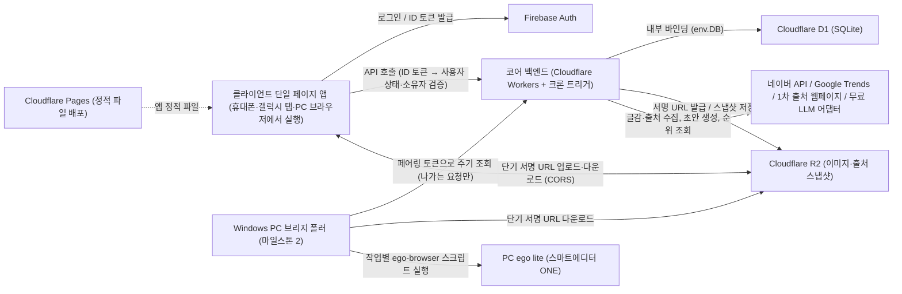
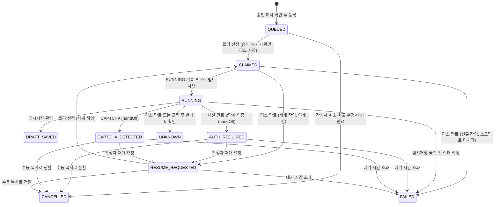

# Content Desk: 확장형 비YMYL 카테고리 및 일상 브이로그 네이버 블로그 자동화 시스템

*   **작성자:** 미지정 (등록 사용자 공통 — 사람마다 자기 네이버 블로그를 운영)
*   **상태:** 초안
*   **작성일:** 2026-11-18

--------------------------------------------------------------------------------

## 개요

Content Desk는 관리자(오너)가 등록한 사용자가 각자 운영하는 네이버 블로그에서 협찬 유치를 위한 전문·경험 콘텐츠와 개인 일상 브이로그 기록을 함께 작성하고 발행 흐름을 관리하기 위한 보조 시스템입니다. 글감 발굴, 현장 사진·메모 기반 원고 작성, 출처 검증, 발행 이후 순위·방문자 추적까지를 지원하며, 최종 발행 버튼은 항상 작성자 본인이 직접 누릅니다. 모든 데이터는 사람별로 분리되어, 관리자도 다른 사용자의 글감·원고·사진·발행 기록에는 접근할 수 없습니다(관리자 권한은 사용자 추가·차단·목록 조회와 사용자별 당일 호출 횟수 숫자 확인뿐).

시스템은 목적에 따라 두 가지 콘텐츠 트랙을 운영합니다.

*   **전문·협찬 발굴 트랙 (`category_discovery`):** 작성자가 YMYL을 제외한 비YMYL 카테고리(기본 `테크/IT` 및 `여행`, `맛집` 등 사용자 추가 카테고리)를 레지스트리로 관리합니다. 각 카테고리는 검색 수요에서 주제를 찾는 `trend_first`(예: 개념·트렌드 해설) 또는 실제 사진·메모를 먼저 등록한 뒤 키워드로 제목·태그를 다듬는 `experience_first`(예: 여행·맛집·제품 후기) 방식으로 동작합니다.
*   **개인 기록 트랙 (`personal_vlog`):** 외부 트렌드 발굴을 거치지 않고 작성자가 올린 현장 메모와 실제 사진만으로 `일상/브이로그` 원고를 작성합니다.

전체 작업은 기기별 역할 분담을 기준으로 설계합니다. 현장에서는 개인 휴대폰(아이폰·안드로이드)으로 사진을 찍어 위치 정보를 제거하고 WebP로 압축한 뒤 메모와 함께 업로드합니다. 주 작업 기기인 갤럭시 탭에서는 글감 선택, 원고 생성·수정, 검증 게이트 승인을 거쳐 수동 복사 모드로 네이버 블로그에 발행합니다. 보조 기기인 Windows PC에서는 수동 복사 외에도 마일스톤 2로 제공하는 `ego-browser` 브리지(PC가 대기열에서 작업을 가져가는 방식)를 통해 스마트에디터 ONE 임시저장까지 자동화할 수 있습니다.

**용어:** 이 문서에서 "1차 범위"는 마일스톤 1·2를 포함한 첫 구현 범위를, "2차 범위"는 그 이후의 확장을 뜻합니다. "단계"는 글감 발굴 파이프라인의 요청 단위(1~4단계)와 네이버 `2단계 인증`에만 씁니다.

## 문제 정의

각 작성자가 네이버 블로그를 협찬 목적과 개인 기록 목적으로 함께 운영할 때 네 가지 구조적 문제가 발생합니다.

1.  **주제 확장과 네이버 `C-Rank` 분산·진정성 훼손 충돌:** `테크/IT` 외에 `여행`·`맛집`·`일상/브이로그`로 주제를 넓히면 카테고리가 섞여 블로그 전문성 평가(`C-Rank`)가 떨어질 위험이 커집니다. 또한 검색 트렌드만으로 후기 글을 자동 생성하면 가 보지 않은 장소나 쓰지 않은 제품에 대한 가짜 후기가 만들어집니다.
2.  **기기 간 파일 이동과 스마트에디터 ONE 서식 장벽:** 사진은 휴대폰으로 찍고 글 검토·발행은 갤럭시 탭에서 진행하므로 사진 전달과 순서 정렬에 반복 작업이 듭니다. 스마트에디터 ONE은 마크다운 기호(`##`, `**`)를 일반 문자로 처리하고 외부 이미지 URL 핫링크(``)를 차단·누락시키므로, 일반 텍스트 복사만으로는 본문과 이미지를 옮길 수 없습니다.
3.  **팩트 오류 및 저품질 페널티 위험:** 검색 결과에서 수치·제품 사양·가격을 대조하지 않고 원고를 만들면 허위 주장이 들어가고, 기존 발행 글이나 상위 노출 문서와 문장이 겹치면 검색 저품질 위험이 높아집니다. 주식·금융·투자·암호화폐·의료·건강·법률 등 YMYL 주제나 협찬 표시 누락 역시 블로그 운영에 직접적인 제재 위험을 만듭니다.
4.  **0원 운영 제약과 보안 경계:** 네이버 오픈 API와 Google Trends는 브라우저 CORS를 허용하지 않으며 `Client-Secret` 등 비밀키를 클라이언트에 둘 수 없습니다. 반면 로컬 상시 서버(Docker)는 외출 중 휴대폰·탭 접속이 어렵고, Firebase Cloud Functions는 배포 자체에 유료 Blaze 요금제가 필요합니다. PC에서 `127.0.0.1` 수신 포트를 여는 브리지 구조는 같은 PC의 다른 웹페이지가 로그인된 브라우저를 조작할 위험을 만듭니다.

Content Desk는 Cloudflare Pages·Workers 무료 플랜을 코어 백엔드로 두고 Firebase Auth(Spark, Google 로그인 후 등록 사용자 검증)·Cloudflare D1(사람별 `owner_uid` 격리 영속 저장소)·Cloudflare R2(미디어·출처 스냅샷)를 결합해 비용 없이 다중 기기 접근과 서버 측 비밀키 격리를 확보합니다. 모든 글감과 원고에 `content_type`(`experience_review` | `explainer` | `vlog`)별 미디어·1차 출처 검증 게이트를 강제하고, 갤럭시 탭용 서식 유지 복사·다중 이미지 공유와 PC 전용 `ego-browser` 임시저장 브리지(작업 가져가기 방식)를 분리해 위 문제를 해결합니다.

## 목표

*   **성공·실패 기준:** 컨셉 브리프의 기준에 따라 성공은 일일 방문자 수와 검색 순위(검색 API 기준 근사치) 추이로, 실패는 네이버 저품질 페널티와 팩트 오류 글 발행으로 판단합니다. 시스템은 성공 지표를 기록하고(아래 발행 후 추적 원장), 실패 위험은 검증 게이트로 막습니다. 운영 중에는 ① 유료 과금 0원, ② 미해소 `[VERIFY]`가 남았거나 승인 후 수정된 원고가 내보내지는 건수 0을 항상 지켜야 할 기준으로 둡니다.
*   **0원 클라우드 상시 운영 경계 유지:** Cloudflare Pages·Workers 무료 플랜(일 100,000건 요청, 요청당 CPU 10ms·외부 호출 50개 이하로 분할 처리), Firebase Auth(Spark, ID 토큰 검증 후 관리자 UID 또는 D1 `users` 표의 `active` 사용자만 통과), Cloudflare D1(Workers 내부 바인딩, 일 읽기 500만 행·쓰기 10만 행·DB당 500 MB), Cloudflare R2(WebP 압축 이미지 저장 및 짧은 만료 서명 URL 제공), 일일 API/LLM 할당량 원장 상한 제어(오너 API 키 하나를 모든 사용자가 공유, 사람별 상한 없이 전체 일일 상한만 적용)로 유료 과금 전환 없이 휴대폰·갤럭시 탭·PC에서 접근할 수 있게 합니다.
*   **사람별 데이터 격리와 웹 기반 사용자 관리:** 관리자(오너)는 재배포 없이 웹 관리 화면에서 사용자를 추가·차단하고 사용자별 당일 호출 횟수(숫자만)를 확인하며, 모든 사용자 데이터는 `owner_uid`로 분리해 다른 사용자(관리자 포함)의 리소스에 접근하면 `404`로 응답합니다. 관리자 권한은 사용자 관리와 당일 호출 횟수 숫자 확인에 한정하며 다른 사용자의 글감·원고·사진·발행 기록·카테고리·프롬프트/검색어 등 내용물에는 접근할 수 없습니다.
*   **트랙 및 `content_type` 기반 진정성·근거 검증:** `experience_review`와 `vlog`는 위치 정보가 제거된 실제 사진 또는 작성자 메모 최소 1건 없이는 원고 생성을 차단하고 실물 사진의 AI 대체를 금지합니다. `explainer`는 원고 작성 전 1차 출처 본문 스냅샷을 저장해 사실 주장을 연결하고, 모든 원고는 미해소 `[VERIFY]`를 모두 해소하고 출처 목록·N-gram 유사도 경고를 확인한 뒤, 원고 버전(`content_hash`)에 묶인 작성자 승인을 통과해야 내보낼 수 있게 합니다.
*   **비YMYL 확장 및 규정 준수 가드레일:** `CategoryProfile` 레지스트리로 카테고리와 네이버 게시판 매핑을 관리하되, 2중 판정(차단 키워드 목록 + LLM 분류기)으로 YMYL 주제를 차단하고, 카테고리 발행 비중 불균형 시 `C-Rank` 분산 경고를 표시하며, `is_sponsored=true` 원고에는 공정위 경제적 이해관계 문구를 제목 또는 본문 첫머리에 삽입·검증합니다.
*   **마일스톤 1(갤럭시 탭 수동 복사) 단독 완결 및 마일스톤 2(PC 임시저장) 분리:** PC 브리지 없이도 마일스톤 1만으로 제목 복사, `ClipboardItem` 서식 유지 본문 복사(이미지 위치 마커 포함), 순번 파일명 다중 이미지 공유·내보내기, 태그 복사까지 완료할 수 있게 합니다. 마일스톤 2는 수신 포트를 열지 않고 대기열에서 작업을 가져가는 PC 브리지가 `ego-browser`로 스마트에디터 ONE 임시저장(`PublishReceipt` 기록)까지만 실행하고, 인증·CAPTCHA 발생 시 `task.handOff()`로 제어를 넘깁니다.
*   **발행 후 추적 원장 제공:** 작성자가 등록한 발행 URL(`logNo`)과 타겟 키워드를 기준으로 네이버 검색 API(`blog.json`) 순위 근사치를 자동 추적하고, 일일 방문자 수와 한국 시간 기준 오늘·이번 주 승인 건수를 대시보드에 기록합니다.

## 범위 제외

*   **무인 자동 발행 영구 제외:** 사람이 최종 발행 버튼을 누르지 않고 시스템이 네이버 블로그에 글을 공개 발행하는 기능은 구현하지 않습니다.
*   **YMYL 분야 영구 제외:** 주식·금융·투자·암호화폐·의료·건강·법률 주제의 글감 발굴 및 원고 작성은 지원하지 않습니다.
*   **허위 경험 및 실물 사진 AI 대체 금지:** 방문하지 않은 장소·사용하지 않은 제품 후기 생성, 음식·장소·제품 실사나 브이로그 사진을 AI 이미지로 대체하는 기능은 제공하지 않습니다.
*   **모바일·클라우드 환경 에디터 자동화 제외:** 갤럭시 탭, 휴대폰, Cloudflare Workers 등 클라우드 서버 내부에서 브라우저 에디터를 자동 조작하지 않습니다.
*   **인증 우회 및 공유 브라우저 프로필 훼손 금지:** 네이버 로그인 자동화, 2단계 인증 우회, CAPTCHA 해결 우회, `ego lite` 프로필의 전체 쿠키·캐시 삭제는 수행하지 않습니다.
*   **공개 가입 서비스 및 타 플랫폼 동시 발행 제외:** 누구나 스스로 가입해 쓰는 공개 서비스(자가 가입·사용자별 결제·사람별 API 키 등록)와 유튜브·인스타그램 등 다른 플랫폼 발행은 1차 범위에 포함하지 않습니다. 관리자가 등록한 사용자에 한한 사람별 다중 사용자 운영은 1차 범위에 포함합니다.

## 미결 질문

구현에 들어가기 전 실제 기기와 외부 서비스 정책에서 확인해 설계에 반영해야 하는 미확정 항목입니다.

*   **질문 1 (갤럭시 탭 서식 유지 붙여넣기 및 에디터 선택):** 갤럭시 탭 크롬에서 `ClipboardItem`으로 복사한 `text/html` 본문을 네이버 블로그 앱과 탭 크롬의 스마트에디터 ONE에 각각 붙여넣을 때 소제목·굵게·목록 서식이 어느 쪽에서 온전히 유지되고 실사용에 나은지 확인이 필요합니다.
*   **질문 2 (갤럭시 탭 다중 이미지 공유 및 화면 분할 조작):** 갤럭시 탭에서 `navigator.canShare({ files })`로 여러 장의 JPEG 이미지를 네이버 블로그 앱에 한 번에 전달할 수 있는지, 멀티 윈도우 분할 화면에서 대시보드에서 블로그 앱으로 이미지 끌어다 놓기가 동작하는지 실측이 필요합니다.
*   **질문 3 (휴대폰 HEIC/HEIF 다중 업로드 및 변환 호환성):** 아이폰 사파리의 다중 선택 업로드 및 HEIC 자동 JPEG 변환 동작(변환 후에도 촬영 일시 메타데이터가 남는지 포함)과, 안드로이드 크롬에서 HEIF 사진을 브라우저 내 WebP로 변환할 때 디코딩 실패가 발생하는 조건, 아이폰 사파리의 캔버스 WebP 인코딩 지원 여부(미지원 시 PNG로 저장되어 JPEG 대체 인코딩이 필요)를 실기기로 확인해야 합니다.
*   **질문 4 (PC 임시저장 글의 갤럭시 탭 이어쓰기 호환성):** 마일스톤 2에서 PC `ego-browser`가 저장한 스마트에디터 ONE 임시저장 글을 갤럭시 탭의 네이버 블로그 앱이나 크롬 에디터에서 열어 이어 쓰고 발행할 때 서식·이미지 깨짐이 없는지 확인이 필요합니다.
*   **질문 5 (네이버 이용약관의 임시저장 자동화 허용 여부):** 스마트에디터 ONE 임시저장 단계까지만 `ego-browser`로 자동화하는 동작이 네이버 이용약관 및 운영정책의 자동화 프로그램 제한 조항에 저촉되는지 마일스톤 2 착수 전에 확인해야 합니다. 위반 소지가 있으면 수동 복사 모드만 유지합니다.
*   **질문 6 (Cloudflare R2 결제수단 등록 조건):** Cloudflare R2 무료 티어(월 10 GB) 범위 내에서만 사용하더라도 버킷 활성화 과정에서 결제수단 등록을 필수로 요구하는지 사전 확인이 필요합니다. 등록만 요구하고 무료 한도 안에서 과금이 없다면 등록 후 사용량 알림을 설정해 R2를 유지합니다. 등록 자체를 받아들이지 않는다면 마일스톤 1 착수 전에 대체 이미지 저장소(후보 A: 별도 이미지 전용 D1 DB의 BLOB 저장 — 문자열·BLOB·행당 2 MB(2,000,000 바이트)·DB당 500 MB 한도로 월 150 MB 기준 약 3개월마다 오래된 이미지 정리 또는 샤드 DB 분리 필요, 후보 B: 이미지 전용 Firestore 잔류안 — 문서당 1 MiB·저장 1 GiB 한도)를 결정합니다. 어떤 대체안을 쓰더라도 두 후보의 더 엄격한 1 MiB 한도 안에 들도록 긴 변 상한을 낮추고(예: 1,600px) 파일 크기 상한(예: 700 KB)을 둡니다. Cloud Storage for Firebase는 대안 C의 이유로 후보에서 제외합니다.
*   **질문 7 (1차 출처 인정 범위):** `explainer`의 사실 주장 근거로 인정할 1차 출처의 범위를 확정해야 합니다. 기본안은 제조사·서비스 공식 문서, 공식 발표·보도자료, 표준·사양 문서를 1차 출처로 보고, `news.json`·`blog.json`으로 수집한 문서는 글감 근거와 교차 확인용 2차 출처로만 쓰는 것입니다. 확정한 범위로 카테고리별 1차 출처 도메인 허용 목록(`primary_source_domains`)의 초기값을 정합니다.
*   **질문 8 (스마트에디터 ONE 자동 임시저장 및 복구 모달):** 스마트에디터 ONE이 작성 중인 글을 자동으로 임시저장하는지(세션 만료 시 자동으로 임시저장되었다는 사용자 보고가 있음), 편집기를 열 때 뜨는 복구 모달("작성 중인 글이 있습니다")의 표시 조건과 각 선택지가 기존 임시저장 글을 지우는지 마일스톤 2 착수 전에 확인해야 합니다. 결과에 따라 §5의 `FAILED` 안내 문구와 §4의 복구 모달 처리 규칙을 확정합니다.
*   **질문 9 (Workers CPU 10ms 실측):** 원고 생성 요청, 대조·정제 요청, 순위 추적 크론 1회 실행이 요청당 CPU 10ms 안에 드는지 실측해야 합니다. 특히 출처 스냅샷 정규화·대조, HTML 정제, 검색 결과 100건 응답 처리 비용을 측정해 §3의 요청 분할 단위와 크론 실행당 처리 쌍 수를 정합니다. (D1 전환으로 서비스 계정 JWT 서명 항목은 제거되었습니다.)

## 핵심 사용자 여정

### 여정 1: 휴대폰 사진·메모 업로드 및 갤럭시 탭 수동 복사 발행 (`experience_review` 및 `vlog`)

*   **전제:** 작성자가 본인 Google 계정으로 Firebase Auth 로그인을 완료했고 관리자가 사용자로 등록(`users.status = 'active'`)했으며, R2 이미지 저장소와 본인 소유 `CategoryProfile`(예: `맛집` 또는 `일상/브이로그`)이 준비되어 있습니다.
*   **동작:**
    1.  작성자가 현장에서 휴대폰 모바일 웹 화면을 열어 사진 여러 장과 메모를 선택하고 카테고리와 `content_type`(`experience_review` 또는 `vlog`)을 지정해 업로드를 실행합니다.
    2.  클라이언트가 업로드 전 촬영 일시 메타데이터를 추출한 뒤 사진을 축소해 WebP(미지원 브라우저는 JPEG)로 다시 인코딩함으로써 위치 정보(EXIF)를 제거하고, Workers가 발급한 서명 URL로 R2에 올린 뒤 사진·메모 묶음을 `CaptureAsset`으로 Cloudflare D1에 기록합니다. (변환 실패 파일이 있으면 업로드를 차단하고 카메라 호환성 설정 안내를 표시합니다.)
    3.  이후 작성자가 갤럭시 탭에서 대시보드를 열어 업로드한 `CaptureAsset`을 선택하고, 메모·사진 설명을 무료 LLM 제공자로 보내는 데 동의한 뒤(개인정보 전송 동의) 원고 생성을 요청합니다.
    4.  작성자는 `experience_review`라면 키워드 최적화 결과(제목·태그)를 확인하고, 검증 게이트(`[VERIFY]` 항목, N-gram 유사도 경고, 협찬 시 공정위 문구)를 검토해 미해소 `[VERIFY]`를 모두 해소한 뒤 승인합니다.
    5.  작성자가 분할 화면으로 네이버 블로그 앱(또는 크롬 에디터)을 함께 띄우고 `[제목 복사]`, `[서식 유지 본문 복사]`, `[이미지 내보내기]`, `[태그 일괄 복사]` 버튼을 눌러 붙여넣고 직접 발행한 뒤 발행 URL(`logNo`)을 대시보드에 등록합니다.
*   **결과:**
    *   위치 정보가 포함된 원본 사진은 서버로 전송되지 않으며, AI 생성 이미지는 본문에 포함되지 않습니다. 전송 동의 전에는 메모·사진 설명이 LLM 제공자로 전달되지 않습니다.
    *   승인 전까지는 복사·공유 버튼이 비활성 상태를 유지하고, 승인 후에는 이미지 파일명 순번(`01_캡션.jpg` 등)과 본문 내 `[📷 이미지 N 삽입 위치: 캡션]` 마커가 일치합니다.
    *   발행 URL 등록 후 백엔드가 검색 API(`blog.json`) 순위 근사치 추적을 시작하고 오늘·이번 주 승인 건수가 한국 시간 기준으로 갱신됩니다.

### 여정 2: 트렌드 우선 글감 발굴 및 1차 출처 기반 해설 원고 생성 (`explainer`)

*   **전제:** `trend_first`로 설정된 비YMYL 카테고리(예: `테크/IT`, `datalab_anchor_keyword`·`primary_source_domains` 설정 완료)가 존재하며, Workers에 네이버 오픈 API·Google AI Studio(무료 티어) 비밀키가 설정되고 일일 할당량 원장에 여유가 있습니다.
*   **동작:**
    1.  작성자가 대시보드에서 `테크/IT` 카테고리 글감 발굴을 실행하면, 브라우저가 단계별 Workers 엔드포인트(후보 수집 → 데이터랩 기준 키워드 정규화 배치 → 검색 공급량 수집)를 순차 호출합니다.
    2.  YMYL 2중 판정에서 차단 키워드 또는 LLM 분류기 경계 사례가 걸리면 즉시 거부하거나 대시보드에 경고를 띄워 작성자 확인을 받습니다.
    3.  작성자가 글감을 고르면 Workers가 1차 출처 후보(웹문서 검색 결과 중 허용 도메인 URL)를 제시하고, 작성자가 후보를 고르거나 URL을 직접 입력하면 본문 스냅샷을 저장합니다.
    4.  작성자가 원고 생성을 실행하면, Workers가 저장된 1차 출처 본문을 근거로 초안을 만들고 필요 시 최대 1~2장의 개념 도식 이미지(AI 활용 표시 포함)를 생성한 뒤, 이어지는 별도 요청에서 주장–출처 대조와 HTML 정제를 수행합니다.
    5.  작성자가 검증 게이트에서 출처 URL, `[VERIFY]` 표시, 과거 발행 글 및 상위 검색 결과 대비 N-gram 유사도를 확인하고 승인한 뒤 수동 복사(또는 PC 임시저장)로 발행을 마칩니다.
*   **결과:**
    *   각 Workers 요청은 CPU 10ms 및 외부 호출 50개 한도를 넘기지 않으며, 중간 결과가 Cloudflare D1에 저장되어 Google Trends 429 차단 시에도 네이버 데이터로 발굴이 완료됩니다.
    *   미검증 수치나 출처 없는 주장은 `[VERIFY]`로 표시되고, 승인된 원고의 사실 주장은 모두 1차 출처 스냅샷과의 대조를 통과했거나 작성자가 확인한 URL을 기록해 해소된 상태입니다.
    *   카테고리 편중 임계치를 넘긴 경우 대시보드에 `C-Rank` 분산 경고가 표시됩니다.

### 여정 3: Windows PC 브리지 기반 스마트에디터 ONE 자동 임시저장 및 인증 예외 인계 (마일스톤 2)

*   **전제:** 네이버 약관 검토를 통과해 마일스톤 2가 활성화되었고, Windows PC에서 기기 페어링 토큰을 발급받은 PC 브리지가 Workers를 주기적으로 조회해 `READY` 상태 신호를 보고하고 있으며, PC의 `ego lite` 브라우저에 사용자가 네이버 로그인을 마친 상태입니다.
*   **동작:**
    1.  작성자가 갤럭시 탭 또는 PC 대시보드에서 검증 게이트를 승인한 원고에 대해 `[PC로 임시저장]`을 클릭하면, 승인된 원고 버전을 고정한 작업 ID가 Workers 작업 대기열에 등록됩니다.
    2.  PC 브리지가 대기열에서 작업을 가져가면 Workers가 승인이 여전히 유효한지 다시 확인합니다. 브리지는 R2 서명 URL로 이미지를 내려받은 뒤 `ego-browser`로 스마트에디터 ONE을 열어 기존 임시저장 복구 모달 여부와 `#mainFrame` 사전 점검을 거치고, 게시판 선택, 이미지 마커 기준 구간별 본문 붙여넣기(`keyboard.paste`)와 이미지 업로드(`phinf.pstatic.net` 마운트 대기), 임시저장 버튼 클릭까지 실행합니다. 복구 모달이 뜨면 어떤 선택지도 누르지 않고 작업을 중단합니다.
    3.  만약 실행 중 세션 만료나 2단계 인증, CAPTCHA가 감지되면 스크립트가 즉시 `task.handOff()`로 제어를 넘기고 작업이 `AUTH_REQUIRED` 또는 `CAPTCHA_DETECTED` 상태로 멈춥니다. 작성자가 PC `ego lite`에서 인증을 완료하고 대시보드에서 `[재개]`를 누르면 브리지가 `takeOverTaskSpace(id)`로 같은 작업 공간을 이어받아 마무리합니다.
*   **결과:**
    *   브리지는 수신 포트를 열지 않고 한 번에 1건씩, 작업 ID당 최대 1회만 실행되며(결과가 불확실하면 자동 재시도 없이 `UNKNOWN`으로 표시), R2 접근 키를 로컬에 저장하지 않고 짧은 만료 서명 URL만 사용합니다.
    *   임시저장 완료 시 `PublishReceipt`(성공 여부, 임시저장 URL, 스크린샷)가 Workers에 기록되어 탭 대시보드에서도 확인할 수 있고, 인증 예외 발생 시 탭에 안내와 함께 수동 복사 모드로 바로 전환할 수 있는 경로가 표시됩니다.
    *   어떤 경우에도 브리지가 최종 발행 버튼을 누르거나, 복구 모달에서 기존 글을 버리거나, `ego lite`의 공용 쿠키·캐시를 삭제하지 않습니다.

## 기술 설계

### 1. 시스템 구성 요소 및 실행 경계

시스템은 0원 무료 플랜 제약과 비밀키 격리, 기기별 실행 제약을 지키기 위해 다섯 개의 실행 경계로 분리합니다. Cloudflare Pages는 정적 파일 배포만 담당하고, 대시보드 코드는 각 기기의 브라우저에서 실행됩니다.

*   **클라이언트 단일 페이지 앱 (Cloudflare Pages 정적 배포, 기기 브라우저에서 실행):** Pages는 정적 파일만 내려주며, 정적 파일 요청은 Workers 일 요청 한도에 합산되지 않습니다. 휴대폰에서는 촬영 일시 추출, 긴 변 상한으로 축소한 재인코딩(위치 EXIF 제거), 현장 메모 업로드를 담당합니다. 갤럭시 탭과 PC에서는 글감 발굴 단계 호출, 브라우저 내 N-gram 유사도 계산(Workers 요청당 CPU 10ms 한도 회피), 검증 게이트 검토·승인, 수동 복사 패널(`ClipboardItem` 서식 복사, 순번 JPEG 웹 공유 API 공유 및 다운로드), 발행 URL(`logNo`)·일일 방문자 수 입력, 전체 데이터 내보내기를 수행합니다. 로그인은 Firebase Auth 클라이언트 SDK로 하고, 이후 모든 데이터 접근은 ID 토큰을 붙여 Workers를 거칩니다. 관리자(`ADMIN_UIDS`)에게는 사용자 추가·차단 및 사용자별 당일 호출 횟수(숫자만) 확인 화면이 추가로 표시됩니다.
*   **코어 백엔드 API (Cloudflare Workers):** 유일한 클라우드 서버 실행 계층입니다.
    *   **ID 토큰 검증:** 모든 요청에서 Firebase ID 토큰의 RS256 서명(Google X.509 공개키), `aud`(Firebase 프로젝트 ID), `iss`(`https://securetoken.google.com/<프로젝트 ID>`), `exp`·`iat`·`auth_time`, 비어 있지 않은 `sub`를 검증하고, 이어서 요청자 UID가 관리자 목록(`wrangler.toml` `[vars]` `ADMIN_UIDS`)에 있거나 D1 `users` 표에서 `status = 'active'`인지 매 요청 확인해, 미등록이면 `403 USER_NOT_REGISTERED`, 차단이면 `403 USER_BLOCKED`로 모든 API를 막습니다(Google 로그인의 신규 계정 자동 생성을 막는 최종 방어선, 상세는 §2 사람별 데이터 격리). `iat`·`auth_time`은 시계 오차 60초를 허용해 미래 시각을 거부하며, 일반 API는 최대 세션 기간 **14일**(`now - auth_time <= 14일`, 초과 시 `401 SESSION_EXPIRED`), 민감 작업(전체 데이터 내보내기 `POST /api/export`, PC 브리지 페어링 토큰 발급·폐기 `POST/DELETE /api/bridge/tokens`, PC 브리지 작업 등록 `POST /api/bridge/jobs`, 관리자 사용자 관리 `/api/admin/users*`)은 **최근 15분 이내 재인증**(`now - auth_time <= 15분`, 초과 시 `401 REAUTH_REQUIRED`)을 강제합니다. 토큰 서명 키는 모든 Firebase 프로젝트가 같이 쓰므로, `aud`·`iss`를 확인하지 않으면 다른 프로젝트에서 같은 UID로 만든 토큰이 통과합니다. Google 공개키는 응답의 `Cache-Control` 만료 시간까지 Workers 전역 메모리에 캐시하며, GCP 서비스 계정 비밀키는 사용하지 않습니다.
    *   **Cloudflare D1 접근:** Workers 내부 바인딩(`env.DB`)으로 SQL을 직접 실행합니다. 무료 플랜의 Worker 호출당 D1 쿼리 50개 한도를 지키기 위해 연관 쓰기·선점·할당량 차감은 `batch()` 트랜잭션으로 묶어 실행합니다.
    *   **그 밖의 역할:** R2 단기 서명 URL 발급, 외부 API(네이버 검색·웹문서 검색·데이터랩·선택형 검색광고 `/keywordstool`, Google Trends RSS, 1차 출처 웹페이지, 교체 가능한 LLM·이미지 생성 제공자 어댑터) 호출, 일일 할당량 원장 차감, PC 브리지 작업 대기열(`BridgeJob`)과 상태 신호 관리를 담당하며, 관리자 전용 사용자 관리 API(`/api/admin/users*`)도 제공합니다. 발행 후 순위 추적과 만료 작업 정리는 크론 트리거로 실행합니다.
*   **인증 (Firebase Auth — Spark 무료 플랜, Google 단독 로그인) 및 영속 저장소 (Cloudflare D1 — SQLite):** 로그인·ID 토큰 발급은 Firebase Auth(Spark) **Google 제공자 단독 로그인**으로 수행합니다(이메일/비밀번호 제공자는 비활성화하며, 추후 필요 시 동일 UID에 보조 수단을 연결할 수 있으나 1차 범위에서는 제외). 클라이언트 로그인은 사용자 클릭 핸들러 안에서 사전 `await` 없이 바로 호출하는 `signInWithPopup`을 기본으로 사용합니다(`signInWithRedirect`는 Chrome 115+·Safari 16.1+ 등 서드파티 저장소 차단 브라우저에서 `authDomain` 불일치 시 실패하고 `/__/auth/*` 프록시 구성과 Workers 일 요청 한도 소모가 필요해 1차 범위에서 채택하지 않음). 클라이언트 세션은 `browserLocalPersistence`(IndexedDB)로 유지하며, Google 로그인은 처음 로그인하는 임의의 Google 계정에도 Firebase 계정을 자동 생성하므로 **Workers의 사용자 상태 검증(관리자 `ADMIN_UIDS` 또는 D1 `users.status = 'active'`, 그 밖에는 `403`)을 최종 방어선**으로 둡니다. 새 사용자가 자기 UID를 얻으려면 Firebase 계정이 먼저 생성되어야 하므로 Firebase 콘솔의 가입(create)은 비활성화하지 않습니다. Firebase 콘솔에서는 Google 사용자를 수동 추가할 수 없으므로 Phase 0에서는 Google 제공자 활성화와 오너 본인 Google 계정 2단계 인증(2FA) 활성화(네이버 2단계 인증 우회 금지 원칙과는 별개)만 준비하고, 0원 무료 플랜에서는 유료 커스텀 도메인 없이 Pages(`*.pages.dev`)와 Workers(`*.workers.dev`)의 **별도 출처 구성**을 기본으로 사용하며, `wrangler deploy`는 `apps/worker/wrangler.toml`의 `[vars]`로 대시보드 설정을 덮어쓰므로 `ALLOWED_ORIGINS`와 `ADMIN_UIDS`는 대시보드에만 입력하지 말고 반드시 `wrangler.toml`에 반영해 재배포합니다(일반 사용자는 `wrangler.toml`이 아니라 관리자 웹 화면에서 D1 `users`에 등록하므로 재배포가 필요 없음). Phase 1 첫 배포 시 **Workers 첫 배포 → Pages 첫 배포(`VITE_API_BASE_URL` 설정으로 `dist/_headers` CSP `connect-src`에 Worker 출처 자동 주입) → `wrangler.toml` `ALLOWED_ORIGINS`에 Pages 출처 반영·재배포 및 Firebase 승인된 도메인에 Pages 도메인 등록(`localhost` 기본 포함) → 오너 최초 1회 로그인으로 UID 확보 → `wrangler.toml` 관리자 UID 등록·재배포(Phase 1에서는 `ALLOWED_UIDS`, Phase 1.5부터 `ADMIN_UIDS`)** 순으로 진행합니다. Pages `_headers`에 보안 헤더를 넣을 때는 팝업 로그인 보호를 위해 COOP를 미설정하거나 `same-origin-allow-popups`로 두고, CSP 적용 시 Firebase Auth 도메인(`apis.google.com`, `<프로젝트>.firebaseapp.com` 스크립트·프레임, `accounts.google.com` 프레임, `identitytoolkit.googleapis.com`, `securetoken.googleapis.com`, `www.googleapis.com`)과 빌드 시 주입되는 Worker API 출처(`VITE_API_BASE_URL`)를 허용합니다. 모든 영속 데이터(`CategoryProfile`, `CaptureAsset`, `TopicDiscoveryJSON`, `NaverBlogManuscriptBundle`, `BridgeJob`·`PublishReceipt`, 실행 원장, 할당량 원장, 발행 기록, 일일 방문자 수)와 사용자 목록(`users`)·관리자용 일일 호출 횟수 집계(`usage_daily`)는 Cloudflare D1에 저장하며, 사용자 데이터 행에는 모두 `owner_uid`를 두어 사람별로 분리하고, D1은 외부 공개 엔드포인트 없이 Workers 바인딩으로만 접근하고 스캔 행 수(`rows_read`) 증가를 막기 위해 `WHERE`·`ORDER BY` 컬럼에 필수 인덱스를 두며 7일 Time Travel 시점 복구를 기본 백업으로 활용합니다.
*   **미디어 객체 저장소 (Cloudflare R2):** D1 문자열·BLOB·행당 2 MB(2,000,000 바이트)·DB당 500 MB 제한을 피하기 위해 압축된 사용자 실사, AI 개념 도식 이미지, 1차 출처 본문 스냅샷 텍스트를 저장합니다. 클라이언트와 PC 브리지는 Workers가 발급한 짧은 만료 시간의 서명 URL로만 객체에 접근합니다. 탭에서 이미지를 캔버스로 그려 JPEG로 변환하려면 교차 출처 이미지를 읽어야 하므로, 버킷 CORS에 대시보드 출처의 `GET`·`PUT`을 허용합니다(미설정 시 캔버스가 오염되어 이미지 내보내기가 실패합니다).
*   **PC 자동 임시저장 브리지 (Windows 호스트 전용, 마일스톤 2):** 상시 실행되는 폴러 프로세스와 작업마다 실행하는 `ego-browser` 스크립트로 나뉩니다. 폴러는 로컬 수신 포트를 열지 않고 기기 페어링 토큰으로 Workers에 나가는 요청만 보내며, 작업은 한 번에 1건만 가져갑니다. 작업을 가져오면 R2 서명 URL로 이미지를 내려받아 원고 JSON과 함께 로컬 파일로 저장한 뒤 `ego-browser` 스크립트를 실행합니다. `ego-browser` 스크립트는 실행마다 새 Node 프로세스로 돌고 환경 변수를 물려받지 않으므로, 페어링 토큰은 폴러에만 두고 스크립트에는 원고·이미지 파일의 절대 경로만 넘깁니다. 스크립트는 Windows PC의 `ego lite`에서 스마트에디터 ONE 임시저장까지만 수행하고, 결과는 폴러가 `PublishReceipt`로 Workers에 보고합니다.

### 2. 핵심 데이터 모델 및 2티어 스키마 계약

채널 중립적 리서치·소재 데이터와 네이버 블로그 전용 출력 문서를 분리해 향후 발행 형식 변경 시 리서치 원천을 재사용할 수 있게 합니다. 휴대폰 업로드는 글감보다 먼저 일어나므로 실사·메모는 독립 엔터티(`CaptureAsset`)로 저장하고 글감이 이를 참조합니다. D1 테이블에서는 조회·필터·집계(`GROUP BY`)에 쓰는 핵심 필드만 인덱싱된 SQL 컬럼으로 두고, 중첩 구조(`TopicDiscoveryJSON`, `NaverBlogManuscriptBundle` 본문·주장 목록 등)는 JSON `TEXT` 컬럼에 저장해 2티어 JSON 계약을 그대로 유지합니다.

| 스키마 / 원장 | 역할 | 핵심 필드 계약 |
| :--- | :--- | :--- |
| **`CategoryProfile`** | 비YMYL 카테고리 및 게시판 정책 정의 | `category_id`, `owner_uid`, `display_name`(사용자별 고유), `naver_board_name`, `discovery_mode`(`trend_first` \| `experience_first` \| `none`), `datalab_anchor_keyword`(`discovery_mode`가 `trend_first`·`experience_first`일 때 필수, `none`인 `일상/브이로그` 등 개인 기록 카테고리는 생략), `seed_keywords`, `primary_source_domains`(1차 출처 도메인 허용 목록, `explainer`를 허용하는 카테고리에서 필수, 미결 질문 7의 범위로 초기화), `default_media_policy`(아래 조합표 범위 안의 허용 `content_type` 목록 및 실사·메모 최소 건수 규칙), `default_visibility`(`전체공개` \| `이웃공개`) |
| **`CaptureAsset`** | 휴대폰 1회 업로드 단위의 실사·메모 묶음 (글감보다 먼저 생성) | `capture_id`, `owner_uid`, `category_id`, `content_type`(`experience_review` \| `vlog`), 사진 목록(R2 키, 촬영 일시, 너비·높이, 캡션), 현장 메모, `sponsorship`(`is_sponsored`, 제공 주체, 제공 형태: 무상 제공·원고료 등), 위치 정보 저장 동의 여부(기본 미저장), LLM 전송 동의 기록(동의 시각) |
| **`TopicDiscoveryJSON`** (1티어) | 채널 중립적 리서치·소재 스키마 | `topic_id`, `owner_uid`, `run_id`, `track`(`category_discovery` \| `personal_vlog`), `category_id`, `content_type`(`experience_review` \| `explainer` \| `vlog`), `capture_ids`(경험 글·브이로그) 또는 1차 출처 후보 목록과 스냅샷 참조(URL, R2 키, 수집 시각, 본문 해시, 수집 경로: 웹문서 검색·직접 입력), YMYL 판정 결과, `sponsorship`(`CaptureAsset`에서 복사하거나 글감 선택 시 입력), 정규화된 데이터랩 수요 지수, 블로그·뉴스 문서 공급량, 선택형 월간 검색량·경쟁도 점수 |
| **`NaverBlogManuscriptBundle`** (2티어) | 네이버 스마트에디터 ONE 전용 출력 묶음 | `manuscript_id`, `owner_uid`, `topic_id`, `version`, `content_hash`, 제목 후보와 선택한 제목, 소제목·굵게·목록·인용구 구조화 본문(정제된 HTML) 및 `[📷 이미지 N 삽입 위치: 캡션]` 마커, 공정위 경제적 이해관계 문구(`sponsorship` 기반, 제목 또는 본문 첫머리 배치)·AI 활용 표시, 순번 매핑된 이미지 R2 참조 목록, 추천 태그, 공개 범위, 주장 목록(주장, `source_id`, 원문 인용구, 대조 결과, `[VERIFY]` 해소 상태와 해소 근거 URL), N-gram 유사도 검사 결과, 승인 기록(`approved_hash`, 승인 시각) |
| **`BridgeJob`** / **`PublishReceipt`** | PC 임시저장 작업과 결과 (마일스톤 2) | `job_id`, `owner_uid`, `manuscript_id`, `manuscript_version`, `approved_hash`, 작업 상태(§5), 재개 작업 여부, 대기 만료 시각, 리스 만료 시각, 본문 입력 시작 여부, `ego_task_space_id`(인증 대기 시), 실패 사유, 상태 변경 이력, `PublishReceipt`(성공 여부, 임시저장 URL, 스크린샷 R2 키) |
| **운영 원장** | 실행 무결성, 한도 통제 및 발행 후 추적 | 실행 원장(`run_id` 기준 중복 생성 방지), 할당량 원장(모든 사용자가 공유하는 전역 원장, 제공자별 일일 카운터와 초기화 기준 시각, 단계별 예약 차감 기록), 사용자별 일일 호출 횟수 집계(`usage_daily`: `(owner_uid, provider, window_date)` PK·`calls`, 관리자 화면 표시용 숫자 집계, 30일 보관 후 크론 삭제, 내용물 미포함), 발행 기록(사용자가 등록한 발행 URL `logNo`, 타겟 키워드, 검색 API `blog.json` 순위 근사치 이력, 추적 종료일), 브리지 상태·`last_seen`, 한국 시간 기준 일·주간 승인 건수 및 일일 방문자 수(사람별), 마지막 전체 내보내기 시각(사람별 `user_meta`), 사용자 목록(`users`: 관리자가 등록한 UID·라벨·상태) |

**`content_hash` 범위:** 선택한 제목, 정제된 본문 HTML(마커 포함), 이미지 순번·캡션·R2 참조, 태그, 공정위 문구·AI 활용 표시와 `sponsorship`, 공개 범위, 게시판을 정규화해 계산합니다. 이 중 하나라도 바뀌면 승인이 풀리므로, 승인 뒤 캡션을 바꿔 마커와 이미지 파일명(`01_캡션.jpg`)이 어긋나는 일이 생기지 않습니다.

**`content_type` 허용 조합:** 미디어·근거 정책은 카테고리명이 아니라 `content_type` 기준으로 적용하며, Workers는 아래 조합에 맞지 않는 글감·원고 생성 요청을 거부합니다.

| `content_type` | `track` | 시작점 | 필수 근거 | AI 이미지 |
| :--- | :--- | :--- | :--- | :--- |
| `explainer` | `category_discovery` | `trend_first` 카테고리의 글감 발굴 | 1차 출처 스냅샷 1건 이상 | 개념 도식 편당 최대 1~2장 (AI 활용 표시 필수) |
| `experience_review` | `category_discovery` | `CaptureAsset` (`experience_first` 카테고리, 또는 후기를 허용한 `trend_first` 카테고리) | 실사 또는 메모 1건 이상 | 금지 |
| `vlog` | `personal_vlog` | `CaptureAsset` (`discovery_mode=none` 카테고리) | 실사 또는 메모 1건 이상 | 금지 |

#### 사람별(다중 사용자) 데이터 격리 및 사용자 관리

오너 결정에 따라 시스템은 관리자가 등록한 여러 사람이 각자 자기 데이터로 같은 기능을 쓰는 **사람별 분리** 구조로 동작합니다. 관리자(오너) 권한은 사용자 관리(추가·차단·목록)와 사용자별 당일 호출 횟수(숫자만) 확인에 한정하며, 관리자도 다른 사용자의 글감·원고·사진·발행 기록·카테고리·프롬프트/검색어·내보내기 등 내용물 데이터에는 접근할 수 없습니다. API 키는 오너 키 하나를 모든 사용자가 공유하고 사람별 호출 상한은 두지 않으며, 0원 원칙에 따른 전체 일일 상한(할당량 원장)은 그대로 유지합니다.

| 구분 | 결정 | 이유 |
| :--- | :--- | :--- |
| **관리자 지정** | `wrangler.toml` `[vars]`의 `ADMIN_UIDS`(쉼표 구분) | 관리자 UID는 거의 바뀌지 않으며, 관리자 지정까지 D1에 두면 "첫 관리자는 누가 등록하는가"가 순환 문제가 됩니다. 관리자 변경만 재배포가 필요하고, 관리자는 웹에서 차단할 수 없어 실수로 모든 관리 권한이 잠기는 일도 막습니다. 관리자는 `users` 행 없이도 통과하므로 `users`를 참조하는 외래 키는 두지 않습니다. |
| **일반 사용자 등록** | D1 `users` 표(`uid` PK, `label`, `status` `active`\|`blocked`, `created_by`, `created_at`, `updated_at`, `status_changed_at`) | 사용자를 추가·차단할 때마다 재배포하지 않도록 관리자 웹 화면에서 관리합니다. 이메일 등 Google 계정 정보는 저장하지 않고, 관리자가 입력한 메모(`label`)로만 구분합니다. |
| **등록 흐름** | 미등록 사용자가 로그인하면 `403 USER_NOT_REGISTERED` 화면에 자기 UID와 복사 버튼을 보여 주고, 사용자가 이 UID를 관리자에게 전달하면 관리자가 사용자 관리 화면에 붙여넣어 등록 | 가장 단순하고, 미등록 Google 계정이 D1 쓰기를 일으키는 경로가 생기지 않습니다. 미등록 로그인을 D1에 "대기"로 자동 기록하는 방식은 임의의 Google 계정이 D1 쓰기 한도(일 10만 행)를 소모하는 경로가 되므로 1차 범위에서 채택하지 않습니다(도입 시 UID당 1행 `INSERT OR IGNORE`, 대기 행 전체 상한 예: 100행, 7일 지난 대기 행 크론 삭제를 함께 적용). |
| **인가 검사** | Firebase ID 토큰 검증 후 ① `ADMIN_UIDS`에 있으면 관리자, ② 아니면 `SELECT status FROM users WHERE uid = ?`를 **매 요청** 조회(메모리 캐시 없음). PC 브리지 폴러 요청도 페어링 토큰 검증 뒤 소유자 `owner_uid`를 같은 기준으로 매 요청 조회 | 차단이 다음 요청부터 일반 API와 브리지 폴러 모두에 즉시 반영되어야 합니다. PK 조회 1행이라 Workers 일 요청 상한 100,000건을 모두 써도 D1 읽기 10만 행(일 500만 행의 2%)으로 충분히 작으며, 이 읽기 비용도 `d1_reads` 보수 상한 계산·추적에 포함합니다. |
| **관리자 API** | `GET/POST /api/admin/users`, `PATCH /api/admin/users/:uid`(라벨 변경, `active`↔`blocked`) — 관리자 UID만 허용(그 외 `403 ADMIN_ONLY`), 전부 15분 재인증 대상. `GET /api/admin/users` 응답에는 `users` 표의 일반 사용자와 `ADMIN_UIDS` 행(`role: 'admin'`, 차단 불가)을 함께 합쳐 관리자 본인을 포함한 각 사용자의 당일 호출 횟수 숫자(제공자별/합계 숫자만)를 포함 | 관리자 세션이 탈취됐을 때 피해를 줄이기 위해 민감 작업과 같은 기준을 적용합니다. 관리자는 `users` 표에 행이 없지만 공유 한도를 쓰므로 응답에 함께 합쳐 본인의 당일 호출 횟수도 확인하며, 당일 호출 횟수 숫자만 제공해 남용 식별 근거는 확보하면서 타인 내용물 비공개 경계를 유지합니다. 관리자 UID 차단 요청은 `400`으로 거부하고, 사용자 삭제와 데이터 삭제는 1차 범위에서 제외합니다(차단해도 데이터는 보존). |
| **일일 호출 집계** | D1 `usage_daily`(`owner_uid`, `provider`, `window_date`, `calls`, PK `(owner_uid, provider, window_date)`)를 두고 단계 종료 정산 `batch()`에서 제공자별 실제 사용량(`used`)만큼 `calls = calls + <used>`로 증가(예약 실패 시 증가 없음). 30일 보관 후 크론(`cron.repo.ts`·`scheduled.ts`)으로 삭제 | 오너 확정 결정에 따라 관리자 화면에 사용자별 하루 호출 횟수를 **숫자만** 표시합니다. 프롬프트·검색어·원고 제목 등 내용물은 전혀 저장하지 않으며, 일반 사용자 `DashboardPage`에는 노출하지 않습니다. 단계 종료 정산 시 늘어나는 D1 쓰기(단계·제공자당 1행)는 `d1_writes` 보수 상한 계산·추적에 포함하고, 30일 보관·크론 삭제로 D1 용량 누적도 막습니다. |
| **데이터 격리** | 모든 사용자 데이터 표에 `owner_uid NOT NULL`, 모든 조회·수정·삭제 SQL에 `owner_uid = ?` 강제, 다른 사용자 리소스 ID 접근은 `404 NOT_FOUND` | 존재 여부도 노출하지 않기 위해 `403` 대신 `404`로 응답합니다(관리자도 같음). |
| **전역 유지** | `quota_ledger`(오너 키 공유 결정에 따른 전체 일일 상한), `api_cache`(외부 공개 API 응답 캐시, 개인 데이터 아님), `app_meta`(전역 설정 전용) | 사람별 상한을 두지 않으므로 원장은 전역 하나입니다. `api_cache`에는 공개 API 응답만 저장하고 사용자 메모·원고·LLM 출력은 저장하지 않습니다. 사람별 값(`last_full_export_at` 등)은 `user_meta`(`owner_uid`, `key`)로 옮깁니다. |

*   **사람별 표와 키:** `categories`, `captures`, `topics`, `source_snapshots`, `manuscripts`, `execution_runs`, `published_posts`, `rank_history`, `daily_visitors`, `user_meta`와 M2 `bridge_tokens`·`bridge_status`·`bridge_jobs`에 `owner_uid`를 둡니다. 이름·번호처럼 사람마다 겹칠 수 있는 고유 제약은 `owner_uid`를 묶은 복합 키로 바꿉니다(`categories (owner_uid, display_name)`, `manuscripts (owner_uid, run_id)`, `published_posts (owner_uid, log_no)`, `rank_history (owner_uid, post_id, keyword, checked_date)`, `daily_visitors` PK `(owner_uid, visit_date)`). 서버가 만드는 ID(UUID)는 단일 PK를 유지하되 부모 표에 `UNIQUE (owner_uid, <id>)`를 두고, 자식 표는 `FOREIGN KEY (owner_uid, <부모 id>) REFERENCES <부모>(owner_uid, <id>)` 복합 외래 키로 참조해 다른 사람의 카테고리·글감·원고를 참조하는 행 자체가 D1(외래 키 기본 강제)에서 거부되게 합니다. 조회 인덱스는 모두 `owner_uid`를 맨 앞에 둡니다(사용자 전체를 도는 크론용 인덱스만 예외). 별도로 관리자 화면 표시용 `usage_daily`(`owner_uid`, `provider`, `window_date`, `calls`, PK `(owner_uid, provider, window_date)`, 크론 삭제용 `(window_date)` 인덱스)를 두어 단계 종료 정산 `batch()`에서 제공자별 실제 사용량(`used`)만큼 `calls = calls + <used>`로 올리고(예약 실패 시 증가 없음, D1 쓰기 단계·제공자당 1행) 30일 보관 후 크론으로 삭제하며, 호출 횟수 숫자 외의 내용물 컬럼은 두지 않습니다.
*   **리포지토리 강제 구조:** 인증 미들웨어만 `UserScope { uid }`를 만들고, 사용자 데이터 리포지토리 함수는 모두 첫 인자로 `UserScope`를 필수로 받아 SQL에 `owner_uid = ?`를 바인딩합니다. 사용자 경계를 넘는 접근은 크론 전용 `cron.repo.ts`(순위 추적 대상 선택·만료 정리·30일 경과 `usage_daily` 삭제), 관리자 전용 `users.repo.ts`(사용자 목록·상태 관리 및 `usage_daily` 당일 호출 횟수 숫자 집계 조회에 한정, 사용자 내용물 표 접근 금지), 할당량 전용 `quota.repo.ts`(전역 `quota_ledger` 예약·정산 및 단계 종료 정산 `batch()`의 `usage_daily` `calls` 증가)로만 분리하고, `scripts/lint-policy.mjs`가 이 예외 3개 파일 밖의 `apps/worker/src/repositories/*.repo.ts`에서 사람별 표를 다루는 SQL 문자열에 `owner_uid`가 없으면 실패시킵니다.
*   **R2 객체 키:** `users/{owner_uid}/captures/{capture_id}/{seq}.{webp|jpg}`, `users/{owner_uid}/snapshots/{topic_id}/{snapshot_id}.txt`, `users/{owner_uid}/ai-images/{manuscript_id}/{n}.png`, `users/{owner_uid}/receipts/{job_id}.png`처럼 사람별 접두사를 붙입니다. 클라이언트는 R2 키를 직접 보내지 않고 리소스 ID만 보내며, Workers는 그 리소스가 요청자 소유인지 D1에서 확인한 뒤 D1에 저장된 키로만 서명 URL을 발급하고, 서명 직전에 키가 `users/{요청자 uid}/`로 시작하는지 한 번 더 확인합니다.
*   **전체 내보내기:** `POST /api/export`는 요청자 `owner_uid`의 본인 데이터 행만 내보내며 타인 데이터 및 `users`·`quota_ledger`·`usage_daily`(관리자용 일일 집계)·`api_cache`·`app_meta`는 포함하지 않습니다. 관리자도 자기 데이터만 내보낼 수 있고, 마지막 내보내기 시각은 `user_meta`에 사람별로 기록합니다.
*   **크론 공정성 및 정리:** 순위 추적 크론은 `blocked` 사용자의 글을 제외하고 활성 사용자(`ADMIN_UIDS` 관리자는 `users` 행 없이도 포함, 일반 사용자는 `users.status = 'active'`만 포함)의 발행 글을 대상으로 하되, `ROW_NUMBER() OVER (PARTITION BY owner_uid ORDER BY last_tracked_date, published_at)` 순번 기준의 사용자 간 라운드로빈으로 골라 한 사용자의 많은 글이 실행당 처리 상한을 독점하지 않게 합니다. 결과는 선택된 행의 `owner_uid`로만 `rank_history`에 쓰고, `published_posts` 갱신도 `owner_uid = ? AND post_id = ?`로 제한합니다. 같은 크론(`cron.repo.ts`·`scheduled.ts`)에서 30일이 지난 `usage_daily` 행도 함께 삭제합니다.
*   **PC 브리지(M2):** 페어링 토큰·브리지 상태·작업은 사람별입니다. `bridge-auth.ts`에서 폴러 토큰 해시(`revoked_at IS NULL`)로 소유자 `owner_uid`를 찾은 뒤, 매 요청(메모리 캐시 없음) 토큰 소유자가 `ADMIN_UIDS`에 있거나 D1 `users` 표에서 `status = 'active'`인지 확인해 미등록이면 `403 USER_NOT_REGISTERED`, 차단 상태이면 `403 USER_BLOCKED`로 막습니다. 이로써 차단 전에 쌓인 `QUEUED` 작업 선점이나 브리지 R2 서명 URL 발급도 즉시 차단합니다. 작업 선점은 `WHERE owner_uid = ? AND status IN (...)`로 자기 토큰 소유자의 작업만 가져가며, 작업 등록 시 원고가 요청자 소유인지 확인하므로 다른 사람의 작업이 내 PC의 네이버 계정에서 실행되지 않습니다.
*   **공유 한도 리스크:** 오너 API 키 하나를 함께 쓰고 사람별 상한을 두지 않으므로, 한 사용자가 그날 네이버·Gemini·D1 무료 한도를 다 쓰면 다른 사용자는 각 제공자의 초기화 시각까지 해당 기능을 쓸 수 없습니다. 대응으로 일반 사용자 포함 모든 사용자의 대시보드(`DashboardPage`)에 제공자별 남은 전역 한도와 초기화 시각만 표시하고(타인 사용량은 표시하지 않음), 한도 소진 시 "전체 사용자 공유 한도 소진" 안내를 보여 줍니다. 관리자는 `AdminUsersPage`에서 `usage_daily` 기반 사용자별 당일 호출 횟수 숫자(글감·원고·검색어 등 내용물은 비공개)를 확인하고, 남용 시 이 일일 호출 횟수 숫자를 근거로 판단해 해당 사용자를 차단합니다.

### 3. 단계별 데이터 흐름 및 무료 플랜 한도 제어

*   **글감 발굴 분할 파이프라인 (`trend_first`, Workers CPU 10ms / 외부 호출 50개 대응):** Workers 무료 플랜은 요청 1건당 CPU 10ms와 외부 호출 50개로 제한되므로, 대시보드가 단일 장기 요청 대신 짧은 단계 요청을 순차 호출하고 단계별 결과를 D1에 저장합니다. 단계를 나누면 요청 수는 늘지만, 일 100,000건 한도에 합산되는 것은 Workers·Pages Functions 호출뿐(정적 파일 요청 제외)이라 소수 등록 사용자 규모에서도 여유가 있습니다(사용자가 늘면 전역 한도를 함께 나눠 씀). 한 단계에서 처리할 후보가 외부 호출 예산을 넘으면 요청을 나눠 이어서 호출합니다. 1~3단계는 실행 한 번으로 이어서 호출하고, 4단계는 작성자가 글감을 고른 뒤에 실행합니다.
    1.  시드·Google Trends RSS 후보 수집 및 **YMYL 2중 판정**(1차 차단 키워드 목록 즉시 거부 → 2차 LLM 분류기 판정, 경계 사례는 대시보드에 표시해 작성자 판단). 2차 판정은 여러 후보를 LLM 호출 1회에 묶어 무료 티어 호출 수를 아낍니다. Google Trends가 HTTP 429를 반환하면 같은 요청 안에서 기다리지 않고 캐시된 RSS를 쓰거나 이번 실행에서 RSS를 생략해 네이버 데이터만으로 진행하며, 다음 RSS 호출 간격을 지수 백오프로 늘립니다.
    2.  `datalab_anchor_keyword`를 항상 포함한 데이터랩 배치 정규화 호출(최대 5개 `keywordGroups`, 결과를 24시간 이상 D1에 캐시).
    3.  네이버 검색 API(`blog.json`, `news.json`) 문서 공급량 수집 및 선택형 검색광고 `/keywordstool` 어댑터 결합(키 미설정 시 기본 파이프라인으로 동작).
    4.  (글감 선택 후) **1차 출처 후보 수집 및 본문 스냅샷 저장.** 글감 키워드로 네이버 웹문서 검색 API(`webkr.json`)를 호출해 `CategoryProfile.primary_source_domains`에 든 도메인의 URL만 후보로 제시하고, 작성자는 후보를 고르거나 1차 출처 URL을 직접 입력합니다(허용 도메인 밖의 URL은 경고 후 작성자 확인을 받습니다). `blog.json`·`news.json` 결과는 1차 출처 후보로 쓰지 않습니다. 선택한 URL의 전체 HTML을 DOM으로 파싱하면 CPU 10ms를 넘기 쉬우므로 `HTMLRewriter`로 본문 텍스트를 스트리밍 추출하고, 본문은 R2에, D1에는 URL·수집 시각·본문 해시만 저장합니다. 1차 출처의 인정 범위는 미결 질문 7에서 확정합니다.
*   **경험 글·브이로그 흐름 (`CaptureAsset` 기반):**
    *   `experience_review`: 작성자가 탭에서 `CaptureAsset`을 골라 글감을 만들면, Workers가 메모의 장소·제품명으로 키워드 후보를 만들고 YMYL 2중 판정을 거친 뒤 데이터랩(기준 키워드 포함)·검색 API로 수요와 문서 공급량을 산출합니다. 이 결과는 제목·태그 최적화에만 쓰고, 본문의 사실은 메모와 사진에서만 가져옵니다.
    *   `vlog`: 키워드 발굴 없이 `CaptureAsset`만으로 글감을 만들고, 메모로 정한 원고 주제에 YMYL 2중 판정을 실행합니다.
    *   세 `content_type` 모두 원고 생성 직전에 확정된 원고 주제로 YMYL 판정을 한 번 더 실행합니다.
*   **원고 생성 및 주장–출처 대조:** 생성과 대조·정제는 CPU 한도를 지키기 위해 별도 요청으로 나눕니다(실측은 미결 질문 9).
    1.  **입력 조립:** Workers가 `content_type` 조합표와 필수 근거를 확인한 뒤, `explainer`는 저장된 출처 스냅샷 텍스트를, `experience_review`·`vlog`는 메모와 사진 설명 텍스트(작성자가 입력한 캡션)를 입력으로 묶습니다. `CaptureAsset` 기반 입력은 작성자의 전송 동의 기록이 있을 때만 전달합니다.
    2.  **생성 (요청 1):** 제공자 어댑터로 LLM을 호출하고, 출력은 제목 후보, 구조화 본문 블록, 이미지 마커, 태그, 주장 목록(주장, `source_id`, 원문 인용구)을 담은 JSON 스키마로 받아 검증 전 초안으로 저장합니다.
    3.  **대조 (요청 2):** Workers가 주장마다 인용구가 `source_id`의 스냅샷 본문(경험 글·브이로그는 메모)에 실제로 있는지 공백·문장부호를 정규화해 문자열로 대조하고, 주장에 나온 수치·단위 토큰(가격, 사양 수치, 날짜 등)이 인용구에도 있는지 확인합니다. 인용구가 없거나, 대조에 실패하거나, 수치가 인용구와 맞지 않는 주장과 출처 없는 수치·사양·가격·날짜는 자동으로 `[VERIFY]` 처리합니다. 인용구가 출처에 있다는 것만으로는 주장이 맞다고 보장할 수 없고, LLM이 스스로 보고한 근거를 그대로 믿지 않기 위한 장치입니다.
    4.  **정제 (요청 2):** 출처 본문(외부 웹페이지)이 LLM 입력에 들어가므로 프롬프트 인젝션이 대시보드 XSS로 이어질 수 있습니다. 대시보드는 Firebase 세션을 쥐고 브리지 작업까지 등록할 수 있으므로, Workers는 `HTMLRewriter` 기반 허용 목록 정제로 본문 HTML에서 허용 태그(문단·소제목·굵게·목록·인용구·링크)만 남기고 모든 속성을 제거합니다. 링크(`<a>`)는 출처 목록에 있는 `http`·`https` URL일 때만 `href` 하나를 남기고, 그 밖의 링크는 글자만 남깁니다. 대시보드도 렌더링 전에 같은 규칙으로 다시 정제하며, 검증 게이트에 보여 주는 외부 인용구·출처 본문 발췌는 HTML이 아닌 텍스트로 표시합니다.
    5.  **저장:** 결과를 `run_id` 기준으로 저장해 같은 `run_id` 재실행 시 중복 초안 생성을 막습니다.
*   **휴대폰 미디어 수집 및 개인정보 보호:** 모바일 웹 업로드 화면(`accept="image/*"`)은 업로드 전에 브라우저에서 촬영 일시 메타데이터를 추출하고, 사진을 긴 변 상한(예: 2,560px)으로 줄인 크기의 캔버스에 그려 다시 인코딩함으로써 GPS 등 EXIF 위치 정보를 제거합니다. 원본 크기의 캔버스는 만들지 않습니다(최신 아이폰 기본 사진 2,400만 화소는 iOS 캔버스 면적 제한 약 1,670만 화소를 넘습니다). 인코딩 결과의 `blob.type`이 `image/webp`가 아니면 JPEG로 다시 인코딩합니다(사파리는 캔버스 WebP 인코딩을 지원하지 않아 PNG를 반환하는 것으로 알려져 있으며, 미결 질문 3에서 확인합니다). 업로드가 끝나면 사진과 메모를 하나의 `CaptureAsset`으로 기록합니다. 아이폰 사파리나 안드로이드 크롬에서 HEIC/HEIF 디코딩·변환에 실패하면 해당 파일 업로드를 중단하고 카메라 호환성 설정 안내를 표시합니다. `experience_review`·`vlog`의 메모와 사진 설명을 무료 티어 LLM에 전달할 때는 제공자 서비스 학습 활용 가능성을 알리고 원고 생성 요청 전에 `CaptureAsset` 단위로 작성자의 명시 동의를 받으며, 사진 원본 대신 설명 텍스트만 전달하는 방식을 기본으로 합니다.
*   **할당량 원장 및 제공자 어댑터 격리:** LLM과 이미지 생성 호출은 제공자 어댑터 뒤에 배치해 무료 티어 정책 변경 시 교체할 수 있게 합니다. 모든 외부 API와 LLM 호출 전 일일 할당량 원장을 확인하며, 한도 소진 시 유료 요금제로 전환하지 않고 이미지 생략 또는 다음 날 보류로 처리합니다. 원장은 모든 사용자가 공유하는 전역 원장(사람별 상한 없음)이며, 단계 요청 시작 시 `UPDATE quota_ledger SET reserved = reserved + ? WHERE provider = ? AND used + reserved + ? <= daily_cap` 한 문장으로 원자 예약 차감하고 끝날 때 미사용분을 정산해 D1 쓰기를 줄이며, 단계 종료 정산 `batch()`에서 제공자별 실제 사용량(`used`)만큼 관리자 화면용 `usage_daily`(`owner_uid`, `provider`, `window_date`, `calls`, PK `(owner_uid, provider, window_date)`, 30일 보관 후 크론으로 삭제, 내용물 미포함)를 `calls = calls + <used>`로 올립니다(예약 실패 시 증가 없음). 일일 한도의 날짜 경계는 제공자마다 다르므로(Workers·D1은 UTC 자정, Gemini 무료 티어는 태평양 시간 자정) 원장에 제공자별 초기화 기준 시각을 두고, 승인 건수 집계만 한국 시간을 따릅니다. 또한 2026-09-01 이후 D1 무료 한도 초과 시 쿼리가 실패해 원장 자체도 읽지 못하므로, 원장에 D1 추정 읽기·쓰기 보수 상한을 함께 두고(매 요청 `users` 상태 조회 — 일반 API 및 브리지 폴러 요청 — 로 늘어나는 D1 읽기와 단계 종료 정산 시 `usage_daily`에 늘어나는 D1 쓰기(단계·제공자당 1행)도 각각 `d1_reads`·`d1_writes` 보수 상한 계산·추적에 포함) 한도 초과 오류 시 대시보드에 UTC 자정 초기화 대기 안내를 표시합니다.
*   **검증 게이트 및 승인 제어:** `experience_review`와 `vlog`는 위치 정보가 제거된 실제 사진이나 메모가 최소 1건 없으면 원고 생성을 차단하고 실사 대체 AI 이미지를 금지합니다. `explainer`는 원고 작성 전 1차 출처 본문 스냅샷을 연결하고 도식 이미지는 편당 최대 1~2장(AI 활용 표시 필수)으로 제한합니다. 원고 생성 후 브라우저는 과거 발행 글과 상위 검색 결과 스니펫을 대상으로 N-gram 유사도를 계산하고, 서버 검증과 합쳐 `C-Rank` 카테고리 분산 경고(D1 `GROUP BY` 집계)·공정위 문구·`[VERIFY]` 미해소 항목을 표시합니다. N-gram 비교 대상인 과거 발행 글은 시스템에 저장된 승인본이라 네이버에서 직접 고친 최종본과 다를 수 있고, 상위 검색 결과는 검색 API 스니펫(100자 안팎)만 비교하므로 유사도 결과는 참고 신호로만 씁니다.
    *   승인은 원고의 `content_hash`(범위는 §2)에 묶어 기록하며, 승인 후 원고를 수정하면 승인이 자동으로 풀립니다.
    *   미해소 `[VERIFY]`가 1건이라도 남아 있으면 승인할 수 없습니다. 작성자가 출처를 확인해 해소 처리(확인한 URL 기록)하거나 해당 문장을 고치거나 지워야 해소되며, `[VERIFY]` 문자열이 네이버로 복사되는 일을 막습니다. 승인 기록은 Workers가 저장하므로, Workers는 미해소 `[VERIFY]`가 남아 있거나 요청의 해시가 현재 `content_hash`와 다르면 승인 저장을 거부합니다.
    *   승인 전에는 복사, 공유, `[PC로 임시저장]` 버튼을 모두 비활성화합니다. 복사·공유 버튼 비활성화는 클라이언트 통제이고, `[PC로 임시저장]` 대기열 등록과 브리지의 작업 가져가기는 Workers가 `approved_hash`와 현재 `content_hash`의 일치를 서버에서 확인한 뒤에만 받습니다.
    *   원고를 수정해 승인이 풀리면 Workers가 그 원고의 `QUEUED` 작업을 같은 `batch()` 트랜잭션으로 자동 취소합니다.
*   **발행 후 순위 추적 및 일일 사용량 정리 (크론 트리거):** 작성자가 발행 URL(`logNo`)과 타겟 키워드를 등록하면 발행 기록에 추적 대상으로 추가됩니다. Workers 크론 트리거(예: 1시간 간격)가 실행마다 차단(`blocked`) 사용자를 제외한 활성 사용자(`ADMIN_UIDS` 관리자는 `users` 행 없이도 포함, 일반 사용자는 `users.status = 'active'`)의 `(발행 글, 타겟 키워드)` 쌍을 사용자 간 라운드로빈(`ROW_NUMBER() OVER (PARTITION BY owner_uid ...)`)으로 골라 `blog.json`(`display=100`)으로 조회하고 `logNo` 순위를 기록하며(100위 밖은 순위 없음으로 기록), 각 쌍은 하루 1회만 조회합니다. D1 쿼리는 외부 호출 50개 한도에 합산되지 않지만 호출당 D1 쿼리 50개 한도가 별도로 적용되므로 결과 저장을 `batch()`로 묶고, 실행당 처리 쌍 수는 외부 호출 50개와 CPU 10ms 실측값(미결 질문 9) 중 더 엄격한 쪽으로 정합니다(필요하면 응답 전체를 파싱하지 않고 문자열 검색으로 순위 계산). 추적은 발행 후 일정 기간(예: 30일)이 지나면 종료하며, 결과는 선택된 발행 글의 `owner_uid` 행에만 기록합니다. 같은 크론 실행에서 30일이 지난 `usage_daily` 행도 함께 정리(삭제)합니다.

### 4. 발행 경로 및 마일스톤 분리 설계

*   **기능·상태 기반 분기 (`User-Agent` 미사용):** 큰 화면 태블릿의 크롬도 데스크톱 `User-Agent`를 전송하므로 기기 문자열로 환경을 판별하지 않습니다. 대신 브라우저 API 지원 여부(`ClipboardItem`, `navigator.canShare({ files })`)로 수동 복사 화면 구성을 정하고, Workers가 기록한 PC 브리지 상태에 따라 `[PC로 임시저장]` 버튼과 상태 안내를 제어합니다. 아래는 브리지 자체의 상태이며, `[PC로 임시저장]` 버튼은 `READY`와 `NAVER_LOGIN_REQUIRED`에서만 활성화합니다. 개별 작업의 상태는 §5에서 따로 정의합니다.
    *   `BRIDGE_OFFLINE`: `last_seen`이 기준 시간(예: 10분) 넘게 갱신되지 않음 — 탭의 수동 복사 흐름을 방해하지 않도록 짧은 상태 문구만 표시.
    *   `EGO_NOT_INSTALLED`: 폴러가 `ego-browser` 명령을 찾지 못했다고 보고 — 설치 안내(`https://lite.ego.app/`) 표시.
    *   `NAVER_LOGIN_REQUIRED`: 마지막 작업의 사전 점검에서 `ego lite`의 네이버 미로그인이 확인됨 — 확인 시각과 함께 PC 로그인 요청 표시. 로그인 상태를 상태 신호로 계속 확인하려면 `ego lite`에 페이지를 열어야 해 사용자 화면에 보이고 비용이 크므로 상시 확인하지 않습니다. 이 상태에서도 작업 등록은 허용하며, 여전히 미로그인이면 작업이 시작 단계에서 `AUTH_REQUIRED`로 멈춥니다.
    *   `READY`: `[PC로 임시저장]` 활성화(갤럭시 탭에서도 PC 대기열로 작업 등록 가능).
*   **주기 조회·상태 신호 예산:** 브리지 폴러는 30초 이상 간격으로 대기열을 조회하고, `last_seen`은 상태가 바뀔 때 또는 5분 간격으로만 기록합니다. D1 무료 플랜의 일 읽기 500만 행·쓰기 10만 행 한도에서 PC를 하루 종일 켜 둔 30초 폴링(일 2,880회)은 0.1% 미만이지만, 대기열 조회 쿼리가 풀 테이블 스캔을 타지 않도록 `(owner_uid, status, created_at)` 인덱스를 둡니다. 페어링 토큰 해시·`revoked_at IS NULL`과 함께 토큰 소유자 `owner_uid`의 `ADMIN_UIDS` 또는 D1 `users.status = 'active'` 상태도 메모리 캐시 없이 매 요청 D1에서 직접 확인해, 토큰을 폐기하거나 사용자를 차단할 때 즉시 차단(`403 USER_BLOCKED`)되도록 합니다.
*   **마일스톤 1 (기본 수동 복사 모드):** 갤럭시 탭 분할 화면(멀티 윈도우) 기준으로 동작합니다. 스마트에디터 ONE이 마크다운 문법과 HTML 외부 이미지 핫링크를 차단하므로 본문과 이미지를 분리 전달합니다. `[제목 복사]`(권장 게시판·공개 범위 안내 포함), `[서식 유지 본문 복사]`(`ClipboardItem`으로 `text/html` + `text/plain` 및 `[📷 이미지 N 삽입 위치: 캡션]` 마커·공정위/AI 표시 복사, 일반 텍스트 복사 대체 경로 제공), `[이미지 내보내기]`(JPEG 변환 및 `01_캡션.jpg` 순번 파일명 부여, 탭에서는 웹 공유 API 다중 공유 또는 일괄 다운로드, PC에서는 PNG 클립보드 복사 또는 일괄 다운로드), `[태그 일괄 복사]`, `[네이버 블로그 글쓰기 열기]` 바로가기를 제공합니다. 탭에서는 `navigator.share`를 클릭 직후 몇 초(크롬 약 5초) 안에만 호출할 수 있으므로, 이미지 JPEG 변환은 `[이미지 내보내기]` 패널을 열 때 미리 끝내 두고 클릭 시에는 공유만 호출합니다.
*   **마일스톤 2 (PC `ego-browser` 임시저장, 작업 가져가기 방식):** 기기 페어링 토큰(대시보드에서 폐기 가능)으로 인증한 폴러가 승인된 `NaverBlogManuscriptBundle` 작업을 §5의 상태 규칙에 따라 한 번에 1건씩 가져갑니다. 여러 작업이 `ego lite` 공용 프로필과 편집기를 동시에 쓰면 복구 모달과 클립보드가 서로 섞이기 때문입니다. 실행 시 R2 서명 URL로 이미지를 내려받고(R2 접근 키 미보관), `ego-browser` 스크립트가 편집기를 연 뒤 복구 모달 확인, `#mainFrame` 셀렉터 사전 점검과 네이버 로그인 확인을 통과하면 `CategoryProfile.naver_board_name`(또는 `일상/브이로그`) 게시판 선택, 본문 입력, 이미지 업로드, 임시저장 클릭을 수행합니다.
    *   **복구 모달:** 편집기를 열 때 "작성 중인 글이 있습니다" 복구 모달이 뜨면 어떤 선택지도 누르지 않고 작업을 `FAILED`(사유: 작성 중인 글 존재)로 끝냅니다. 모달에서 새로 쓰기를 고르면 탭에서 쓰던 글이 사라질 수 있기 때문입니다. 작성자는 기존 글을 정리한 뒤 새 작업으로 다시 요청합니다. 모달의 표시 조건과 선택지 동작은 미결 질문 8에서 확인합니다.
    *   **본문 입력:** `.se-component` DOM을 직접 조작하지 않고, 마일스톤 1의 `[서식 유지 본문 복사]`와 같은 HTML을 `keyboard.paste({ text, html })`로 붙여넣습니다(Windows 지원). 본문을 이미지 마커 기준 구간으로 나눠 "구간 붙여넣기 → 그 위치에 이미지 업로드"를 반복합니다. 마일스톤 1과 2가 같은 HTML 생성 로직을 공유하고, 에디터 내부 상태와 어긋날 위험도 줄어듭니다. `keyboard.paste()`는 OS 클립보드에 내용을 넣고 붙여넣기 단축키를 보낸 뒤 사용자 클립보드를 복원하므로, 작업 중 PC에서 사용자가 복사·붙여넣기를 하면 내용이 섞일 수 있습니다. 폴러는 작업 중임을 PC 알림으로 표시해 이를 안내합니다.
    *   **이미지 업로드:** `page.setInputFiles()`(클릭으로 파일 선택창이 열리면 `page.waitForFileChooser()` 후 `chooser.setFiles()`)로 올리고 `phinf.pstatic.net` 이미지 노드가 마운트될 때까지 기다립니다.
    *   **자동 임시저장 주의:** 스마트에디터 ONE은 작성 중인 글을 자동으로 임시저장할 수 있으므로(미결 질문 8), 본문 입력을 시작한 뒤 실패하거나 취소된 작업은 임시저장 버튼을 누르지 않았더라도 일부만 채워진 임시저장 글을 남길 수 있습니다. 폴러는 본문 입력 시작 여부를 작업에 기록하고, 대시보드는 이 경우 "네이버 임시저장 목록을 확인하세요"를 함께 안내합니다.
    *   **API 사용 범위:** `ego-browser`는 Playwright와 메서드 이름이 비슷해도 별도 API이므로, 설치된 버전의 가이드(`ego-browser skill` 출력)에 있는 TaskSpace·Page API만 사용합니다.
    *   **작업 공간 정리:** `DRAFT_SAVED`로 끝나면 `finish({ keep: [] })`로 작업 공간을 닫습니다. `FAILED`·`UNKNOWN`으로 끝나면 작성자가 상태를 확인할 수 있도록 편집기 탭만 남깁니다(`finish({ keep: [편집기 탭] })`). `task.handOff()`로 멈춘 작업은 `finish()`를 호출하지 않고 작업 공간을 그대로 둡니다.
    *   **인증 예외:** 세션 만료·2단계 인증·CAPTCHA가 발생하면 즉시 `task.handOff()`로 제어권을 넘기고 스크립트를 종료하며, 작업을 `AUTH_REQUIRED` 또는 `CAPTCHA_DETECTED`로 보고하면서 작업 공간 ID를 저장합니다. 재개 절차는 §5를 따릅니다.
    *   브리지는 `ego lite` 공용 프로필의 쿠키·캐시를 삭제하지 않으며 최종 발행 버튼을 누르지 않습니다.

### 5. PC 브리지 작업 상태 및 실행 규칙 (마일스톤 2)

`BridgeJob`은 작업 ID당 **최대 1회** 실행합니다. 브리지가 실행 도중 멈추면 네이버에 임시저장 글이 생겼는지 알 수 없으므로, 같은 작업 ID를 자동으로 다시 실행하지 않고 재시도는 항상 새 작업 ID로 등록합니다. 작업은 등록 시점의 원고 버전(`manuscript_version`, `approved_hash`)을 고정하고, 폴러는 한 번에 1건만 실행합니다.

**시간 기반 전이의 실행 주체:** 리스 만료, 대기 만료, 인증 대기 시간 초과처럼 시간이 지나 바뀌는 상태는 상주 프로세스 없이 처리합니다. Workers는 작업 행을 읽거나 쓸 때(폴러 조회, 대시보드 조회) 만료 시각을 현재 시각과 비교해 전이를 판정·기록하고, 아무도 조회하지 않는 작업은 시간당 크론이 정리합니다.

| 작업 상태 | 의미 및 규칙 |
| :--- | :--- |
| `QUEUED` | Workers가 `approved_hash`와 현재 `content_hash`의 일치를 확인한 뒤, 승인된 원고 버전을 고정해 등록합니다. 대기 만료 시각(예: 등록 후 24시간)을 두어 PC가 꺼져 있는 동안 쌓인 작업이 나중에 PC를 켤 때 갑자기 실행되지 않게 합니다. 작성자가 취소하거나, 원고를 수정해 승인이 풀리거나, 대기 시간이 지나면 `CANCELLED`가 됩니다. |
| `CLAIMED` | 폴러 요청을 받은 Workers가 승인 해시와 원고 버전이 여전히 유효한지 다시 확인하고(달라졌으면 `CANCELLED`), D1 조건부 `UPDATE`(`WHERE job_id = ? AND owner_uid = ? AND status IN ('QUEUED', 'RESUME_REQUESTED') AND approved_hash = ?`) 실행 후 `meta.changes === 1`로 선점을 확정해 리스 만료 시각을 기록합니다. 폴러는 `RUNNING` 기록에 성공한 뒤에만 스크립트를 시작하므로, 이 상태에서 리스가 만료되면 이번 선점으로는 네이버에 아무 일도 일어나지 않은 것이 확실해 신규 작업은 `FAILED`로 닫고, 재개 작업은 아직 작업 공간을 이어받기 전이므로 `RESUME_REQUESTED`로 되돌립니다. |
| `RUNNING` | 스크립트 실행 중입니다. 폴러가 리스를 주기적으로 연장하고, 본문 입력을 시작하면 그 사실을 기록합니다. 재개 작업은 이 상태에서 `takeOverTaskSpace(ego_task_space_id)`(`task`의 메서드가 아닌 최상위 함수)로 같은 작업 공간을 이어받으며, 작업 공간이 사라져 이어받지 못하면 `FAILED`로 닫습니다. |
| `DRAFT_SAVED` | 임시저장을 확인하고 `PublishReceipt`(성공 여부, 임시저장 URL, 스크린샷)를 기록한 종료 상태입니다. |
| `AUTH_REQUIRED` / `CAPTCHA_DETECTED` | `task.handOff()` 후 대기합니다. `ego_task_space_id`를 저장하고, 탭 대시보드에 "PC에서 인증이 필요합니다"와 `[재개]`·`[수동 복사로 전환]`을 표시합니다. 대기 시간(예: 24시간)이 지나면 `FAILED`로 닫습니다. |
| `RESUME_REQUESTED` | 작성자가 PC `ego lite`에서 인증을 마치고 대시보드에서 `[재개]`를 누른 상태입니다. 폴러가 신규 작업과 같은 선점 규칙으로 가져갑니다(`CLAIMED` → `RUNNING`). 이 상태에서도 수동 복사로 전환할 수 있고, 대기 시간이 지나면 `FAILED`로 닫습니다. |
| `FAILED` | 임시저장 버튼을 누르지 않은 채 실패가 확정된 상태입니다(사전 점검 실패, 복구 모달 감지, 이미지 업로드 실패, 작업 공간 인계 실패, 대기 시간 초과 등). 본문 입력을 시작한 뒤 실패했다면 자동 임시저장 글이 남았을 수 있으므로 "네이버 임시저장 목록을 확인하세요"를 함께 안내합니다. 재시도는 새 작업 ID로 등록합니다. |
| `UNKNOWN` | `RUNNING` 중 리스가 만료되었거나 임시저장 클릭 후 결과를 확인하지 못한 상태입니다. 자동 재시도하지 않고 "네이버 임시저장 목록을 확인한 뒤 필요하면 새 작업으로 재시도"를 안내합니다. |
| `CANCELLED` | 작성자가 작업을 취소하거나 수동 복사 모드로 전환했거나, 원고 수정·대기 만료로 Workers가 취소한 상태입니다. 본문 입력을 시작한 뒤였다면 `FAILED`와 같은 안내를 표시합니다. |

## 검토한 대안

### 대안 A: 로컬 Docker 백엔드 및 SQLite 단일 로컬 DB

*   **장점:** 별도 클라우드 계정이나 무료 플랜 한도 제약 없이 로컬 서버에서 파일 시스템·SQLite DB·외부 API 호출을 한 번에 처리할 수 있습니다.
*   **단점:** PC가 꺼져 있거나 외부에 있을 때 휴대폰과 갤럭시 탭에서 업로드·원고 작성을 이어갈 수 없으며, 외부 접속을 열려면 별도 터널링이나 고정 네트워크 구성이 필요합니다.
*   **기각 사유:** 작성자 기각: 현장 휴대폰 업로드와 갤럭시 탭 중심 상시 접속을 0원 클라우드 환경에서 유지하기 위해 Cloudflare Pages·Workers, Firebase Auth(Spark), Cloudflare D1, Cloudflare R2 조합을 선택했습니다.

### 대안 B: Firebase Cloud Functions 백엔드

*   **장점:** Firebase Auth 및 Firestore와 같은 프로젝트 안에서 Admin SDK를 바로 사용할 수 있어 JWT 서명·REST API 직접 구현이 필요 없습니다.
*   **단점:** Firebase Cloud Functions는 배포 자체에 유료 Blaze 요금제 전환이 필요해 0원 운영 경계와 충돌합니다.
*   **기각 사유:** 작성자 기각: 유료 요금제 전환 없이 무료 범위 안에서 외부 네트워크 API 호출이 가능한 Cloudflare Workers를 코어 백엔드로 채택했습니다.

### 대안 C: Cloud Storage for Firebase 이미지 저장소

*   **장점:** Firebase Auth·Firestore와 같은 프로젝트 안에서 클라이언트 SDK로 업로드하고 보안 규칙으로 접근을 통제할 수 있어, 서명 URL 발급을 직접 구현하지 않아도 됩니다.
*   **단점:** 2024-10-30 이후 새로 만드는 기본 버킷은 유료 Blaze 요금제가 필요하고, Spark 요금제 프로젝트는 버킷에 접근할 수 없어 0원 운영 경계와 충돌합니다.
*   **기각 사유:** 작성자 기각: 무료 저장 한도(월 10 GB) 안에서 쓸 수 있는 Cloudflare R2를 이미지·출처 스냅샷 저장소로 채택했습니다(결제수단 등록 조건은 미결 질문 6에서 확인).

### 대안 D: 네이버·구글 API를 브라우저에서 직접 호출하는 순수 클라이언트 앱

*   **장점:** 서버 API 계층을 따로 구축·배포하지 않고 정적 웹페이지만으로 동작할 수 있습니다.
*   **단점:** 네이버 오픈 API는 브라우저 CORS를 허용하지 않고 비공개 `Client-Secret` 헤더가 브라우저에 노출되며, Google Trends 역시 브라우저 CORS가 차단됩니다. 또한 브라우저 JavaScript에서는 PC 로컬 `ego-browser` 제어를 직접 실행할 수 없습니다.
*   **기각 사유:** 작성자 기각: 비밀키 격리, CORS 제약 우회, 무료 할당량 보호, 브리지 작업 대기열 중계를 위해 Cloudflare Workers 코어 백엔드와 PC 브리지를 분리했습니다.

### 대안 E: `테크/IT` 단일 카테고리 고정

*   **장점:** 단일 카테고리만 다루면 `CategoryProfile` 레지스트리와 `C-Rank` 분산 경고가 필요 없습니다.
*   **단점:** `여행`·`맛집` 및 `일상/브이로그`로 확장할 수 없습니다.
*   **기각 사유:** 작성자 기각: 카테고리 레지스트리로 비YMYL 범위 안에서 카테고리를 확장하는 방향을 선택했습니다.

### 대안 F: YMYL 주제 포함 또는 전 트랙 AI 이미지 허용

*   **장점:** 다룰 수 있는 글감 범위가 넓어지고, 전 트랙 AI 이미지를 허용하면 사진 업로드·변환 파이프라인 없이 원고를 빠르게 만들 수 있습니다.
*   **단점:** YMYL 주제를 다루거나 음식·장소·제품 실물 사진을 AI 이미지로 대체하면 검색 페널티·허위 후기·법적 위험이 발생합니다.
*   **기각 사유:** 작성자 기각: YMYL 영구 차단과 `content_type`별 실사·1차 출처 필수 원칙을 유지했습니다.

### 대안 G: 무코드 수동 검증으로 먼저 시작하거나 명령줄 전용 도구로 구현

*   **장점:** 초기 화면 개발이나 백엔드 구현 공수를 줄이고 기존 메모 앱·터미널 스크립트만으로 빠르게 시작할 수 있습니다.
*   **단점:** 무코드 수동 검증만으로는 출처 대조·N-gram 유사도·할당량 관리를 일관되게 강제하기 어렵고, 명령줄 전용 도구는 주 작업 기기인 갤럭시 탭과 휴대폰에서 사진 첨부·카테고리 관리·승인·방문자 기록을 처리할 수 없습니다.
*   **기각 사유:** 작성자 기각: 모바일·태블릿 웹 환경에서 카테고리 관리, 사진 업로드, 검증 게이트 승인, 지표 기록을 한 화면에서 수행하기 위해 웹 대시보드를 선택했습니다.

### 대안 H: 네이버 검색광고 API(`/keywordstool`) 필수 강제 또는 완전 배제

*   **장점:** 필수 강제 시 모든 발굴 결과에 월간 절대 검색량과 경쟁도 점수를 항상 포함할 수 있고, 완전 배제 시 연동 코드와 인증 구현을 없앨 수 있습니다.
*   **단점:** 필수 강제는 검색광고 계정·API 키가 없는 초기 상태에서 시스템 실행 자체를 막으며, 완전 배제는 상대 비율만 제공하는 데이터랩의 한계를 보완할 절대 검색량 지표를 포기하게 됩니다.
*   **기각 사유:** 작성자 기각: 키 미설정 상태에서도 기본 파이프라인이 동작하고, 키 등록 시 월간 검색량·경쟁도 점수가 추가되는 선택형 플러그인 어댑터 방식으로 결정했습니다.

### 대안 I: 휴대폰 사진을 상용 클라우드 갤러리 동기화로 갤럭시 탭에 전달

*   **장점:** 별도 모바일 업로드 화면이나 R2 저장소, WebP/JPEG 변환 로직을 구현하지 않아도 됩니다.
*   **단점:** 위치 정보(EXIF)가 담긴 원본 사진이 클라우드 갤러리에 올라가며, 작성자가 탭에서 사진 순서를 손으로 맞춰 원고 마커와 대조해야 합니다.
*   **기각 사유:** 작성자 기각: 업로드 시점에 위치 정보를 제거하고 촬영 일시만 추출해 R2에 저장한 뒤, 대시보드에서 본문 마커 순번(`01_캡션.jpg`)에 맞춰 바로 내보내는 흐름으로 대체했습니다.

### 대안 J: 무인 자동 발행 전환

*   **장점:** 사람의 최종 클릭 없이 발행까지 끝낼 수 있습니다.
*   **단점:** 봇 탐지·저품질 페널티·팩트 오류 공개 발행 위험이 큽니다.
*   **기각 사유:** 작성자 기각: 최종 발행은 항상 사람이 클릭하는 원칙을 영구 고정했습니다.

### 대안 K: PC 자동 임시저장을 2차 범위 이후로 연기

*   **장점:** 1차 범위의 구현 분량이 줄어듭니다.
*   **단점:** PC로 작업할 때도 수동 붙여넣기를 반복해야 합니다.
*   **기각 사유:** 작성자 기각: 1차 범위 안에서 갤럭시 탭 수동 복사(마일스톤 1)를 먼저 완결하고 PC 임시저장(마일스톤 2)을 순차 제공하는 구성으로 확정했습니다.

### 대안 L: `User-Agent` 기반 기기 구분

*   **장점:** `User-Agent` 문자열만 검사해 화면 분기를 단순화할 수 있습니다.
*   **단점:** 큰 화면 안드로이드 태블릿의 크롬은 데스크톱 사이트를 요청해 PC와 비슷한 `User-Agent`를 보내므로 탭이 PC로 오인됩니다.
*   **기각 사유:** 작성자 기각: 브라우저 API 지원 여부(`ClipboardItem`, `navigator.canShare`)와 브리지 상태 신호로 기능을 분기합니다.

### 대안 M: 대시보드의 `127.0.0.1` 로컬 브리지 직접 호출

*   **장점:** 대시보드에서 PC 로컬 포트로 직접 요청을 보내면 대기열 조회 없이 즉시 임시저장을 실행할 수 있습니다.
*   **단점:** `127.0.0.1` 수신 포트를 열면 같은 PC에서 열린 다른 웹페이지가 로그인된 브라우저를 조작할 위험이 있고, 크롬의 로컬 네트워크 접근 권한 확인에 막힐 수 있습니다. 또한 갤럭시 탭에서는 PC의 로컬 포트에 접근할 수 없어 탭에서 승인한 원고를 PC로 보낼 수 없습니다.
*   **기각 사유:** 작성자 기각: 수신 포트를 열지 않고 Workers 대기열에서 작업을 가져가는 브리지로 대체했습니다.

### 대안 N: Firebase Firestore (Spark 무료 플랜, Workers 경유 REST API) 유지

*   **장점:** 중첩 JSON 문서를 별도 SQL 테이블·마이그레이션 없이 그대로 저장할 수 있고, Firebase 프로젝트 안에서 Auth와 데이터를 함께 관리할 수 있습니다.
*   **단점:** 현재 구조는 Firestore 클라이언트 SDK·실시간 동기화·오프라인 지원을 쓰지 않고 Workers 뒤의 REST 저장소로만 쓰므로, GCP 서비스 계정 키 보관, RS256 JWT 서명, OAuth 토큰 교환, 외부 호출(CPU 10ms·외부 호출 50개) 비용을 그대로 부담합니다. 또한 무료 한도(일 읽기 50,000건·쓰기 20,000건)가 작고 Spark 요금제에 관리형 백업이 없습니다.
*   **기각 사유:** 작성자 기각: Workers 내부 바인딩(`env.DB`)으로 서비스 계정 키·토큰 교환 부담을 없애고 SQL 원자적 선점·집계·7일 Time Travel 시점 복구·더 큰 무료 한도를 확보하기 위해 Cloudflare D1으로 전환했습니다(본인 인증은 Firebase Auth 유지).

--------------------------------------------------------------------------------

## 비기능 요구사항

### 보안 및 개인정보 보호

*   **등록 사용자 인증, 사람별 데이터 격리 및 서버 경유 접근:** Firebase Auth Google 제공자 단독 로그인(`signInWithPopup`, 이메일/비밀번호 제공자 비활성화)과 `browserLocalPersistence`를 사용합니다. Google 로그인은 임의의 Google 계정에도 Firebase 계정을 자동 생성하므로, 모든 API 요청에서 Workers가 Firebase ID 토큰의 RS256 서명(Google X.509 공개키), `aud`·`iss`·`exp`·`iat`·`auth_time`(시계 오차 60초, 일반 API 최대 세션 14일, 민감 작업 — 전체 내보내기·페어링 토큰 발급/폐기·브리지 작업 등록·관리자 사용자 관리 — 15분 재인증 `reauthenticateWithPopup`), 사용자 상태(관리자 `ADMIN_UIDS` 또는 D1 `users.status = 'active'`, 매 요청 조회·캐시 없음)를 검증해 미등록·차단 UID를 모든 API에서 `403`으로 차단하는 것을 최종 방어선으로 둡니다. 모든 사용자 데이터는 `owner_uid`로 분리하고 다른 사용자(관리자 포함)의 리소스 접근은 `404`로 응답하며, 관리자 API(`/api/admin/users*`)는 관리자만·15분 재인증으로 허용하고 관리자 권한은 사용자 관리와 사용자별 당일 호출 횟수(숫자만) 확인에 한정합니다. 0원 무료 플랜 첫 배포는 커스텀 도메인 없이 Pages(`*.pages.dev`)와 Workers(`*.workers.dev`) 별도 출처 구성을 기본으로 합니다. Phase 0에서 오너 본인 Google 계정의 2단계 인증(2FA) 활성화와 Google 제공자 단독 설정을 완료하고, Phase 1 첫 배포 시 Workers 첫 배포 → Pages 첫 배포(`VITE_API_BASE_URL`로 `dist/_headers` CSP `connect-src`에 Worker 출처 자동 주입) → `wrangler.toml` `ALLOWED_ORIGINS`에 Pages 출처 반영·재배포 및 Firebase 승인된 도메인에 Pages 도메인 등록 → 오너 최초 1회 로그인·UID 확보 → `wrangler.toml` 관리자 UID 등록·재배포(Phase 1은 `ALLOWED_UIDS`, Phase 1.5부터 `ADMIN_UIDS`; `wrangler deploy`가 대시보드 `[vars]`를 덮어쓰므로 `wrangler.toml` 반영 필수) 순으로 적용하며, 새 사용자 UID 생성을 위해 콘솔 가입(create)은 유지합니다. Pages `_headers`에 보안 헤더를 넣을 때는 COOP를 미설정 또는 `same-origin-allow-popups`로 유지하고(`same-origin` 금지), CSP 적용 시 Firebase Auth 도메인(`apis.google.com`, `<프로젝트>.firebaseapp.com` 스크립트·프레임, `accounts.google.com` 프레임, `identitytoolkit.googleapis.com`, `securetoken.googleapis.com`, `www.googleapis.com`)과 `VITE_API_BASE_URL`(Worker API 출처)을 허용합니다. Cloudflare D1은 외부 공개 엔드포인트 없이 Workers 내부 바인딩(`env.DB`)으로만 접근하며, Workers API는 `ALLOWED_ORIGINS`에 등록된 대시보드 출처만 CORS로 허용합니다. GCP 서비스 계정 비밀키는 보관하지 않습니다.
*   **비밀키 관리:** 네이버·LLM API 키와 R2 서명용 키는 Workers 비밀 환경 변수에만 둡니다. 업로드용 서명 URL은 객체 키와 콘텐츠 형식을 고정하고 짧은 만료 시간으로 발급합니다.
*   **사진 위치 정보 제거 및 개인 기록 보호:** 휴대폰 업로드 클라이언트는 전송 전 긴 변 상한(2,560px)으로 축소한 캔버스에서 WebP(미지원 시 JPEG)로 재인코딩해 GPS 등 EXIF 위치 정보를 제거합니다. `experience_review`·`vlog` 메모·사진 설명을 무료 LLM 제공자로 보낼 때는 학습 활용 가능성을 알리고 원고 생성 요청 전에 작성자의 명시 동의를 받은 뒤 텍스트 설명만 전달합니다.
*   **프롬프트 인젝션 및 XSS 방어:** 외부 출처 본문이 LLM 입력으로 들어가므로 `NaverBlogManuscriptBundle` 본문 HTML은 서버 저장 전과 클라이언트 렌더링 전에 각각 허용 태그(문단·소제목·굵게·목록·인용구·링크)만 남기고 모든 속성을 제거하며, 링크는 출처 목록에 있는 `http`·`https` URL만 남깁니다. 검증 게이트의 외부 인용구는 텍스트로만 표시합니다.
*   **PC 브리지 격리 및 R2 접근 제한:** PC 브리지 폴러는 수신 포트를 열지 않고 기기 페어링 토큰(대시보드에서 폐기 가능)으로 Workers에 나가는 요청만 보냅니다. Workers에는 페어링 토큰의 해시만 저장하고, PC에서는 토큰을 Windows 사용자 계정만 읽을 수 있는 위치에 둡니다. 페어링 토큰은 폴러 프로세스에만 두고, 작업별 `ego-browser` 스크립트에는 원고·이미지 로컬 파일 경로만 전달합니다. 페어링 토큰과 작업은 사람별(`owner_uid`)로 분리해 폴러는 토큰 소유자의 작업만 가져가며, 폴러 매 요청(메모리 캐시 없음) 토큰 해시(`revoked_at IS NULL`)와 함께 소유자 `owner_uid`가 `ADMIN_UIDS`에 있거나 D1 `users.status = 'active'`인지 검증해 미등록 `403 USER_NOT_REGISTERED`·차단 `403 USER_BLOCKED`로 차단 전 쌓인 `QUEUED` 작업 선점 및 브리지 R2 서명 URL 발급을 즉시 차단합니다. 이미지 내려받기에는 R2 접근 키 대신 단기 서명 URL만 사용하며, `ego lite` 공용 프로필의 쿠키·캐시는 삭제하지 않습니다.

### 성능, 무료 할당량 및 0원 한도 제어

*   **Workers 실행 한도 준수 (CPU 10ms / 외부 호출 50개 / 호출당 D1 쿼리 50개 / 일 100,000건):** 글감 발굴은 네 단계의 짧은 요청으로, 원고 생성은 생성과 대조·정제 두 요청으로 나눕니다. 출처 본문 추출과 HTML 정제는 전체 DOM 파싱 대신 `HTMLRewriter` 스트리밍을 사용하고, Google 공개키는 만료 전까지 캐시하며, 복수 D1 문장은 `batch()`로 묶습니다. N-gram 유사도 계산과 이미지 축소·재인코딩·JPEG 변환은 브라우저에서 실행하고, 정적 앱 파일은 Workers 한도에 합산되지 않는 Cloudflare Pages로 배포합니다. 요청별 CPU 사용량은 미결 질문 9에서 실측합니다.
*   **Cloudflare D1 무료 한도 준수 (일 읽기 500만 행 / 일 쓰기 10만 행 / DB당 500 MB·계정 5 GB):** 이미지 바이너리와 1차 출처 본문 스냅샷은 R2에 저장합니다. 읽은 행은 스캔 행 수 기준이므로 `WHERE`·`ORDER BY` 컬럼에 필수 인덱스만 설계해 풀 스캔과 과도한 인덱스 쓰기 증폭을 함께 피합니다. 데이터랩 결과는 24시간 이상 캐시하고, 할당량 원장은 단계 시작 시 SQL 원자 예약 차감 후 미사용분을 정산합니다. PC 브리지는 30초 이상 간격으로 대기열을 조회하고 `last_seen`은 상태 변경 시 또는 5분 간격으로만 기록합니다.
*   **할당량 상한 및 유료 전환 차단:** 할당량 원장은 제공자별 일일 초기화 기준 시각(Workers·D1은 UTC 자정, Gemini 무료 티어는 태평양 시간 자정)을 기준으로 호출 상한을 통제합니다. 2026-09-01 이후 D1 무료 한도 초과 시 쿼리가 실패해 원장 자체도 읽지 못하므로, 원장에 D1 자체 추정 읽기·쓰기 보수 상한을 함께 두고 한도 초과 오류 시 대시보드에 UTC 자정 초기화 대기 안내를 표시합니다. 무료 한도가 소진되면 유료 요금제로 전환하지 않고 이미지 생략 또는 다음 날 보류로 처리합니다.
*   **공유 한도 리스크와 대응:** 오너 API 키 하나를 모든 사용자가 공유하고 사람별 상한을 두지 않으므로, 한 사용자가 그날 네이버·Gemini·D1 한도를 모두 쓰면 다른 사용자는 제공자별 초기화 시각(UTC 자정·태평양 시간 자정)까지 기다려야 합니다. 대시보드(`DashboardPage`)에는 일반 사용자 포함 모든 사용자에게 제공자별 남은 전역 한도와 초기화 시각만 표시하고(타인 사용량은 표시하지 않음), 소진 시 "전체 사용자 공유 한도 소진" 안내를 보여 줍니다. 관리자는 `AdminUsersPage`에서 `usage_daily` 기반 사용자별 당일 호출 횟수(숫자만, 글감·원고·검색어 등 내용물 비공개)를 확인하고, 남용 시 이 일일 호출 횟수 숫자를 근거로 판단해 해당 사용자를 차단합니다. 매 요청 `users` 상태 조회(일반 API 및 브리지 폴러 요청)로 늘어나는 D1 읽기 1행(Workers 일 요청 상한 기준 최대 10만 행, 일 500만 행의 2%)과 단계 종료 정산 `batch()` 시 `usage_daily`에 늘어나는 D1 쓰기(단계·제공자당 1행, 예약 실패 시 증가 없음)도 각각 `d1_reads`·`d1_writes` 보수 상한 계산·추적에 포함합니다.
*   **R2 저장 용량:** 원고당 사진 10장, 장당 약 0.5 MB, 월 30건을 가정하면 월 약 150 MB가 쌓여 무료 한도 10 GB까지 약 5년의 여유가 있습니다(사용자 1명 기준이며, 사용자 수에 비례해 줄어 5명이면 약 1년). 사용량이 한도의 80%를 넘으면 대시보드에 경고를 표시합니다.

### 안정성, 배포 순서 및 대체 경로

*   **마일스톤 분리 배포 및 상시 수동 대체 경로:** 마일스톤 1(갤럭시 탭 수동 복사 모드)만으로 전체 글감·작성·검증·발행·추적 흐름이 동작하도록 먼저 완결합니다. 마일스톤 2(PC 브리지)가 비활성 상태이거나 인증·DOM 변경으로 실패해도 언제든 수동 복사 모드로 전환할 수 있습니다.
*   **작업 1회 실행 및 멱등성:** `run_id`로 중복 초안 생성을 막고, `BridgeJob`은 D1 조건부 `UPDATE`(`meta.changes === 1`) 선점과 리스 관리를 통해 작업 ID당 최대 1회, 한 번에 1건만 실행합니다. 실행 도중 중단되어 임시저장 여부를 확인할 수 없으면 `UNKNOWN` 상태로 격리해 자동 재시도(중복 글 생성)를 막습니다. 대기 중인 작업은 원고 수정 시 같은 `batch()` 트랜잭션으로 자동 취소되고 대기 만료 시에도 취소되므로, 승인되지 않은 내용이나 오래된 작업이 실행되지 않습니다.
*   **데이터 백업:** Cloudflare D1 무료 플랜이 제공하는 7일 Time Travel 시점 복구를 기본 백업으로 사용하고, 대시보드의 `[전체 내보내기]`로 본인 소유 카테고리·원고·실행 원장(`execution_runs`)·발행 기록 등 본인 데이터만 JSON 파일로 내려받는 보조 백업을 유지합니다(전역 할당량 원장 `quota_ledger`·`users`·`usage_daily`·`api_cache`·`app_meta` 제외, 사람별 마지막 내보내기 후 30일이 지나면 백업 알림 표시). R2 객체(사진·스냅샷)는 원고 JSON에 담긴 R2 키로 다시 찾을 수 있습니다. Time Travel 복구는 DB 전체를 한 시점으로 되돌려 모든 사용자에게 영향을 주므로, 관리자(오너)가 사용자에게 알린 뒤에만 수행합니다.

--------------------------------------------------------------------------------

## 참고 자료

*   [컨셉 브리프](./concepts_brief.md): 시스템 목표, 콘텐츠 트랙, 편집 원칙, 기기별 역할 및 1차 범위 마일스톤 정의
*   [설계 메모](./docs/designs/content_desk_design_notes.md): 무료 플랜 한도 계산, API 명세, 인증·저장소 세부 설계, 실측 항목 및 초기 검토 이력
*   [디자인 기준 문서](./DESIGN.md): 색상·타이포그래피·표면 계층 원천 토큰 레퍼런스
*   [Cloudflare D1 공식 한도](https://developers.cloudflare.com/d1/platform/limits/): 문자열·BLOB·행당 2,000,000 바이트(2 MB), DB당 500 MB, 호출당 쿼리 50개 및 `batch()` 규정 근거
*   [Cloudflare D1 무료 티어 일일 한도 강제 공지 (2026-09-01)](https://developers.cloudflare.com/changelog/post/2026-09-01-d1-free-tier-limit-enforcement/): 2026-09-01 이후 D1 무료 한도 초과 시 쿼리 오류 반환 근거
*   [Firebase Auth signInWithRedirect 모범 사례](https://firebase.google.com/docs/auth/web/redirect-best-practices): 서드파티 저장소 차단 브라우저(Chrome 115+·Safari 16.1+)에서 `authDomain` 불일치 시 리다이렉트 실패 및 `signInWithPopup` 채택 근거

## 향후 개선

*   **다중 플랫폼 출력 어댑터 확장 (2차 범위 이후):** 1티어 채널 중립 스키마(`TopicDiscoveryJSON`)를 기반으로 유튜브 대본, 인스타그램 카드뉴스 등 타 플랫폼용 2티어 출력 묶음과 발행 경로 어댑터를 추가할 수 있습니다.
*   **1차 출처 도메인 허용 목록 추천:** 작성자가 `[VERIFY]` 해소나 직접 입력에 자주 쓴 도메인을 카테고리별 허용 목록(`primary_source_domains`) 후보로 제안해 목록 관리 부담을 줄일 수 있습니다.
*   **사람별 호출 상한 추가 여부 (향후 필요 시 결정):** 현재 오너 확정 결정에 따라 관리자 화면에는 사용자별 당일 호출 횟수(숫자만)를 표시하되 사람별 호출 상한은 두지 않습니다. 관리자는 호출 횟수 숫자만 볼 수 있고 내용은 볼 수 없으며, 남용 시 이 일일 호출 횟수 숫자를 근거로 판단해 차단합니다. 공유 한도 소진이 반복되면 이미 집계 중인 `usage_daily`를 기반으로 사람별 일일 호출 상한을 추가할 수 있습니다.
*   **사용자 삭제 및 데이터 파기:** 차단한 사용자의 D1 행·R2 객체를 일괄 삭제하는 기능은 1차 범위에서 제외하고 필요할 때 추가합니다.

--------------------------------------------------------------------------------

## 상세 구현 계획

본 절은 마일스톤 1(갤럭시 탭 수동 복사 중심 전체 흐름)을 단독 완결하고, 오너의 네이버 이용약관 검토 완료 및 미결 질문 8 확인 이후 마일스톤 2(Windows PC `ego-browser` 브리지)로 확장하기 위한 단일 구현 목록과 검증 계획을 정의합니다. 기준 문서 우선순위는 [`concepts_brief.md`](./concepts_brief.md) > [`design_draft.md`](./design_draft.md) > [`docs/designs/content_desk_design_notes.md`](./docs/designs/content_desk_design_notes.md) > [`DESIGN.md`](./DESIGN.md)입니다.

### 확정 기술 스택·라이브러리 및 공통 규칙

*   **모노레포:** `pnpm` workspace + `pnpm-workspace.yaml` `catalog:`로 `typescript`, `zod`, `vitest` 등 공통 의존성 버전을 단일 고정합니다(`packages/shared`, `apps/web`, `apps/worker`, `apps/pc-bridge`).
*   **프론트엔드 (`apps/web`):** React + Vite + TypeScript + Tailwind CSS v4(`@theme inline`에 [`DESIGN.md`](./DESIGN.md) 중립화 토큰 정의, `--color-*: initial`로 기본 팔레트 제거) + TanStack Query + Firebase Auth JS SDK(`firebase/auth` modular, Google 제공자 단독) + `exifr`(`readCaptureMeta` 어댑터 래핑, 교체 후보 `ExifReader`).
    *   브라우저 지원 하한: 최소 **Safari 16.4+** (권장 **17+**), **Chrome 111+** (갤럭시 탭 Chrome 기준, 삼성 인터넷 미지원), **Firefox 128+**. Vite `build.target`을 `['es2022', 'safari16.4', 'chrome111', 'firefox128']`로 고정합니다.
    *   `DESIGN.md` 모바일·태블릿 적응: 브랜드명 토큰 중립화(`--color-brand`, `--color-cta`, `--color-band` 등), `:root` 의미 변수 분리(1차 범위 다크 모드 제외), `Pretendard Variable` 동적 서브셋(serif·script 미사용), 루트 `62.5%` 미사용(`16px` 기준), 한글 `word-break: keep-all`·긴 URL `overflow-wrap: anywhere`·본문 `line-height: 1.65`, 터치 타깃 최소 `44px`(탭 반복 복사 버튼 `48px` + 간격 `8px+`), 입력창 `>= 16px`(iOS 자동 확대 방지), `@container` 쿼리·`h-dvh`·`viewport-fit=cover` + `env(safe-area-inset-bottom)` 하단 고정 액션 바, 상태 색 체계(`[VERIFY]`·승인·승인 후 수정·YMYL 차단·`BridgeJob`, `#fbbc05` 배경+어두운 글자+아이콘/라벨 병행, 골드 `#cba258`은 협찬 `is_sponsored` 배지 전용), 원고 미리보기 테마 격리.
*   **백엔드 (`apps/worker`):** Cloudflare Workers + Hono(`hono/cors`, `app.onError`, `hc` RPC 타입 공유, `{ fetch, scheduled }`) + `@hono/standard-validator` + `jose`(`importX509` + `jwtVerify`, Firebase 공식 X.509 인증서 엔드포인트 + `Cache-Control max-age` isolate 캐시) + Cloudflare D1(`env.DB`, `wrangler d1 migrations` 단일 원천, `wrangler types`, 얇은 repository 계층, `batch()` 트랜잭션) + Cloudflare R2(WebCrypto AWS SigV4 단기 서명 URL) + Workers 내장 `HTMLRewriter`.
    *   **`zod` 4.x (`>= 4.4.0`) 규칙:** `packages/shared`에만 직접 의존하고 타 패키지는 `@content-desk/shared`에서 import합니다. Worker 진입점 최상단(첫 스키마 정의·실행 전)에 `z.config({ jitless: true })`를 명시해 `eval`/`new Function` 탐지를 차단합니다. zod 3 문법을 금지하고 zod 4 문법(`z.strictObject`, `z.email()`, `z.iso.datetime()`, `{ error }` 옵션)만 사용하며, 대용량 외부 응답(`blog.json` 100건 등)은 필수 필드만 검증합니다.
    *   **금지 의존성:** Worker 번들에 `firebase-admin`, `jsdom`, `cheerio`, `@aws-sdk/*` 전체 번들 금지. 클라이언트 1차 범위에 wasm HEIC 디코더 제외.
*   **인증·세션·환경 변수 분리:**
    *   Firebase Auth(Spark) **Google 제공자 단독 로그인** (이메일/비밀번호 제공자 비활성화, 1차 범위 보조 로그인 미포함). 기본은 `signInWithPopup(auth, GoogleAuthProvider)`이며 팝업 차단 회피를 위해 반드시 클릭 핸들러 안에서 사전 `await` 없이 바로 호출합니다. `signInWithRedirect`는 Chrome 115+·Safari 16.1+ 등 서드파티 저장소 차단 브라우저에서 `authDomain` 불일치 시 실패하고 Pages `/__/auth/*` 프록시 구성과 Workers 일 요청 한도 소모가 필요하므로 1차 범위에서 채택하지 않습니다. 관리자(오너) Google 계정이 탈취되면 사용자 등록·차단 권한과 오너 데이터가 노출되므로(다른 사용자 데이터는 `owner_uid` 격리로 보호) 오너 본인 Google 계정의 2단계 인증(2FA) 활성화를 운영 전제로 둡니다(네이버 2단계 인증 우회 금지 원칙과는 별개). 0원 무료 플랜에서는 커스텀 도메인 없이 Pages(`*.pages.dev`)와 Workers(`*.workers.dev`)를 별도 출처로 배포합니다. Pages `_headers`에 보안 헤더를 추가할 때 `Cross-Origin-Opener-Policy: same-origin`을 쓰면 `signInWithPopup`·`reauthenticateWithPopup`이 팝업 결과를 받지 못해 로그인이 깨지므로 COOP는 넣지 않거나 `same-origin-allow-popups`로 설정하고, CSP를 적용할 때는 `apis.google.com`, `<프로젝트>.firebaseapp.com`(스크립트·프레임), `accounts.google.com`(프레임), `identitytoolkit.googleapis.com`, `securetoken.googleapis.com`, `www.googleapis.com`과 함께 Pages 빌드 시 `VITE_API_BASE_URL`에서 추출해 `dist/_headers`의 `connect-src`에 자동 주입되는 Worker API 출처를 허용합니다(실기기 로그인 확인은 보안 헤더 적용 뒤에 수행).
    *   `ADMIN_UIDS`·`FIREBASE_PROJECT_ID`·`ALLOWED_ORIGINS`는 비밀키가 아니므로 `wrangler.toml` `[vars]`(일반 환경 변수)로 통일하고, 네이버 API·LLM·R2 서명 키만 Workers Secret으로 관리합니다(모든 사용자가 오너 키를 공유). `wrangler deploy`는 실행 시 `wrangler.toml`의 `[vars]`로 Cloudflare 대시보드 값을 덮어쓰므로, `ALLOWED_ORIGINS`(Pages 프로덕션 출처 `https://<project>.pages.dev` 포함)와 `ADMIN_UIDS`는 대시보드에만 수정하지 말고 반드시 `apps/worker/wrangler.toml`에 반영한 뒤 재배포해야 합니다. 일반 사용자는 `wrangler.toml`이 아니라 D1 `users` 표에 관리자 웹 화면으로 등록하므로 사용자 추가·차단에는 재배포가 필요 없습니다(Phase 1의 `ALLOWED_UIDS`는 Phase 1.5에서 제거).
    *   세션 기준: 클라이언트 `browserLocalPersistence`(IndexedDB; iOS 홈 화면 단독 실행 모드에서는 팝업 로그인이 실패하거나 복귀하지 못할 수 있으므로 홈 화면 추가를 권장하지 않음), Workers `iat`/`auth_time` 시계 오차 `60초`, 일반 API `now - auth_time <= 14일`(`401 SESSION_EXPIRED`), 민감 작업(`POST /api/export`, `POST/DELETE /api/bridge/tokens`, `POST /api/bridge/jobs`, `/api/admin/users*`) `now - auth_time <= 15분`(`401 REAUTH_REQUIRED` → 재인증 버튼 클릭 핸들러에서 사전 `await` 없이 `reauthenticateWithPopup(user, GoogleAuthProvider)` + `getIdToken(true)`).
    *   Google 로그인은 최초 로그인 시 임의의 Google 계정에도 Firebase 계정을 자동 생성하므로, 관리자(`ADMIN_UIDS`)가 아니고 D1 `users`에서 `status = 'active'`가 아닌 유효 토큰은 모든 API에서 `403`(`USER_NOT_REGISTERED`·`USER_BLOCKED`)으로 거부하는 것을 최종 방어선으로 유지합니다. 사용자 상태는 메모리 캐시 없이 매 요청 D1에서 조회해 차단을 즉시 반영하고, 사용자 데이터 리포지토리는 `UserScope`를 필수 인자로 받아 모든 SQL에 `owner_uid = ?`를 강제하며 다른 사용자 리소스는 `404`로 응답합니다(§2 사람별 데이터 격리). PC 브리지 페어링 토큰은 메모리 캐시 없이 매 요청 D1에서 `token_hash`·`revoked_at IS NULL`과 함께 토큰 소유자 `owner_uid`가 `ADMIN_UIDS`에 있거나 `users.status = 'active'`인지 직접 검증해, 토큰 폐기뿐 아니라 사용자 차단도 즉시 `403 USER_BLOCKED`로 반영하고 토큰 소유자 `owner_uid`의 작업만 다룹니다.

### 생성·수정 대상 파일 목록 (Single Implementation List)

#### A. 문서 정합화 (현재 단계 선행 반영)

1.  **[`./concepts_brief.md`](./concepts_brief.md)** (`Modify` — 기준 문서)
    *   **변경 내용 및 근거:** 핵심 결정 표의 인프라 구성을 `Firebase Auth(Spark) + Cloudflare D1 + Cloudflare R2`로 정합화해 최우선 기준 문서와 설계 초안·설계 메모 간 불일치를 해소하고, 사람별(다중 사용자) 전환에 맞춰 사용자 정의·핵심 결정·공유 한도 리스크를 갱신합니다.
2.  **[`./design_draft.md`](./design_draft.md)** (`Modify` — 설계 초안)
    *   **변경 내용 및 근거:** §1·§4·비기능 요구사항·참고 자료에 Google 단독 로그인(`signInWithPopup`), `auth_time` 세션/재인증 기준(14일·15분 `reauthenticateWithPopup`, `POST /api/bridge/jobs` 포함), 페어링 토큰 캐시 제거(즉시 폐기), D1 행 크기 공식 한도(`2 MB` / `2,000,000 바이트`), D1 공식 근거 링크 및 본 상세 구현 계획, 사람별 데이터 격리·관리자 사용자 관리 설계(§2)를 반영합니다.
3.  **[`./docs/designs/content_desk_design_notes.md`](./docs/designs/content_desk_design_notes.md)** (`Modify` — 설계 메모)
    *   **변경 내용 및 근거:** §2(인증 및 접근 제어), §3(D1 행 크기 2 MB), §5(페어링 토큰 캐시 제거)를 `design_draft.md`와 동일한 기준으로 맞추고, §2·§3·§5·§10을 사람별 데이터 격리 기준으로 갱신합니다.
4.  **[`./DESIGN.md`](./DESIGN.md)** (`Create` — 디자인 기준 문서)
    *   **변경 내용 및 근거:** 프론트엔드 색 블록·그린 4단계·크림 캔버스·카드/버튼 원형 토큰의 원천 레퍼런스로 저장소에 포함합니다(실제 CSS 적용 시 중립화·한글/태블릿 적응 규칙 적용).

#### B. 루트 및 모노레포 설정 (Phase 1)

5.  **`./pnpm-workspace.yaml`** (`Create` — 워크스페이스 설정)
    *   **변경 내용 및 근거:** `packages/*`, `apps/*` 워크스페이스 선언 및 `catalog:`에 `typescript`, `zod`(4.4+), `vitest`, `@cloudflare/vitest-pool-workers` 호환 버전을 단일 고정해 모노레포 버전 충돌을 차단합니다.
6.  **`./package.json`** (`Create` — 루트 스크립트)
    *   **변경 내용 및 근거:** `dev`(로컬 D1 `wrangler dev` + `vite dev` `/api` 프록시 동시 실행), `build`, `typecheck`, `lint`, `test`, `db:migrate:local` 통합 스크립트를 정의해 로컬 개발 실행 경로를 단순화합니다.
7.  **`./tsconfig.base.json`** (`Create` — TypeScript 공통 설정)
    *   **변경 내용 및 근거:** `strict`, `noUncheckedIndexedAccess`, `moduleResolution: "bundler"`, 경로 매핑을 통일해 공유 패키지와 앱 간 타입 계약을 강제합니다.
8.  **`./.gitignore`** (`Create` — Git 무시 규칙)
    *   **변경 내용 및 근거:** `node_modules/`, `dist/`, `.wrangler/`, `.dev.vars`, `.env*`, 커버리지 산출물을 제외해 비밀키와 로컬 D1 파일의 저장소 유입을 원천 차단합니다.

#### C. 공유 계약 패키지 `packages/shared/` (Phase 1)

9.  **`./packages/shared/package.json`** (`Create` — 패키지 매니페스트)
    *   **변경 내용 및 근거:** `@content-desk/shared` 패키지 선언 및 `zod`(catalog) 단일 의존성 배치.
10. **`./packages/shared/src/zod.ts`** (`Create` — 스키마 유틸 진입점)
    *   **변경 내용 및 근거:** `zod` 4를 re-export해 `web`·`worker`·`pc-bridge`가 동일한 단일 인스턴스와 버전을 사용하도록 강제합니다.
11. **`./packages/shared/src/schemas/category.ts`** (`Create` — Zod 4 스키마)
    *   **변경 내용 및 근거:** `CategoryProfile` 생성/수정/조회 스키마 및 `discovery_mode`(`trend_first`/`experience_first` 시 `datalab_anchor_keyword` 필수), `explainer` 허용 시 `primary_source_domains` 필수 조건부 검증 정의.
12. **`./packages/shared/src/schemas/capture.ts`** (`Create` — Zod 4 스키마)
    *   **변경 내용 및 근거:** `CaptureAsset`, R2 서명 URL 요청(`seq`, `image/webp`|`image/jpeg` 허용, 최대 20장), `sponsorship`, 무료 LLM 전송 동의 페이로드 스키마 정의.
13. **`./packages/shared/src/schemas/topic.ts`** (`Create` — Zod 4 스키마)
    *   **변경 내용 및 근거:** 1티어 `TopicDiscoveryJSON`, 단계별 발굴(step1~step3) 및 1차 출처 후보·스냅샷 요청/응답 스키마, `content_type` 허용 조합 검증 규칙 정의.
14. **`./packages/shared/src/schemas/manuscript.ts`** (`Create` — Zod 4 스키마)
    *   **변경 내용 및 근거:** 2티어 `NaverBlogManuscriptBundle`, 주장(`claim`, `source_id`, `quote`, `[VERIFY]` 해소 상태), 수정·승인(`content_hash`) 요청/응답 스키마 정의.
15. **`./packages/shared/src/schemas/publish.ts`** (`Create` — Zod 4 스키마)
    *   **변경 내용 및 근거:** 발행 URL(`logNo`)·타겟 키워드 등록, 순위 이력, 일일 방문자 수, 대시보드 요약(`C-Rank` 비중·전역 공유 할당량·R2 용량·사람별 백업 30일 경과 알림), 본인 데이터 전체 JSON 내보내기 스키마 정의.
16. **`./packages/shared/src/schemas/bridge.ts`** (`Create` — Zod 4 스키마, M2 계약)
    *   **변경 내용 및 근거:** `BridgeJob` 10개 상태, `PublishReceipt`, 브리지 상태 4종, 페어링 토큰 발급/폐기 및 폴러 API 요청/응답 스키마 정의.
17. **`./packages/shared/src/domain/content-hash.ts`** (`Create` — 순수 도메인 모듈)
    *   **변경 내용 및 근거:** 선택한 제목, 정제 본문 HTML(마커 포함), 이미지 순번·캡션·R2 참조, 태그, 공정위 문구·AI 표시·`sponsorship`, 공개 범위, 게시판을 결정적으로 직렬화해 SHA-256 `content_hash`를 계산합니다(WebCrypto 공용, 승인 무결성 단일 원천).
18. **`./packages/shared/src/domain/html-sanitize.ts`** (`Create` — 순수 도메인 모듈)
    *   **변경 내용 및 근거:** 허용 태그(`p`, `h2`, `h3`, `strong`, `ul`, `ol`, `li`, `blockquote`, `a`, `br`) 외 태그 제거, 모든 속성 제거, `<a>`는 출처 허용 목록의 `http`/`https` URL일 때만 `href` 유지하는 클라이언트·테스트 공용 정제 규칙을 제공합니다.
19. **`./packages/shared/src/domain/manuscript.ts`** (`Create` — 순수 도메인 모듈)
    *   **변경 내용 및 근거:** `[📷 이미지 N 삽입 위치: 캡션]` 마커 기준 구간 분할(M1 복사·M2 `keyboard.paste` 공유), 순번 파일명(`01_캡션.jpg`) 생성, 협찬 공정위 문구·AI 활용 표시 삽입·검증 규칙을 단일화합니다.
20. **`./packages/shared/src/domain/ymyl.ts`** (`Create` — 순수 도메인 모듈)
    *   **변경 내용 및 근거:** 주식·금융·투자·암호화폐·의료·건강·법률 1차 차단 키워드 목록과 공백·기호 정규화 매칭 로직을 정의합니다.
21. **`./packages/shared/src/domain/errors.ts`** (`Create` — 공통 에러 코드)
    *   **변경 내용 및 근거:** `USER_NOT_REGISTERED`, `USER_BLOCKED`, `ADMIN_ONLY`, `NOT_FOUND`, `USER_ALREADY_EXISTS`, `TOKEN_INVALID`, `SESSION_EXPIRED`, `REAUTH_REQUIRED`, `VERIFY_UNRESOLVED`, `HASH_MISMATCH`, `LLM_CONSENT_REQUIRED`, `QUOTA_EXCEEDED`, `D1_DAILY_LIMIT_EXCEEDED` 등 API 에러 코드 상수와 응답 스키마를 통일합니다(Phase 1의 `UID_NOT_ALLOWED`는 Phase 1.5에서 `USER_NOT_REGISTERED`·`USER_BLOCKED`로 대체).
22. **`./packages/shared/src/index.ts`** (`Create` — 패키지 export 진입점)
    *   **변경 내용 및 근거:** 스키마·도메인 함수·`zod`를 명시적으로 re-export합니다.
23. **`./packages/shared/test/*.test.ts`** (`Create` — 단위 테스트)
    *   **변경 내용 및 근거:** `content-hash`, `html-sanitize`(XSS 차단), `manuscript`(구간 분할·파일명·공정위 문구), `ymyl`(1차 차단), zod 4 스키마 계약 단위 테스트.

#### D. 코어 백엔드 `apps/worker/` (Phase 1~4: M1, Phase 5: M2)

24. **`./apps/worker/package.json`** (`Create` — 패키지 매니페스트)
    *   **변경 내용 및 근거:** `hono`, `@hono/standard-validator`, `jose`, `@content-desk/shared` 및 개발 의존성(`wrangler`, `@cloudflare/vitest-pool-workers`) 정의. 금지 의존성 미포함.
25. **`./apps/worker/wrangler.toml`** (`Create` — Workers 배포·바인딩 설정)
    *   **변경 내용 및 근거:** D1(`DB`), R2(`MEDIA_BUCKET`), Cron Trigger(`0 * * * *`), 일반 환경 변수 `[vars]`(`FIREBASE_PROJECT_ID`, `ADMIN_UIDS`(Phase 1의 `ALLOWED_UIDS` 대체), `ALLOWED_ORIGINS`, `R2_ACCOUNT_ID`, `R2_BUCKET_NAME`, `SESSION_MAX_AGE_SECONDS = 1209600`, `REAUTH_MAX_AGE_SECONDS = 900`, `CLOCK_SKEW_SECONDS = 60`) 선언(`wrangler deploy` 시 대시보드 `[vars]`를 덮어쓰므로 프로덕션 `ALLOWED_ORIGINS`와 `ADMIN_UIDS`를 반드시 이 파일에 유지). 비밀키는 Secret으로만 주입.
26. **`./apps/worker/vitest.config.ts`** (`Create` — Worker 테스트 설정)
    *   **변경 내용 및 근거:** `@cloudflare/vitest-pool-workers` 설정 및 `readD1Migrations`/`applyD1Migrations` 테스트 격리 구성.
27. **`./apps/worker/migrations/0001_initial.sql`** (`Create` — D1 마일스톤 1 초기 스키마, 원격 적용 완료·수정 금지)
    *   **변경 내용 및 근거:** Phase 1에서 원격 D1에 적용한 초기 스키마로(데이터 없음), 이미 적용된 마이그레이션이므로 고치지 않고 사람별 구조는 `0002_multi_user.sql`에서 재구성합니다. M1 영속 테이블 11종과 필수 인덱스 정의(`WHERE`/`ORDER BY` 컬럼 한정으로 풀 스캔과 쓰기 증폭 동시 방지):
        *   `categories` (`category_id` PK, `display_name` UNIQUE, `discovery_mode`, `datalab_anchor_keyword`, `default_visibility`, `profile_json`)
        *   `captures` (`capture_id` PK, `category_id` FK, `content_type`, `llm_consent_at`, `capture_json`; 인덱스 `(category_id, created_at DESC)`)
        *   `topics` (`topic_id` PK, `run_id`, `track`, `category_id` FK, `content_type`, `status`, `ymyl_status`, `topic_json`; 인덱스 `(category_id, status, created_at DESC)`, `(run_id)`)
        *   `source_snapshots` (`snapshot_id` PK, `topic_id` FK, `url`, `domain`, `ingest_channel`, `r2_key`, `body_sha256`, `char_count`, `fetched_at`; 인덱스 `(topic_id)`)
        *   `manuscripts` (`manuscript_id` PK, `topic_id` FK, `category_id` FK, `content_type`, `run_id` UNIQUE, `version`, `content_hash`, `approved_hash`, `approved_at`, `unresolved_verify_count`, `bundle_json`; 인덱스 `(approved_at DESC)`, `(category_id, created_at DESC)`)
        *   `execution_runs` (`run_id` PK, `kind`, `status`, `state_json`)
        *   `quota_ledger` (`(provider, window_date)` PK, `reset_tz` `UTC`|`America/Los_Angeles`, `daily_cap`, `used`, `reserved`; `d1_reads`·`d1_writes` 보수 상한 행 포함)
        *   `api_cache` (`cache_key` PK, `payload_json`, `expires_at`, `backoff_until`)
        *   `published_posts` (`post_id` PK, `manuscript_id` FK, `category_id` FK, `log_no` UNIQUE, `post_url`, `target_keywords_json`, `published_at`, `track_until`, `last_tracked_date`; 인덱스 `(track_until, last_tracked_date)`, `(category_id, published_at DESC)`)
        *   `rank_history` (`id` PK, `post_id` FK, `keyword`, `rank` NULLABLE, `checked_date`, `checked_at`; UNIQUE `(post_id, keyword, checked_date)`)
        *   `daily_visitors` (`visit_date` KST PK, `visitor_count`), `app_meta` (`key` PK, `value`)
28. **`./apps/worker/migrations/0002_multi_user.sql`** & **`./apps/worker/migrations/0003_bridge.sql`** (`Create` — Phase 1.5 사람별 스키마 / D1 마일스톤 2 스키마, 게이트 통과 후 적용)
    *   **변경 내용 및 근거:** `0002_multi_user.sql`(Phase 1.5): 적용 전 원격 D1의 사용자 데이터 표가 모두 0행인지 `wrangler d1 execute --remote`로 확인하고, **0행이 아닌 표가 하나라도 있으면 즉시 적용을 멈추고(DROP 금지) 기존 행을 오너 UID로 이관할지 폐기할지 오너 결정 후 진행**합니다. 모두 0행임이 확인된 뒤 `PRAGMA defer_foreign_keys = ON` 상태에서 자식 표부터 `rank_history`·`published_posts`·`manuscripts`·`source_snapshots`·`topics`·`captures`·`categories`·`execution_runs`·`daily_visitors`를 `DROP`하고 `owner_uid NOT NULL`과 복합 키로 다시 만듭니다(`categories` `UNIQUE (owner_uid, category_id)`·`UNIQUE (owner_uid, display_name)`, `captures`·`topics`·`manuscripts`·`published_posts`는 `UNIQUE (owner_uid, <id>)`와 `FOREIGN KEY (owner_uid, <부모 id>)` 복합 외래 키, `source_snapshots`·`rank_history`도 부모와 `owner_uid` 복합 외래 키, `manuscripts` `UNIQUE (owner_uid, run_id)`, `published_posts` `UNIQUE (owner_uid, log_no)`와 크론용 `(track_until, last_tracked_date, owner_uid)` 인덱스, `rank_history` `UNIQUE (owner_uid, post_id, keyword, checked_date)`, `daily_visitors` PK `(owner_uid, visit_date)`, 그 밖의 조회 인덱스는 `owner_uid` 선두). 새로 `users`(`uid` PK, `label`, `status` `CHECK (status IN ('active','blocked'))`, `created_by`, `created_at`, `updated_at`, `status_changed_at`), `user_meta`(PK `(owner_uid, key)`, `value`, `updated_at`), 관리자 화면 표시용 일일 호출 횟수 숫자 집계 `usage_daily`(`owner_uid`, `provider`, `window_date`, `calls`, PK `(owner_uid, provider, window_date)`, 크론 삭제용 `(window_date)` 인덱스, 내용물 컬럼 없음; 단계 종료 정산 `batch()`에서 제공자별 실제 사용량(`used`)만큼 `calls = calls + <used>`로 증가·예약 실패 시 증가 없음·D1 쓰기 단계·제공자당 1행, 30일 보관 후 크론으로 삭제)를 만들고, `quota_ledger`·`api_cache`·`app_meta`는 전역으로 그대로 둡니다. `0003_bridge.sql`(M2): `bridge_tokens`(`token_id` PK, `owner_uid`, `label`, `token_hash` UNIQUE, `revoked_at`), `bridge_status`(PK `(owner_uid, device_id)`, `status`, `detail`, `last_seen`), `bridge_jobs`(`job_id` PK, `owner_uid`, `(owner_uid, manuscript_id)` 복합 FK, `manuscript_version`, `approved_hash`, `status`, `is_resume`, `body_input_started`, `ego_task_space_id`, `queue_expires_at`, `lease_expires_at`, `auth_wait_expires_at`, `failure_reason`, `receipt_json`, `history_json`; 인덱스 `(owner_uid, status, created_at ASC)`, `(owner_uid, manuscript_id, status)`, 크론 정리용 `(status, queue_expires_at)`).
29. **`./apps/worker/src/index.ts`** (`Create` — Workers 진입점)
    *   **변경 내용 및 근거:** 파일 최상단에서 `z.config({ jitless: true })` 실행 후 Hono 앱 구성(`cors`, `onError`, 라우트 마운트, `AppType` export) 및 `{ fetch, scheduled }` 내보내기.
30. **`./apps/worker/src/middleware/error-handler.ts`** (`Create` — 공통 에러 미들웨어)
    *   **변경 내용 및 근거:** 도메인 오류·Zod 검증 오류·D1 무료 한도 초과 오류(`503 D1_DAILY_LIMIT_EXCEEDED` + 다음 UTC 00:00 `reset_at`)를 표준 JSON 형식으로 정규화하고 내부 스택·비밀키 노출을 차단합니다.
31. **`./apps/worker/src/middleware/firebase-auth.ts`** (`Create` — Firebase ID 토큰 검증 미들웨어)
    *   **변경 내용 및 근거:** Google X.509 엔드포인트에서 `Cache-Control max-age` 동안 isolate 메모리에 `kid`별 공개키(`importX509`) 캐시(미지 `kid` 시 최대 1회 재조회), `jwtVerify`(`RS256`, `aud`, `iss`, `exp`), `sub` 비어있지 않음, `iat`/`auth_time <= now + 60`, `now - auth_time <= 14일`(`401 SESSION_EXPIRED`), 이어서 `ADMIN_UIDS`에 있으면 `role = 'admin'`, 아니면 D1 `users`를 매 요청 PK 조회(메모리 캐시 없음)해 미등록 `403 USER_NOT_REGISTERED`(`details.uid` 포함), `blocked` `403 USER_BLOCKED`, `active`면 `role = 'user'`로 `auth`·`UserScope { uid }`를 컨텍스트에 설정합니다(Phase 1의 `ALLOWED_UIDS` 검사는 Phase 1.5에서 제거).
32. **`./apps/worker/src/middleware/recent-auth.ts`** & **`./apps/worker/src/middleware/require-admin.ts`** (`Create` — 민감 작업 재인증·관리자 전용 미들웨어)
    *   **변경 내용 및 근거:** `POST /api/export`, `POST/DELETE /api/bridge/tokens`, `POST /api/bridge/jobs`, `/api/admin/users*`에 적용해 `now - auth_time <= 15분` 미충족 시 `401 REAUTH_REQUIRED`를 반환하고, `require-admin`은 `/api/admin/*`에서 `role !== 'admin'`이면 `403 ADMIN_ONLY`를 반환합니다.
33. **`./apps/worker/src/middleware/bridge-auth.ts`** (`Create` — M2 폴러 인증 미들웨어)
    *   **변경 내용 및 근거:** 폴러 Bearer 토큰의 SHA-256 해시를 매 요청 D1 `bridge_tokens`(`revoked_at IS NULL`)에서 직접 검증하고(메모리 캐시 미사용), 찾아낸 소유자 `owner_uid`가 `ADMIN_UIDS`에 있거나 D1 `users` 표에서 `status = 'active'`인지도 매 요청(메모리 캐시 없음) 확인해 미등록이면 `403 USER_NOT_REGISTERED`, 차단 상태이면 `403 USER_BLOCKED`로 막습니다. 이로써 토큰 폐기뿐 아니라 사용자 차단 시에도 차단 전에 쌓인 `QUEUED` 작업 선점이나 브리지 R2 서명 URL 발급을 즉시 차단하고, 통과 시 `owner_uid`로 `UserScope`를 설정해 그 사용자의 작업만 다루게 합니다.
34. **`./apps/worker/src/repositories/{categories,captures,topics,manuscripts,quota,publish,bridge,user-meta,users,cron}.repo.ts`** (`Create` — D1 Repository 계층)
    *   **변경 내용 및 근거:** 사용자 데이터 리포지토리(`categories`·`captures`·`topics`·`manuscripts`·`publish`·`bridge`·`user-meta`)는 모든 함수가 첫 인자로 `UserScope`를 필수로 받아 모든 SQL에 `owner_uid = ?`를 바인딩합니다. 사용자 경계를 넘는 접근은 크론 전용 `cron.repo.ts`(순위 추적 대상 선택 시 `blocked` 사용자 글 제외 — `ADMIN_UIDS` 관리자는 `users` 행 없이도 포함, 일반 사용자는 `users.status = 'active'`만 포함 — 및 사용자 간 라운드로빈·만료 정리·30일 경과 `usage_daily` 행 삭제), 관리자 전용 `users.repo.ts`(사용자 등록·상태 변경·목록과 `ADMIN_UIDS` 행을 합친 `usage_daily` 당일 호출 횟수 숫자 집계 조회에 한정, 사용자 내용물 표 접근 금지), 할당량 전용 `quota.repo.ts`(전역 `quota_ledger` 예약·정산 및 단계 종료 정산 `batch()`의 `usage_daily` `calls = calls + <used>` 증가, 예약 실패 시 증가 없음)로만 분리하고, `scripts/lint-policy.mjs`가 이 예외 3개 파일(`cron.repo.ts`·`users.repo.ts`·`quota.repo.ts`) 밖의 리포지토리 SQL에서 `owner_uid` 누락을 검사합니다. prepared statement와 `env.DB.batch()` 트랜잭션 캡슐화(원고 수정 + `QUEUED` 브리지 작업 일괄 취소, 할당량 SQL 원자 예약 `UPDATE ... WHERE used + reserved + ? <= daily_cap` 및 단계 종료 정산 `batch()`의 미사용분 정산 + `usage_daily` `calls = calls + <used>` 증가, `BridgeJob` 조건부 `UPDATE ... WHERE job_id = ? AND owner_uid = ? AND status IN ('QUEUED','RESUME_REQUESTED') AND approved_hash = ?` + `meta.changes === 1` 선점, `GROUP BY` `C-Rank`·KST 승인 집계).
35. **`./apps/worker/src/services/r2-signer.ts`** (`Create` — R2 단기 서명 URL 서비스)
    *   **변경 내용 및 근거:** 경량 WebCrypto AWS SigV4로 PUT(5분 만료, 객체 키·`Content-Type` `image/webp`|`image/jpeg`·최대 크기 바인딩) 및 GET(10분 만료) 서명 URL을 발급해 이미지 바이트가 Workers CPU/메모리를 통과하지 않게 합니다. 객체 키는 서버가 `users/{owner_uid}/` 접두사로 만들고(클라이언트는 리소스 ID만 전송), 서명 직전 키가 요청자 접두사로 시작하는지 다시 확인합니다.
36. **`./apps/worker/src/services/quota-ledger.ts`** (`Create` — 할당량·D1 보수 상한 서비스)
    *   **변경 내용 및 근거:** 제공자별 초기화 타임존(Workers·D1 UTC 자정 / Gemini 태평양 시간 자정) 기준일 계산, 단계 시작 시 원자 예약·종료 시 정산 `batch()`에서 미사용분 정산과 함께 제공자별 실제 사용량(`used`)만큼 요청자 `usage_daily`를 `calls = calls + <used>`로 증가(예약 실패 시 증가 없음), 한도 초과 시 유료 전환 없이 차단, `d1_reads`·`d1_writes` 보수 상한(80% 경고·95% 신규 생성 차단) 추적(매 요청 `users` 상태 조회 — 일반 API 및 브리지 폴러 요청 — 로 늘어나는 D1 읽기와 단계 종료 정산 시 `usage_daily`에 늘어나는 D1 쓰기(단계·제공자당 1행)도 각각 `d1_reads`·`d1_writes` 보수 상한 계산·추적에 포함). 원장은 모든 사용자가 공유하는 전역 원장(사람별 상한 없음)이며, 대시보드에 보여 줄 제공자별 남은 전역 한도·초기화 시각 조회를 제공합니다.
37. **`./apps/worker/src/services/ymyl.ts`** (`Create` — YMYL 2중 판정 서비스)
    *   **변경 내용 및 근거:** 1차 키워드 즉시 거부 + 2차 LLM 배치 분류기 호출(경계 사례는 `BORDERLINE_PENDING`으로 작성자 확인).
38. **`./apps/worker/src/services/naver-api.ts`** (`Create` — 네이버 API·Google Trends 어댑터)
    *   **변경 내용 및 근거:** `blog.json`, `news.json`, `webkr.json`, `/v1/datalab/search`(기준 키워드 포함 5개 배치 + 24시간+ 캐시), 선택형 `/keywordstool`(HMAC-SHA256, 키 미설정 시 우회), Google Trends RSS(429 시 캐시/생략 + 지수 백오프).
39. **`./apps/worker/src/services/source-snapshot.ts`** (`Create` — 1차 출처 스트리밍 추출 서비스)
    *   **변경 내용 및 근거:** Workers `HTMLRewriter`로 전체 DOM 파싱 없이 본문 텍스트만 스트리밍 추출해 R2(`users/{owner_uid}/snapshots/{topic_id}/{snapshot_id}.txt`)에 저장하고 D1에 SHA-256 해시·문자 수를 기록합니다.
40. **`./apps/worker/src/services/llm-adapter.ts`** (`Create` — 교체 가능 LLM·도식 이미지 어댑터)
    *   **변경 내용 및 근거:** Google AI Studio(Gemini 무료 티어) 기본 어댑터를 인터페이스 뒤에 격리해 무료 티어 변경 시 교체 가능하게 하며, `explainer` 한정 AI 도식 최대 1~2장 생성(할당량 0 시 이미지 생략).
41. **`./apps/worker/src/services/claim-verify.ts`** (`Create` — 주장 대조·HTML 정제 서비스)
    *   **변경 내용 및 근거:** 요청 2 전용으로 인용구 공백·문장부호 정규화 문자열 대조, 수치·단위 토큰 일치 검사(실패·미근거 시 자동 `[VERIFY]`), Workers `HTMLRewriter` 기반 서버 측 허용 태그·출처 URL 링크 정제를 수행합니다.
42. **`./apps/worker/src/routes/{me,admin,categories,captures,topics,manuscripts,media,publish,export,bridge}.ts`** (`Create` — Hono API 라우트)
    *   **변경 내용 및 근거:** 도메인별 엔드포인트 구현(`GET /api/me`(`role` 포함), 관리자 `GET/POST /api/admin/users`·`PATCH /api/admin/users/:uid`(`require-admin` + 15분 재인증, 스키마 `packages/shared/src/schemas/admin.ts`, 관리자는 `users` 표에 행이 없지만 공유 한도를 쓰므로 `GET /api/admin/users` 응답에 `users` 표 행과 `ADMIN_UIDS` 행(`role: 'admin'`, 차단 불가)을 함께 합쳐 관리자 본인을 포함한 각 사용자의 당일 호출 횟수 숫자만 포함·내용물 미포함, UID 형식 검증 `400`·중복 `409 USER_ALREADY_EXISTS`·관리자 UID 차단 거부 `400`), `/api/categories*`, `/api/captures/{presign,,:id/consent}`, `/api/topics/discover/step{1-seeds,2-datalab,3-supply}`, `/api/topics/{from-capture,:id/sources/*}`, `/api/manuscripts/{generate,:id/verify-sanitize,:id,:id/resolve-verify,:id/approve}`, `POST /api/media/download-urls`, `/api/published-posts`, `/api/visitors`, `/api/dashboard/summary`, `POST /api/export`, M2 `/api/bridge/{tokens*,jobs*,poll/*}`). 모든 경로에 `@hono/standard-validator`와 권한 미들웨어를 적용하고, 사용자 리소스 경로는 `UserScope`로만 리포지토리를 호출해 다른 사용자 리소스 ID에는 `404 NOT_FOUND`를 반환합니다. `POST /api/export`는 요청자 `owner_uid` 행만 내보내고(`users`·`quota_ledger`·`usage_daily`·`api_cache`·`app_meta` 제외) `last_full_export_at`을 `user_meta`에 기록하며, `POST /api/media/download-urls`·`/api/captures/presign`은 D1에서 소유를 확인한 뒤 서명합니다.
43. **`./apps/worker/src/jobs/scheduled.ts`** (`Create` — Cron Trigger 핸들러)
    *   **변경 내용 및 근거:** 매시 정각 실행: ① `blocked` 사용자를 제외한 활성 사용자(`ADMIN_UIDS` 관리자는 `users` 행 없이도 포함, 일반 사용자는 `users.status = 'active'`)의 추적 대상 `(owner_uid, post_id, keyword)` 쌍을 `cron.repo.ts`의 사용자 간 라운드로빈(`ROW_NUMBER() OVER (PARTITION BY owner_uid ...)`)으로 배치 상한(외부 호출 50개·CPU 10ms 실측값 중 엄격한 쪽, 초기 보수값 10쌍)만큼 `blog.json`(`display=100`, 일 1회, 30일) 조회 후 해당 `owner_uid` 행에만 `batch()` 저장, ② M2 시간 기반 상태 전이(대기 만료·리스 만료·인증 대기 시간 초과) 일괄 정리, ③ `cron.repo.ts`로 30일이 지난 `usage_daily` 행 삭제.
44. **`./apps/worker/test/*.test.ts`** (`Create` — Worker 통합 테스트)
    *   **변경 내용 및 근거:** `user-access.test.ts`(Phase 1 `auth-uid-403.test.ts` 대체: 미등록 UID 유효 토큰으로 모든 API 전수 `403 USER_NOT_REGISTERED`와 `details.uid`, 차단 사용자는 같은 토큰의 다음 요청부터 `403 USER_BLOCKED`, 차단 뒤 폴러 `403 USER_BLOCKED`(선점·브리지 R2 서명 URL 발급 즉시 차단), `ADMIN_UIDS`는 `users` 행 없이 통과, `ADMIN_UIDS`와 `users`가 모두 비면 전원 `403`), `admin-users.test.ts`(① 비관리자가 사용량/관리자 목록(`GET /api/admin/users`)을 조회하거나 관리자 API를 호출하면 `403 ADMIN_ONLY` 반환, ② `GET /api/admin/users` 응답에는 `ADMIN_UIDS` 행(`role: 'admin'`, 차단 불가)을 합쳐 관리자 본인을 포함한 사용자별 당일 호출 횟수 숫자만 포함되며 타인 글감·원고·사진·발행 기록·검색어 등 내용물은 포함되지 않음, 15분 재인증, UID 형식 `400`, 중복 `409`, 관리자 UID 차단 거부, 차단·해제 즉시 반영), `data-isolation.test.ts`(사용자 A 리소스를 사용자 B·관리자가 API별로 조회·수정·삭제·승인·서명 URL 요청하면 `404`, 목록에서 제외, 내보내기에 타인 행 및 `users`·`quota_ledger`·`usage_daily` 등 제외·관리자도 자기 행만, `GET /api/admin/users` 숫자 외 타인 내용물 비노출, 복합 외래 키로 타인 카테고리 참조 거부), `auth-session.test.ts`(14일 만료·15분 재인증·60초 시계 오차·타 프로젝트 `aud`/`iss`), `manuscript-gate.test.ts`(미해소 `[VERIFY]` 차단·수정 시 승인 해제 + `QUEUED` 취소·`content_type` 조합·LLM 동의), `concurrency-ledger.test.ts`(`run_id` 중복 방지·할당량 원자 예약/정산 및 `usage_daily` 검증(예약 실패 시 `usage_daily` 불변, 정산 시 실제 사용량만큼 `calls` 증가)·D1 보수 상한·`BridgeJob` 조건부 선점·폴러는 토큰 소유자 작업만 선점·페어링 토큰 폐기 즉시 차단), `scheduled.test.ts`(Cron 순위 추적·차단 사용자 발행 글 제외(관리자 포함)·사용자 간 라운드로빈·결과 `owner_uid` 기록·만료 정리·30일 경과 `usage_daily` 행 삭제).

#### E. 프론트엔드 `apps/web/` (Phase 1~4: M1, Phase 5: M2 UI)

45. **`./apps/web/package.json`**, **`./apps/web/vite.config.ts`**, **`./apps/web/public/_headers`** & **`./apps/web/src/lib/csp.ts`** (`Create` — 프론트엔드 빌드·프록시·보안 헤더 설정)
    *   **변경 내용 및 근거:** React, Vite, Tailwind CSS v4, `@tanstack/react-query`, `firebase`, `exifr`, `@content-desk/shared` 정의. `build.target: ['es2022', 'safari16.4', 'chrome111', 'firefox128']`, 개발 시 `/api`를 로컬 `wrangler dev`로 프록시. Pages 별도 출처 배포(`*.pages.dev` ↔ `*.workers.dev`) 시 Vite 빌드 플러그인이 `VITE_API_BASE_URL`의 출처를 `dist/_headers`의 CSP `connect-src`에 자동 주입하고 COOP `same-origin-allow-popups`와 Firebase Auth 도메인 허용을 유지.
46. **`./apps/web/index.html`** (`Create` — 앱 HTML 셸)
    *   **변경 내용 및 근거:** `viewport-fit=cover`, 한국어 `lang="ko"`, `Pretendard Variable` 동적 서브셋 로드.
47. **`./apps/web/src/styles/tokens.css`** (`Create` — 디자인 토큰)
    *   **변경 내용 및 근거:** `:root` 의미 변수 + Tailwind v4 `@theme inline` + `--color-*: initial`로 `DESIGN.md` 기반 중립화 팔레트, 상태 색 체계, 협찬 골드 배지, 16px 기준 스케일, 한글 조판 규칙 정의.
48. **`./apps/web/src/lib/firebase.ts`** (`Create` — Firebase Auth 초기화)
    *   **변경 내용 및 근거:** `browserLocalPersistence` 명시, Google 팝업 로그인(`signInWithPopup(auth, new GoogleAuthProvider())`), 15분 재인증(`reauthenticateWithPopup(user, new GoogleAuthProvider())` + `getIdToken(true)`), 로그아웃만 노출(이메일/비밀번호 로그인·가입 API 및 `signInWithRedirect` 미포함).
49. **`./apps/web/src/lib/api-client.ts`** & **`./apps/web/src/lib/query-client.ts`** (`Create` — API·상태 클라이언트)
    *   **변경 내용 및 근거:** Hono `hc<AppType>` 기반 타입 안전 클라이언트, 요청마다 ID 토큰 첨부, `401 SESSION_EXPIRED` 시 자동 로그아웃·로그인 이동, `401 REAUTH_REQUIRED` 시 재인증 모달 트리거 후 자동 재시도, `503 D1_DAILY_LIMIT_EXCEEDED` 시 UTC 자정 대기 배너 표시, `403 USER_NOT_REGISTERED`·`USER_BLOCKED` 시 접근 안내 화면 이동.
50. **`./apps/web/src/platform/exif.ts`** (`Create` — EXIF 어댑터)
    *   **변경 내용 및 근거:** `readCaptureMeta(file)` 함수로 `exifr`를 격리(`pick: ['DateTimeOriginal', 'OffsetTimeOriginal', 'Orientation']`, `gps: false`, `reviveValues: false`), `OffsetTimeOriginal` 결합 및 누락 시 `+09:00`(KST) 간주.
51. **`./apps/web/src/platform/image-encode.ts`** & **`./apps/web/src/platform/image.worker.ts`** (`Create` — 24MP 안전 이미지 처리)
    *   **변경 내용 및 근거:** 원본 업로드 절대 금지(실패 시 오류+카메라 호환성 안내). 메인 스레드 `` `naturalWidth`/`naturalHeight`로 방향 반영 크기 조회 → 긴 변 `2,560px` 목표 `w × h` 계산 → Web Worker `createImageBitmap(..., { imageOrientation: 'from-image', resizeWidth, resizeHeight, resizeQuality: 'high' })` 호출 및 결과 치수 일치 검증(불일치·미지원 시 목표 크기 캔버스 `drawImage` 폴백, 수동 회전 금지) → `blob.type !== 'image/webp'` 시 JPEG(`0.82`) 재인코딩 → 동시 1장 제한·`bitmap.close()`·캔버스 `width=height=0`·`revokeObjectURL` 메모리 회수 → 1장씩 처리·업로드 멱등 루프.
52. **`./apps/web/src/platform/clipboard.ts`** (`Create` — 서식 복사 모듈)
    *   **변경 내용 및 근거:** 클릭 핸들러 내 동기 `new ClipboardItem({ 'text/html': Promise<Blob>, 'text/plain': Promise<Blob> })` 생성, 공유 `html-sanitize` 적용, `ClipboardItem` 미지원 시 일반 텍스트 복사 폴백.
53. **`./apps/web/src/platform/share.ts`** (`Create` — 다중 이미지 내보내기 모듈)
    *   **변경 내용 및 근거:** 패널 오픈 시 R2 GET 서명 URL로 이미지를 사전 다운로드·JPEG 변환해 `01_캡션.jpg` 순번 `File[]`을 준비해 두고, 클릭 시 즉시 `navigator.canShare({ files })` → `navigator.share({ files })` 호출(미지원 시 일괄 다운로드 / PC PNG 클립보드 복사).
54. **`./apps/web/src/platform/ngram.worker.ts`** (`Create` — 브라우저 N-gram Web Worker)
    *   **변경 내용 및 근거:** Workers CPU 10ms 한도를 소비하지 않고 과거 승인 원고·SERP 스니펫 대비 N-gram 유사도를 브라우저에서 계산합니다.
55. **`./apps/web/src/components/{ReauthModal,StatusBadge,VerifyGate,IsolatedPreview,BottomActionBar}.tsx`** (`Create` — 공용 UI 컴포넌트)
    *   **변경 내용 및 근거:** 민감 작업 15분 재인증 모달(버튼 클릭 핸들러에서 사전 `await` 없이 바로 `reauthenticateWithPopup` 호출 및 팝업 차단 안내), 색+아이콘+라벨 병행 상태 배지, `[VERIFY]` 해소·출처·유사도·공정위 문구 검증 게이트, 대시보드 CSS를 차단한 원고 미리보기, 안전 영역 하단 고정 액션 바.
56. **`./apps/web/src/pages/{LoginPage,AccessDeniedPage,AdminUsersPage,MobileUploadPage,DashboardPage,CategoriesPage,DiscoveryPage,ManuscriptPage,CopyPanelPage,PublishTrackerPage,SettingsPage}.tsx`** (`Create` — 화면 페이지)
    *   **변경 내용 및 근거:**
        *   `LoginPage`: Google 단독 로그인 버튼(클릭 핸들러에서 사전 `await` 없이 바로 `signInWithPopup` 호출), 팝업 차단·취소 오류(`auth/popup-blocked`, `auth/popup-closed-by-user`) 안내·재시도 및 홈 화면 단독 실행(standalone) 모드에서 팝업 로그인 실패 시 "일반 브라우저 탭에서 열어 로그인" 안내(이메일/비밀번호 폼·회원가입 UI 부재).
        *   `AccessDeniedPage`(Phase 1 `Phase1HomePage`의 `403` 표시를 분리): `USER_NOT_REGISTERED`이면 "관리자에게 아래 UID를 전달해 등록을 요청하세요" 안내와 UID·복사 버튼, `USER_BLOCKED`이면 차단 안내와 로그아웃 버튼만 표시.
        *   `AdminUsersPage`(`/api/me`의 `role = 'admin'`일 때만 메뉴 표시): 사용자 목록(`ADMIN_UIDS` 관리자 본인 행 `role: 'admin'`·차단 버튼 없음 포함, UID·라벨·상태·등록일·당일 호출 횟수 숫자), UID 붙여넣기와 라벨 입력으로 추가, 차단·해제 버튼(관리자 UID는 차단 버튼 없음), 15분 재인증 모달 연동. 다른 사용자의 글감·원고·사진·발행 기록·검색어 등 내용물 화면이나 링크는 두지 않음.
        *   `MobileUploadPage`: `<input type="file" accept="image/*" multiple>`(최대 20장, `capture` 미사용), 한 장씩 EXIF 제거·업로드 진행률·실패 안내, 메모·협찬·카테고리 선택, 제한적 플로팅 액션 버튼.
        *   `DashboardPage`: KST 오늘·이번 주 승인 건수, `C-Rank` 분산 경고, 제공자별 남은 전역 공유 한도와 초기화 시각(타인 사용량 미표시, 소진 시 "전체 사용자 공유 한도 소진" 안내)·D1 보수 상한·R2 80% 경고·사람별 30일 백업 알림, M2 브리지 상태 표시.
        *   `CategoriesPage` / `DiscoveryPage`: 비YMYL 카테고리 CRUD, 4단계 분할 발굴 호출(TanStack Query), YMYL 경계 사례 확인, 1차 출처 후보 선택·직접 입력.
        *   `ManuscriptPage` / `CopyPanelPage`: 무료 LLM 전송 동의, 생성(요청 1)→대조·정제(요청 2) 순차 실행, 검증 게이트·승인(`content_hash`), 승인 전 복사/공유/브리지 버튼 비활성화, 갤럭시 탭 분할 화면 48px 복사·공유 버튼, `네이버 블로그 글쓰기 열기` 바로가기.
        *   `PublishTrackerPage` / `SettingsPage`: `logNo`·타겟 키워드 등록, 순위 근사치 추이, 일일 방문자 수 입력, 본인 데이터 전체 JSON 내보내기(15분 재인증), M2 페어링 토큰 발급/폐기(15분 재인증).
57. **`./apps/web/test/*.test.ts`** (`Create` — 프론트엔드 단위 테스트)
    *   **변경 내용 및 근거:** `LoginPage`(클릭 즉시 `signInWithPopup` 호출·이메일/비밀번호 및 회원가입 UI 부재·팝업 차단/취소 오류 안내), `ReauthModal`(클릭 즉시 `reauthenticateWithPopup` + `getIdToken(true)` 호출), `exif.ts`(KST 오프셋 폴백), `ngram.worker`, `IsolatedPreview`(테마 격리), 승인 전 내보내기 버튼 비활성화, `AccessDeniedPage`(미등록 UID 표시·복사, 차단 안내), `AdminUsersPage`(관리자에게만 메뉴 노출, 당일 호출 횟수 숫자 표시, 추가·차단 요청, 재인증 연동) 검증.

#### F. PC 브리지 `apps/pc-bridge/` (Phase 5 — 마일스톤 2, 게이트 조건부)

> **착수 게이트:** 오너의 네이버 이용약관 검토 완료 승인 및 미결 질문 8(스마트에디터 ONE 자동 임시저장·복구 모달) 실측 완료 전까지 구현·배포하지 않습니다.

58. **`./apps/pc-bridge/package.json`** (`Create` — M2 패키지 매니페스트)
    *   **변경 내용 및 근거:** Windows Node.js 실행 스크립트 및 `@content-desk/shared` 의존성 정의.
59. **`./apps/pc-bridge/src/poller.ts`** (`Create` — 상시 폴러)
    *   **변경 내용 및 근거:** 수신 포트 없이 30초 이상 간격으로 Workers 대기열 조회(`last_seen` 상태 변경 시 또는 5분 간격), Windows 사용자 전용 위치(`%LOCALAPPDATA%\content-desk\token`, DPAPI/사용자 ACL)에서 페어링 토큰 로드, R2 GET 서명 URL로 이미지 임시 다운로드, `RUNNING` 확정 후에만 작업 실행 및 PC 알림 표시, 리스 연장 및 결과(`PublishReceipt`/`AUTH_REQUIRED`/`CAPTCHA_DETECTED`) 보고.
60. **`./apps/pc-bridge/src/runner.ts`** & **`./apps/pc-bridge/src/scripts/smarteditor-draft.ts`** (`Create` — `ego-browser` 작업 스크립트)
    *   **변경 내용 및 근거:** 페어링 토큰을 넘기지 않고 원고 JSON·로컬 이미지 절대 경로만 인자로 실행. 복구 모달 감지 시 즉시 `FAILED` 중단, `#mainFrame` 사전 점검·로그인 확인, 게시판 선택, 이미지 마커 구간별 `keyboard.paste({ text, html })` + `page.setInputFiles()`/`waitForFileChooser()` + `phinf.pstatic.net` 대기 반복, 임시저장 클릭(최종 발행 금지), 인증 예외 시 `task.handOff()` 및 재개 시 최상위 `takeOverTaskSpace(id)` 인계, 종료 상태별 `finish({ keep })` 정리(`ego lite` 쿠키·캐시 미삭제).
61. **`./apps/pc-bridge/test/*.test.ts`** (`Create` — M2 단위 테스트)
    *   **변경 내용 및 근거:** 폴러 상태 전이·토큰 미전달 격리·구간 분할 실행 순서·복구 모달 즉시 중단 로직 검증.

### 단계별 실행 순서 (Phase 0 ~ Phase 5)

*   **Phase 0 (착수 전 검증·외부 설정):** 오너 본인 Google 계정 2단계 인증(2FA) 활성화 확인, Firebase Spark 프로젝트에서 **Google 제공자만 활성화**(이메일/비밀번호 비활성), D1·R2 생성(결제수단·CORS·사용량 알림 확인), 실기기 사전 검증(미결 질문 1~3, 7). *(Firebase 콘솔에서는 Google 사용자를 수동 추가할 수 없고 Pages 도메인도 첫 배포 전에는 확정되지 않으므로, 승인된 도메인 등록·최초 로그인은 Phase 1 완료 후 첫 배포 시 수행합니다.)*
*   **Phase 1 (M1 기반 및 첫 배포 초기 계정 등록, 완료):** 모노레포·`packages/shared`·`0001_initial.sql`·Worker 인증/세션(`14일`·`15분`·`60초`)·허용 UID `403`(임시 `ALLOWED_UIDS`, Phase 1.5에서 대체)·웹 Google 팝업 로그인 및 15분 팝업 재인증 화면 구현. **Phase 1 완료 후 첫 배포 시 순서(0원 별도 출처 `*.pages.dev` ↔ `*.workers.dev` 기준):** ① Workers 첫 배포(원격 D1 마이그레이션 포함)로 `*.workers.dev` URL 확정 → ② Pages 빌드 환경 변수에 `VITE_API_BASE_URL`(Workers URL)과 Firebase 공개 설정을 넣어 Pages 첫 배포(빌드 로그와 `dist/_headers`의 CSP `connect-src`에 Worker 출처가 들어갔는지, COOP `same-origin-allow-popups` 및 Firebase Auth 도메인 허용이 유지되는지 확인)로 `<project>.pages.dev` 도메인 확정 → ③ `apps/worker/wrangler.toml` `[vars]`의 `ALLOWED_ORIGINS`에 Pages 프로덕션 출처(`https://<project>.pages.dev`)를 추가해 Workers 재배포 및 Firebase 승인된 도메인에 스킴 없는 도메인(`<project>.pages.dev`) 등록(`localhost` 기본 포함; Pages 미리보기 배포 `<해시>.<project>.pages.dev`는 허용 목록 외이므로 의도적으로 로그인·API 호출 불가) → ④ 오너 최초 1회 Google 로그인으로 계정 생성·UID 확보(이 시점에는 `ALLOWED_UIDS`가 비어 있어 API는 fail-closed `403` 유지) → ⑤ 확보한 UID를 대시보드가 아니라 **반드시 `apps/worker/wrangler.toml` `[vars]`에 등록**하고 `wrangler deploy`로 재배포(Phase 1에서는 `ALLOWED_UIDS`, Phase 1.5부터 같은 UID를 `ADMIN_UIDS`로 이전; `wrangler deploy`가 대시보드 `[vars]`를 덮어쓰므로 주의) → ⑥ 콘솔 가입(create)은 새 사용자가 Firebase 계정과 UID를 얻는 데 필요하므로 비활성화하지 않음(차단은 Workers 사용자 상태 검증이 담당) → ⑦ 보안 헤더 적용 상태에서 실기기(iOS Safari·갤럭시 탭 Chrome 일반 탭 및 단독 실행 모드) 팝업 로그인·재인증 검증.
*   **Phase 1.5 (사람별 전환 — Phase 2 착수 전 필수):** ① `0002_multi_user.sql`(`usage_daily` 포함, 30일 보관·크론 삭제용 `(window_date)` 인덱스) 작성 및 로컬·테스트 적용, ② `wrangler.toml`에서 `ALLOWED_UIDS`를 제거하고 `ADMIN_UIDS`에 오너 UID 등록, `env.ts`·`firebase-auth.ts`를 관리자/`users` 매 요청 조회 방식으로 교체하고 `require-admin.ts`·`users.repo.ts`·`user-meta.repo.ts`·`routes/admin.ts`(`GET /api/admin/users`에 `ADMIN_UIDS` 행 합산 및 당일 호출 횟수 숫자 포함) 추가, `POST /api/export`를 요청자 `owner_uid` 한정(`users`·`quota_ledger`·`usage_daily`·`api_cache`·`app_meta` 제외)·`user_meta` 기록으로 수정, `packages/shared` 에러 코드(`USER_NOT_REGISTERED`·`USER_BLOCKED`·`ADMIN_ONLY`·`NOT_FOUND`·`USER_ALREADY_EXISTS`)와 `schemas/admin.ts` 추가, ③ `scripts/lint-policy.mjs`에 예외 3개 파일(`cron.repo.ts`·`users.repo.ts`·`quota.repo.ts`) 외 리포지토리 `owner_uid` 누락 검사 추가, ④ 테스트: `auth-uid-403.test.ts`를 `user-access.test.ts`로 교체하고 `admin-users.test.ts`(비관리자 사용량/관리자 목록 조회 `403 ADMIN_ONLY` 및 `ADMIN_UIDS` 행 합산·당일 호출 횟수 숫자만 반환·타인 내용물 미포함 검증)·`data-isolation.test.ts`(Phase 1.5 범위는 `me`·`admin`·`export`, 이후 Phase마다 새 API를 같은 파일에 추가) 작성, ⑤ 웹: `AccessDeniedPage`(UID 복사)·`AdminUsersPage`(관리자 본인 행 포함 당일 호출 횟수 숫자 표시)·`/api/me` `role` 기반 메뉴, ⑥ 배포 순서: **원격 D1 사용자 데이터 표가 모두 0행인지 확인하고, 0행이 아닌 표가 하나라도 있으면 즉시 적용을 멈추고(DROP 금지) 기존 행을 오너 UID로 이관할지 폐기할지 오너 결정 후 진행** → 모두 0행이면 `wrangler d1 migrations apply DB --remote` → 곧바로 Workers 배포(그 사이 짧은 구간에는 Phase 1 내보내기가 실패할 수 있음) → Pages 배포 → 관리자 화면에서 테스트 사용자 등록·차단·당일 호출 횟수 숫자 표시·데이터 격리 실측.
*   **Phase 2 (M1 여정 1):** `CategoryProfile` CRUD·YMYL 2중 차단·R2 SigV4 서명 URL·휴대폰 24MP 안전 업로드(`CaptureAsset`, EXIF 제거, LLM 전송 동의). 모든 새 API는 `UserScope` 경유·R2 `users/{owner_uid}/` 키·`data-isolation.test.ts` 항목 추가를 완료 조건으로 합니다.
*   **Phase 3 (M1 여정 2):** 4단계 분할 글감 발굴·1차 출처 `HTMLRewriter` 스냅샷·할당량 원장(단계 종료 정산 `batch()`에서 제공자별 실제 사용량(`used`)만큼 `usage_daily`를 `calls = calls + <used>`로 증가·예약 실패 시 증가 없음, 매 요청 `users` 상태 조회 `d1_reads` 및 단계·제공자당 `usage_daily` 쓰기 1행 `d1_writes` 포함 D1 보수 상한)·원고 생성/대조/정제·브라우저 N-gram·검증 게이트/승인.
*   **Phase 4 (M1 완결):** 갤럭시 탭 수동 복사·다중 공유 패널·발행 URL(`logNo`)·순위 추적 및 30일 경과 `usage_daily` 정리 Cron(차단 사용자 제외·사용자 간 라운드로빈)·방문자/C-Rank/전역 공유 한도 표시/본인 데이터 전체 내보내기(15분 재인증, 다운로드 저장 완료 확인 후 `last_full_export_at` 기록)·프로덕션 빌드 `VITE_API_BASE_URL` 누락 실패 처리·Workers Logs CPU 10ms 실측(미결 질문 9).
*   **Phase 5 (M2 — 게이트 통과 후):** `0003_bridge.sql`(사람별 토큰·작업)·페어링 토큰(15분 재인증·즉시 폐기·폴러 요청마다 소유자 상태 검증으로 차단 시 `403 USER_BLOCKED`)·`BridgeJob` API(작업 등록 15분 재인증)·`apps/pc-bridge` 폴러 및 `ego-browser` 스크립트.

### 검증 계획 (Verification Plan)

*   **빌드 및 타입 체크:** `pnpm typecheck` 및 `pnpm build` (Vite `safari16.4`/`chrome111`/`firefox128` 타깃 빌드, `wrangler deploy --dry-run` 번들 검증 및 금지 의존성 미포함 확인).
*   **정적 분석 및 린트:** `pnpm lint` (zod 3 금지 문법·이메일/비밀번호 인증 API 및 `signInWithRedirect` 미사용·비밀키 리터럴 미포함·예외 3개 파일 외 리포지토리 SQL `owner_uid` 누락 확인).
*   **단위 테스트 (`pnpm test:unit`):**
    *   `packages/shared`: `content_hash` 결정성, HTML 정제·XSS 차단, 마커 구간 분할·순번 파일명, 공정위 문구, YMYL 1차 필터, zod 4 스키마.
    *   `apps/web`: `LoginPage`(클릭 즉시 `signInWithPopup` 호출·팝업 차단/취소 안내·이메일/비밀번호 폼 부재), `AccessDeniedPage`(미등록 UID 복사·차단 안내), `AdminUsersPage`(관리자 메뉴 노출·당일 호출 횟수 숫자 표시·재인증 연동), `ReauthModal`(클릭 즉시 `reauthenticateWithPopup` + `getIdToken(true)`), `readCaptureMeta` KST 오프셋 파싱, N-gram 계산, 미리보기 테마 격리, 승인 전 복사·공유 비활성화.
*   **통합 테스트 (`pnpm test:worker`, `@cloudflare/vitest-pool-workers` + Miniflare D1 `applyD1Migrations`):**
    *   **가입 경로 차단·사용자 상태 전수 검증:** 미등록 UID의 유효 서명 ID 토큰으로 모든 API(특히 `/api/manuscripts/:id/approve`, `/api/captures/presign`, `/api/media/download-urls`, `/api/export`, `/api/bridge/tokens`, `/api/bridge/jobs`, `/api/admin/users`) 호출 시 예외 없이 `403 USER_NOT_REGISTERED`, 차단 사용자는 같은 토큰의 다음 요청부터 `403 USER_BLOCKED`, 차단 뒤 PC 브리지 폴러 요청도 `403 USER_BLOCKED`(선점·브리지 R2 서명 URL 발급 즉시 차단), 비관리자의 `/api/admin/*`(사용량·관리자 목록 조회 포함)는 `403 ADMIN_ONLY` 반환.
    *   **사람별 데이터 격리 전수 검증:** 사용자 A의 리소스 ID로 사용자 B와 관리자가 각 API(조회·수정·삭제·승인·서명 URL·브리지 작업 등록)를 호출하면 `404 NOT_FOUND`, 목록 API에 타인 행 0건, `GET /api/admin/users`는 `ADMIN_UIDS` 행(`role: 'admin'`, 차단 불가)을 합쳐 관리자 본인을 포함한 사용자별 당일 호출 횟수 숫자만 반환하고 타인 내용물은 비노출, `POST /api/export` 결과의 모든 행이 요청자 `owner_uid`(관리자 포함, `users`·`quota_ledger`·`usage_daily` 등 제외), 타인 `category_id`·`topic_id`를 참조하는 생성 요청은 복합 외래 키로 거부, 순위 추적 크론 결과가 해당 `owner_uid` 행에만 기록.
    *   **세션·재인증 검증:** `auth_time` 14일 초과 → `401 SESSION_EXPIRED`, 민감 작업(`POST /api/export`, `POST/DELETE /api/bridge/tokens`, `POST /api/bridge/jobs`, `/api/admin/users*`) `auth_time` 15분 초과 → `401 REAUTH_REQUIRED`, 시계 오차 60초 초과 미래 `iat`/`auth_time`·타 프로젝트 `aud`/`iss` → `401`.
    *   **검증 게이트·동시성·원장:** 미해소 `[VERIFY]` 승인 거부, 해시 불일치 승인 거부, 수정 시 승인 해제 + `QUEUED` 작업 `batch()` 자동 취소, `run_id` 중복 방지, 할당량 SQL 원자 예약·정산 및 `usage_daily`(예약 실패 시 `usage_daily` 불변, 정산 시 실제 사용량만큼 `calls` 증가)·D1 보수 상한(`503 D1_DAILY_LIMIT_EXCEEDED`), `BridgeJob` 조건부 `UPDATE` 동시 선점 1건 보장, 폐기된 페어링 토큰 즉시 `401` 차단(캐시 지연 없음).
    *   **Cron `scheduled`:** `fetch` 모킹으로 순위 추적(`blog.json` 100위 내/외, 일 1회, 30일 종료, 차단 사용자 발행 글 제외·관리자 포함, 사용자 간 라운드로빈, 결과 `owner_uid` 기록), M2 만료 작업 정리, 30일 경과 `usage_daily` 행 삭제 검증.
*   **배포 전·첫 배포 보안 점검 체크리스트 (수동 확인 필수):**
    *   Phase 0: Firebase 콘솔 **Google 제공자만 활성**(이메일/비밀번호 비활성), 오너 본인 Google 계정의 2단계 인증(2FA) 활성화 확인.
    *   Phase 1 첫 배포 시 순서 확인(별도 출처 `*.pages.dev` ↔ `*.workers.dev`): Workers 첫 배포 → Pages 첫 배포(`VITE_API_BASE_URL` 설정 후 빌드 로그와 `dist/_headers` CSP `connect-src`에 Worker 출처 포함 확인) → `apps/worker/wrangler.toml` `ALLOWED_ORIGINS`에 `https://<project>.pages.dev` 반영·재배포 및 Firebase 승인된 도메인에 `<project>.pages.dev`(스킴 제외) 등록(`localhost` 기본 포함, 미리보기 배포 `<해시>.<project>.pages.dev`는 로그인 불가) → 오너 최초 1회 로그인 및 UID 확보 → `apps/worker/wrangler.toml` 관리자 UID 등록·재배포(Phase 1 `ALLOWED_UIDS` → Phase 1.5 `ADMIN_UIDS`) → 콘솔 가입(create)은 새 사용자 UID 생성을 위해 유지됨을 확인.
    *   Phase 1.5 배포 시: **원격 D1 사용자 데이터 표가 모두 0행인지 확인하고, 0행이 아닌 표가 하나라도 있으면 즉시 적용을 멈추고(DROP 금지) 기존 행을 오너 UID로 이관할지 폐기할지 오너 결정 후 진행** → 모두 0행이면 `0002_multi_user.sql` 적용, `wrangler.toml`에 `ALLOWED_UIDS`가 남아 있지 않고 `ADMIN_UIDS`에 오너 UID만 있는지 확인, 테스트 Google 계정으로 미등록 `403` 화면의 UID 표시 → 관리자 화면 등록 → 접근 가능 → 관리자 화면에 사용자별 당일 호출 횟수 숫자만 표시됨을 확인 → 차단 시 다음 요청부터 `403` → 해제를 확인하고, 테스트 계정과 오너 계정이 서로의 데이터를 볼 수 없는지 확인.
    *   보안 헤더·접근 제어 확인: Pages `dist/_headers`에 COOP 미설정 또는 `same-origin-allow-popups`(`same-origin` 금지), CSP에 Firebase Auth 도메인(`apis.google.com`, `<프로젝트>.firebaseapp.com` 스크립트·프레임, `accounts.google.com` 프레임, `identitytoolkit.googleapis.com`, `securetoken.googleapis.com`, `www.googleapis.com`) 및 `connect-src`의 Worker API 출처(`VITE_API_BASE_URL`)가 모두 포함되었는지 확인. 미등록·차단 Google 계정 로그인 시 모든 API `403` 차단 및 오너 계정 15분 초과 민감 작업 시 `reauthenticateWithPopup` 후 새 `auth_time` 발급 확인.
    *   `ADMIN_UIDS`·`ALLOWED_ORIGINS` 등 `wrangler.toml` `[vars]`(대시보드만 수정 시 `wrangler deploy`로 덮어쓰임 방지)와 API/R2 Secret 분리 점검, R2 버킷 CORS(`GET`·`PUT`, 대시보드 출처 한정) 및 사용량 알림 설정 확인.
*   **실기기·실측 체크리스트 (Phase 0 사전 검증 / Phase 1 첫 배포·보안 헤더 적용 후 로그인 검증 / Phase 4 완결):**
    *   아이폰 Safari(실기기 버전 기록): 보안 헤더 적용 후 일반 브라우저 탭 `signInWithPopup`·`reauthenticateWithPopup` 동작, 홈 화면 단독 실행(standalone) 모드 팝업 로그인 동작·한계 확인(실패 시 "일반 브라우저 탭에서 열어 로그인" 안내 동작 포함), 24MP 사진 업로드, EXIF 방향 1~8 회귀, WebP→JPEG 폴백, R2 객체 GPS EXIF 0건 확인, 16px 입력창 자동 확대 없음, 7일 비활성 후 재로그인.
    *   안드로이드 Chrome: 다중 업로드, HEIF 디코딩 실패 시 원본 미업로드 및 안내 확인.
    *   갤럭시 탭 Chrome 분할 화면: 보안 헤더 적용 후 `signInWithPopup`·`reauthenticateWithPopup` 동작(홈 화면 단독 실행 모드 동작 포함, 실패 시 "일반 브라우저 탭에서 열어 로그인" 안내로 대응), `ClipboardItem` 서식 유지 붙여넣기, 48px 복사 버튼, 사전 변환 JPEG `navigator.share({ files })` 다중 공유, 하단 고정 바 안전 영역.
    *   Cloudflare Workers Logs 실측: 원고 생성, 대조·정제, 순위 추적 크론 호출별 CPU 시간 10ms 이내 확인(Workers Spectre 완화로 코드 내부 타이머 대신 대시보드/로그 실측).

--------------------------------------------------------------------------------

*Drafted with EGM*
