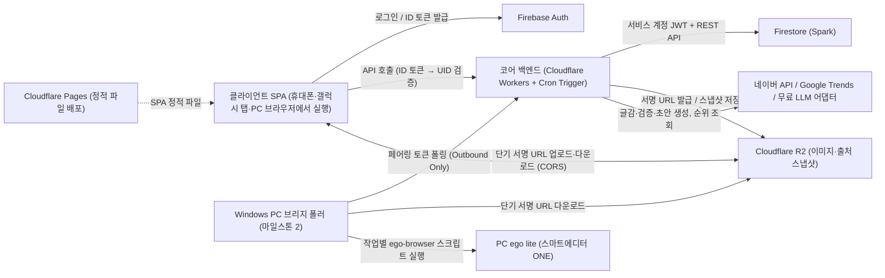
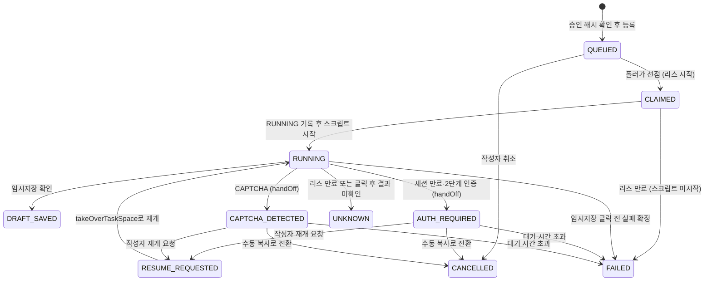

# Content Desk: 확장형 비YMYL 카테고리 및 일상 브이로그 네이버 블로그 자동화 시스템

*   **Author:** 미지정 (1인 블로그 운영자 공통)
*   **Status:** Draft
*   **Date:** 2026-11-18

--------------------------------------------------------------------------------

## Overview

Content Desk는 1인이 운영하는 네이버 블로그에서 협찬 유치를 위한 전문·경험 콘텐츠와 개인 일상 브이로그 기록을 함께 작성하고 발행 흐름을 관리하기 위한 보조 시스템입니다. 글감 발굴, 현장 사진·메모 기반 원고 작성, 출처 검증, 발행 이후 순위·방문자 추적까지를 지원하며, 최종 발행 버튼은 항상 운영자 본인이 직접 누릅니다.

시스템은 목적에 따라 두 가지 콘텐츠 트랙을 운영합니다.

*   **전문·협찬 발굴 트랙 (`category_discovery`):** 운영자가 YMYL을 제외한 비YMYL 카테고리(기본 `테크/IT` 및 `여행`, `맛집` 등 사용자 추가 카테고리)를 레지스트리로 관리합니다. 각 카테고리는 검색 수요에서 주제를 찾는 `trend_first`(예: 개념·트렌드 해설) 또는 실제 사진·메모를 먼저 등록한 뒤 키워드로 제목·태그를 다듬는 `experience_first`(예: 여행·맛집·제품 후기) 방식으로 동작합니다.
*   **개인 기록 트랙 (`personal_vlog`):** 외부 트렌드 발굴을 거치지 않고 운영자가 올린 현장 메모와 실제 사진만으로 `일상/브이로그` 원고를 작성합니다.

전체 작업은 기기별 역할 분담을 기준으로 설계합니다. 현장에서는 개인 휴대폰(아이폰·안드로이드)으로 사진을 찍어 위치 정보를 제거하고 WebP로 압축한 뒤 메모와 함께 업로드합니다. 주 작업 기기인 갤럭시 탭에서는 글감 선택, 원고 생성·수정, 검증 게이트 승인을 거쳐 수동 복사 모드로 네이버 블로그에 발행합니다. 보조 기기인 Windows PC에서는 수동 복사 외에도 마일스톤 2로 제공하는 `ego-browser` 브리지(pull 방식)를 통해 스마트에디터 ONE 임시저장까지 자동화할 수 있습니다.

## The Problem

1인 운영자가 네이버 블로그를 협찬 목적과 개인 기록 목적으로 함께 운영할 때 네 가지 구조적 문제가 발생합니다.

1.  **주제 확장과 네이버 `C-Rank` 분산·진정성 훼손 충돌:** `테크/IT` 외에 `여행`·`맛집`·`일상/브이로그`로 주제를 넓히면 카테고리가 섞여 블로그 전문성 평가(`C-Rank`)가 떨어질 위험이 커집니다. 또한 검색 트렌드만으로 후기 글을 자동 생성하면 가 보지 않은 장소나 쓰지 않은 제품에 대한 가짜 후기가 만들어집니다.
2.  **기기 간 파일 이동과 스마트에디터 ONE 서식 장벽:** 사진은 휴대폰으로 찍고 글 검토·발행은 갤럭시 탭에서 진행하므로 사진 전달과 순서 정렬에 반복 작업이 듭니다. 스마트에디터 ONE은 마크다운 기호(`##`, `**`)를 일반 문자로 처리하고 외부 이미지 URL 핫링크(``)를 차단·누락시키므로, 일반 텍스트 복사만으로는 본문과 이미지를 옮길 수 없습니다.
3.  **팩트 오류 및 저품질 페널티 위험:** 검색 결과에서 수치·제품 사양·가격을 대조하지 않고 원고를 만들면 허위 주장이 들어가고, 기존 발행 글이나 상위 노출 문서와 문장이 겹치면 검색 저품질 위험이 높아집니다. 주식·금융·투자·암호화폐·의료·건강·법률 등 YMYL 주제나 협찬 표시 누락 역시 블로그 운영에 직접적인 제재 위험을 만듭니다.
4.  **0원 운영 제약과 보안 경계:** 네이버 OpenAPI와 Google Trends는 브라우저 CORS를 허용하지 않으며 `Client-Secret` 등 비밀키를 클라이언트에 둘 수 없습니다. 반면 로컬 상시 서버(Docker)는 외출 중 휴대폰·탭 접속이 어렵고, Firebase Cloud Functions는 배포 자체에 유료 Blaze 요금제가 필요합니다. PC에서 `127.0.0.1` 수신 포트를 여는 브리지 구조는 같은 PC의 다른 웹페이지가 로그인된 브라우저를 조작할 위험을 만듭니다.

Content Desk는 Cloudflare Pages·Workers 무료 플랜을 코어 백엔드로 두고 Firebase Spark(단일 허용 UID 검증·Firestore REST)와 Cloudflare R2를 결합해 비용 없이 다중 기기 접근과 서버 측 비밀키 격리를 확보합니다. 모든 글감과 원고에 `content_type`(`experience_review` | `explainer` | `vlog`)별 미디어·1차 출처 검증 게이트를 강제하고, 갤럭시 탭용 서식 유지 복사·다중 이미지 공유와 PC 전용 pull 방식 `ego-browser` 임시저장 브리지를 분리해 위 문제를 해결합니다.

## Goals

*   **0원 클라우드 상시 운영 경계 유지:** Cloudflare Pages·Workers 무료 플랜(일 100,000건 요청, 요청당 CPU 10ms·subrequest 50개 이하 분할 처리), Firebase Spark(단일 허용 UID만 통과시키는 Auth 검증 및 서버 경유 Firestore REST 접근), Cloudflare R2(WebP 압축 이미지 저장 및 짧은 만료 서명 URL 제공), 일일 API/LLM 할당량 원장 상한 제어로 유료 과금 전환 없이 휴대폰·갤럭시 탭·PC에서 접근할 수 있게 합니다.
*   **트랙 및 `content_type` 기반 진정성·근거 검증:** `experience_review`와 `vlog`는 위치 정보가 제거된 실제 사진 또는 작성자 메모 최소 1건 없이는 원고 생성을 차단하고 실물 사진의 AI 대체를 금지합니다. `explainer`는 원고 작성 전 1차 출처 본문 스냅샷을 저장해 사실 주장을 연결하고, 모든 원고는 미해소 `[VERIFY]`를 모두 해소하고 출처 목록·N-gram 유사도 경고를 확인한 뒤, 원고 버전(`content_hash`)에 묶인 작성자 승인을 통과해야 내보낼 수 있게 합니다.
*   **비YMYL 확장 및 컴플라이언스 가드레일:** `CategoryProfile` 레지스트리로 카테고리와 네이버 게시판 매핑을 관리하되, 2단계 판정(차단 키워드 목록 + LLM 분류기)으로 YMYL 주제를 차단하고, 카테고리 발행 비중 불균형 시 `C-Rank` 분산 경고, `is_sponsored=true` 원고의 공정위 경제적 이해관계 문구 삽입·검증을 수행합니다.
*   **마일스톤 1(갤럭시 탭 수동 복사) 단독 완결 및 마일스톤 2(PC 임시저장) 분리:** PC 브리지 없이도 마일스톤 1만으로 제목 복사, `ClipboardItem` 서식 유지 본문 복사(이미지 위치 마커 포함), 순번 파일명 다중 이미지 공유·내보내기, 태그 복사까지 완료할 수 있게 합니다. 마일스톤 2는 수신 포트를 열지 않는 pull 방식 PC 브리지가 `ego-browser`로 스마트에디터 ONE 임시저장(`PublishReceipt` 기록)까지만 실행하고, 인증·CAPTCHA 발생 시 `task.handOff()`로 제어를 넘깁니다.
*   **발행 후 추적 원장 제공:** 작성자가 등록한 발행 URL(`logNo`)과 타겟 키워드를 기준으로 네이버 검색 API(`blog.json`) 순위 근사치를 자동 추적하고, 일일 방문자 수와 한국 시간 기준 오늘·이번 주 승인 건수를 대시보드에 기록합니다.

## Non-Goals

*   **무인 자동 발행 영구 제외:** 사람이 최종 발행 버튼을 누르지 않고 시스템이 네이버 블로그에 글을 공개 발행하는 기능은 구현하지 않습니다.
*   **YMYL 분야 영구 제외:** 주식·금융·투자·암호화폐·의료·건강·법률 주제의 글감 발굴 및 원고 작성은 지원하지 않습니다.
*   **허위 경험 및 실물 사진 AI 대체 금지:** 방문하지 않은 장소·사용하지 않은 제품 후기 생성, 음식·장소·제품 실사나 브이로그 사진을 AI 이미지로 대체하는 기능은 제공하지 않습니다.
*   **모바일·클라우드 환경 에디터 자동화 제외:** 갤럭시 탭, 휴대폰, Cloudflare Workers 등 클라우드 서버 내부에서 브라우저 에디터를 자동 조작하지 않습니다.
*   **인증 우회 및 공유 브라우저 프로필 훼손 금지:** 네이버 로그인 자동화, 2단계 인증 우회, CAPTCHA 해결 우회, `ego lite` 프로필의 전체 쿠키·캐시 삭제는 수행하지 않습니다.
*   **멀티테넌시 및 타 플랫폼 동시 발행 제외:** 복수 사용자·타인 공개 서비스와 유튜브·인스타그램 등 다른 플랫폼 발행은 1단계 범위에 포함하지 않습니다.

## Open Questions

구현에 들어가기 전 실제 기기와 외부 서비스 정책에서 확인해 설계에 반영해야 하는 미확정 항목입니다.

*   **Question 1 (갤럭시 탭 서식 유지 붙여넣기 및 에디터 선택):** 갤럭시 탭 크롬에서 `ClipboardItem`으로 복사한 `text/html` 본문을 네이버 블로그 앱과 탭 크롬의 스마트에디터 ONE에 각각 붙여넣을 때 소제목·굵게·목록 서식이 어느 쪽에서 온전히 유지되고 실사용에 나은지 확인이 필요합니다.
*   **Question 2 (갤럭시 탭 다중 이미지 공유 및 화면 분할 조작):** 갤럭시 탭에서 `navigator.canShare({ files })`로 여러 장의 JPEG 이미지를 네이버 블로그 앱에 한 번에 전달할 수 있는지, 멀티 윈도우 분할 화면에서 대시보드에서 블로그 앱으로 이미지 끌어다 놓기가 동작하는지 실측이 필요합니다.
*   **Question 3 (휴대폰 HEIC/HEIF 다중 업로드 및 변환 호환성):** 아이폰 사파리의 다중 선택 업로드 및 HEIC 자동 JPEG 변환 동작과, 안드로이드 크롬에서 HEIF 사진을 브라우저 내 WebP로 변환할 때 디코딩 실패가 발생하는 조건, 아이폰 사파리의 canvas WebP 인코딩 지원 여부(미지원 시 PNG로 저장되어 JPEG 대체 인코딩이 필요)를 실기기로 확인해야 합니다.
*   **Question 4 (PC 임시저장 글의 갤럭시 탭 이어쓰기 호환성):** 마일스톤 2에서 PC `ego-browser`가 저장한 스마트에디터 ONE 임시저장 글을 갤럭시 탭의 네이버 블로그 앱이나 크롬 에디터에서 열어 이어 쓰고 발행할 때 서식·이미지 깨짐이 없는지 확인이 필요합니다.
*   **Question 5 (네이버 이용약관의 임시저장 자동화 허용 여부):** 스마트에디터 ONE 임시저장 단계까지만 `ego-browser`로 자동화하는 동작이 네이버 이용약관 및 운영정책의 자동화 프로그램 제한 조항에 저촉되는지 마일스톤 2 착수 전에 확인해야 합니다. 위반 소지가 있으면 수동 복사 모드만 유지합니다.
*   **Question 6 (Cloudflare R2 결제수단 등록 조건):** Cloudflare R2 무료 티어(월 10 GB) 범위 내에서만 사용하더라도 버킷 활성화 과정에서 결제수단 등록을 필수로 요구하는지 사전 확인이 필요합니다. 등록만 요구하고 무료 한도 안에서 과금이 없다면 등록 후 사용량 알림을 설정해 R2를 유지합니다. 등록 자체를 받아들이지 않는다면 마일스톤 1 착수 전에 대체 이미지 저장소(후보: 이미지 1장당 Firestore 문서 1개, 저장 1 GiB 한도)를 결정합니다.
*   **Question 7 (1차 출처 인정 범위):** `explainer`의 사실 주장 근거로 인정할 1차 출처의 범위를 확정해야 합니다. 기본안은 제조사·서비스 공식 문서, 공식 발표·보도자료, 표준·사양 문서를 1차 출처로 보고, `news.json`으로 수집한 기사는 글감 근거와 교차 확인용 2차 출처로만 쓰는 것입니다.

## Critical User Journeys (CUJs)

### CUJ 1: 휴대폰 사진·메모 업로드 및 갤럭시 탭 수동 복사 발행 (`experience_review` 및 `vlog`)

*   **Given:** 작성자가 본인 계정으로 Firebase Auth 로그인을 완료했고 허용 UID 목록에 등록되어 있으며, R2 이미지 저장소와 `CategoryProfile`(예: `맛집` 또는 `일상/브이로그`)이 준비되어 있습니다.
*   **When:**
    1.  작성자가 현장에서 휴대폰 모바일 웹 화면을 열어 사진 여러 장과 메모를 선택하고 카테고리와 `content_type`(`experience_review` 또는 `vlog`)을 지정해 업로드를 실행합니다.
    2.  클라이언트가 업로드 전 촬영 일시 메타데이터를 추출한 뒤 사진을 축소해 WebP(미지원 브라우저는 JPEG)로 다시 인코딩함으로써 위치 정보(EXIF)를 제거하고, Workers가 발급한 서명 URL로 R2에 올린 뒤 사진·메모 묶음을 `CaptureAsset`으로 Firestore에 기록합니다. (변환 실패 파일이 있으면 업로드를 차단하고 카메라 호환성 설정 안내를 표시합니다.)
    3.  이후 작성자가 갤럭시 탭에서 대시보드를 열어 업로드한 `CaptureAsset`을 선택해 원고 생성을 요청하고, `experience_first` 트랙의 경우 키워드 최적화 결과와 검증 게이트(`개인정보 전송 동의`, `[VERIFY]` 항목, N-gram 유사도 경고, 협찬 시 공정위 문구)를 검토해 미해소 `[VERIFY]`를 모두 해소한 뒤 승인합니다.
    4.  작성자가 분할 화면으로 네이버 블로그 앱(또는 크롬 에디터)을 함께 띄우고 `[제목 복사]`, `[서식 유지 본문 복사]`, `[이미지 내보내기]`, `[태그 일괄 복사]` 버튼을 눌러 붙여넣고 직접 발행한 뒤 발행 URL(`logNo`)을 대시보드에 등록합니다.
*   **Then:**
    *   위치 정보가 포함된 원본 사진은 서버로 전송되지 않으며, AI 생성 이미지는 본문에 포함되지 않습니다.
    *   승인 전까지는 복사·공유 버튼이 비활성 상태를 유지하고, 승인 후에는 이미지 파일명 순번(`01_캡션.jpg` 등)과 본문 내 `[📷 이미지 N 삽입 위치: 캡션]` 마커가 일치합니다.
    *   발행 URL 등록 후 백엔드가 검색 API(`blog.json`) 순위 근사치 추적을 시작하고 오늘·이번 주 승인 건수가 한국 시간 기준으로 갱신됩니다.

### CUJ 2: 트렌드 우선 글감 발굴 및 1차 출처 기반 해설 원고 생성 (`explainer`)

*   **Given:** `trend_first`로 설정된 비YMYL 카테고리(예: `테크/IT`, `datalab_anchor_keyword` 설정 완료)가 존재하며, Workers에 네이버 OpenAPI·Google AI Studio(무료 티어) 비밀키가 설정되고 일일 할당량 원장에 여유가 있습니다.
*   **When:**
    1.  작성자가 대시보드에서 `테크/IT` 카테고리 글감 발굴을 실행하면, 브라우저가 단계별 Workers 엔드포인트(후보 수집 → 데이터랩 기준 키워드 정규화 배치 → 검색 공급량 수집 → 선택 시 1차 출처 본문 스냅샷 저장)를 순차 호출합니다.
    2.  YMYL 2단계 판정에서 차단 키워드 또는 LLM 분류기 경계 사례가 걸리면 즉시 거부하거나 대시보드에 경고를 띄워 작성자 확인을 받습니다.
    3.  작성자가 글감을 고르고 원고 생성을 실행하면, Workers가 미리 저장된 1차 출처 본문을 근거로 초안을 만들고 필요 시 최대 1~2장의 개념 도식 이미지(AI 활용 표시 포함)를 생성합니다.
    4.  작성자가 검증 게이트에서 출처 URL, `[VERIFY]` 표시, 과거 발행 글 및 SERP 대비 N-gram 유사도를 확인하고 승인한 뒤 수동 복사(또는 PC 임시저장)로 발행을 마칩니다.
*   **Then:**
    *   각 Workers 단계 요청은 CPU 10ms 및 외부 호출 50개 한도를 넘기지 않으며, 중간 결과가 Firestore에 저장되어 Google Trends 429 차단 시에도 네이버 데이터로 발굴이 완료됩니다.
    *   미검증 수치나 출처 없는 주장은 `[VERIFY]`로 표시되고, 원고 내 모든 사실 주장이 1차 출처 URL 스냅샷과 연결됩니다.
    *   카테고리 편중 임계치를 넘긴 경우 대시보드에 `C-Rank` 분산 경고가 표시됩니다.

### CUJ 3: Windows PC 브리지 기반 스마트에디터 ONE 자동 임시저장 및 인증 예외 인계 (마일스톤 2)

*   **Given:** 네이버 약관 검토를 통과해 마일스톤 2가 활성화되었고, Windows PC에서 기기 페어링 토큰을 발급받은 PC 브리지가 Workers를 주기적으로 polling해 `READY` heartbeat를 보고하고 있으며, PC의 `ego lite` 브라우저에 사용자가 네이버 로그인을 마친 상태입니다.
*   **When:**
    1.  작성자가 갤럭시 탭 또는 PC 대시보드에서 검증 게이트를 승인한 원고에 대해 `[PC로 임시저장]`을 클릭하면 Workers 작업 대기열에 작업 ID가 등록됩니다.
    2.  PC 브리지가 대기열에서 작업을 pull해 R2 서명 URL로 이미지를 내려받은 뒤 `ego-browser`로 스마트에디터 ONE `#mainFrame`을 점검(canary)하고, 기존 임시저장 복구 모달 처리, 게시판 선택, 이미지 마커 기준 구간별 본문 붙여넣기(`keyboard.paste`)와 이미지 업로드(`phinf.pstatic.net` 마운트 대기), 임시저장 버튼 클릭까지 실행합니다.
    3.  만약 실행 중 세션 만료나 2단계 인증, CAPTCHA가 감지되면 `ego-browser`가 즉시 `task.handOff()`로 제어를 넘기고 작업이 `AUTH_REQUIRED` 또는 `CAPTCHA_DETECTED` 상태로 멈춥니다. 작성자가 PC `ego lite`에서 인증을 완료하고 대시보드에서 `[재개]`를 누르면 브리지가 `takeOverTaskSpace(id)`로 같은 작업 공간을 이어받아 마무리합니다.
*   **Then:**
    *   브리지는 수신 포트를 열지 않고 작업 ID당 최대 1회만 실행되며(결과가 불확실하면 자동 재시도 없이 `UNKNOWN`으로 표시), R2 접근 키를 로컬에 저장하지 않고 짧은 만료 서명 URL만 사용합니다.
    *   임시저장 완료 시 `PublishReceipt`(성공 여부, 임시저장 URL, 스크린샷)가 Workers에 기록되어 탭 대시보드에서도 확인할 수 있고, 인증 예외 발생 시 탭에 안내와 함께 수동 복사 모드로 바로 전환할 수 있는 경로가 표시됩니다.
    *   어떤 경우에도 브리지가 최종 발행 버튼을 누르거나 `ego lite`의 공용 쿠키·캐시를 삭제하지 않습니다.

## Technical Plan (Architecture)

### 1. 시스템 컴포넌트 및 실행 경계 (Component Architecture)

시스템은 0원 무료 플랜 제약과 비밀키 격리, 기기별 실행 제약을 지키기 위해 다섯 개의 실행 경계로 분리합니다. Cloudflare Pages는 정적 파일 배포만 담당하고, 대시보드 코드는 각 기기의 브라우저에서 실행됩니다.

*   **클라이언트 SPA (Cloudflare Pages 정적 배포, 기기 브라우저에서 실행):** Pages는 정적 파일만 내려주며, 정적 파일 요청은 Workers 일 요청 한도에 합산되지 않습니다. 휴대폰에서는 촬영 일시 추출, 긴 변 상한으로 축소한 재인코딩(위치 EXIF 제거), 현장 메모 업로드를 담당합니다. 갤럭시 탭과 PC에서는 글감 발굴 단계 호출, 브라우저 내 N-gram 유사도 계산(Workers 요청당 CPU 10ms 한도 회피), 검증 게이트 검토·승인, 수동 복사 패널(`ClipboardItem` 서식 복사, 순번 JPEG `Web Share API` 공유 및 다운로드), 발행 URL(`logNo`)·일일 방문자 수 입력을 수행합니다. 로그인은 Firebase Auth 클라이언트 SDK로 하고, 이후 모든 데이터 접근은 ID 토큰을 붙여 Workers를 거칩니다.
*   **코어 백엔드 API (Cloudflare Workers):** 유일한 클라우드 서버 실행 계층입니다. 모든 요청에서 Firebase ID 토큰의 RS256 서명을 Google 공개키로 직접 검증하고 허용된 단일 UID 목록에 없는 요청을 차단합니다. 서비스 계정 키 기반 JWT로 Firestore REST API를 호출하며, R2 단기 서명 URL 발급, 외부 API(네이버 검색·데이터랩·선택형 검색광고 `/keywordstool`, Google Trends RSS, 교체 가능한 LLM·이미지 생성 제공자 어댑터) 호출, 일일 할당량 원장 차감, PC 브리지 작업 대기열(`BridgeJob`)과 하트비트 관리를 담당합니다. 발행 후 순위 추적은 Cron Trigger로 실행합니다.
*   **영속 저장소 및 인증 (Firebase Spark — Auth & Firestore):** Firebase Auth로 본인 인증을 수행하며, Firestore 보안 규칙은 클라이언트 직접 읽기·쓰기를 전면 거부합니다. 모든 데이터(`CategoryProfile`, `CaptureAsset`, `TopicDiscoveryJSON`, `NaverBlogManuscriptBundle`, `BridgeJob`·`PublishReceipt`, 실행 원장, 할당량 원장, 발행 기록, 일일 방문자 수)는 Workers를 거쳐 저장·조회합니다.
*   **미디어 오브젝트 스토리지 (Cloudflare R2):** Firestore 문서당 1 MiB 제한을 피하기 위해 압축된 사용자 실사, AI 개념 도식 이미지, 1차 출처 본문 스냅샷 텍스트를 저장합니다. 클라이언트와 PC 브리지는 Workers가 발급한 짧은 만료 시간의 서명 URL로만 객체에 접근합니다. 탭에서 이미지를 canvas로 그려 JPEG로 변환하려면 교차 출처 이미지를 읽어야 하므로, 버킷 CORS에 대시보드 출처의 `GET`·`PUT`을 허용합니다(미설정 시 canvas가 오염되어 이미지 내보내기가 실패합니다).
*   **PC 자동 임시저장 브리지 (Windows 호스트 전용, 마일스톤 2):** 상시 실행되는 폴러 프로세스와 작업마다 실행하는 `ego-browser` 스크립트로 나뉩니다. 폴러는 로컬 수신 포트를 열지 않고 기기 페어링 토큰으로 Workers에 outbound 요청만 보내며, 작업을 가져오면 R2 서명 URL로 이미지를 내려받아 원고 JSON과 함께 로컬 파일로 저장한 뒤 `ego-browser` 스크립트를 실행합니다. `ego-browser` 스크립트는 실행마다 새 Node 프로세스로 돌고 환경 변수를 물려받지 않으므로, 페어링 토큰은 폴러에만 두고 스크립트에는 원고·이미지 파일의 절대 경로만 넘깁니다. 스크립트는 Windows PC의 `ego lite`에서 스마트에디터 ONE 임시저장까지만 수행하고, 결과는 폴러가 `PublishReceipt`로 Workers에 보고합니다.

### 2. 핵심 데이터 모델 및 2티어 스키마 계약 (Data Contracts)

채널 중립적 리서치·소재 데이터와 네이버 블로그 전용 출력 문서를 분리해 향후 발행 형식 변경 시 리서치 원천을 재사용할 수 있게 합니다. 휴대폰 업로드는 글감보다 먼저 일어나므로 실사·메모는 독립 엔터티(`CaptureAsset`)로 저장하고 글감이 이를 참조합니다.

| 스키마 / 원장 | 역할 | 핵심 필드 계약 |
| :--- | :--- | :--- |
| **`CategoryProfile`** | 비YMYL 카테고리 및 게시판 정책 정의 | `category_id`, `display_name`, `naver_board_name`, `discovery_mode`(`trend_first` \| `experience_first` \| `none`), `datalab_anchor_keyword`(`discovery_mode`가 `trend_first`·`experience_first`일 때 필수, `none`인 `일상/브이로그` 등 개인 기록 카테고리는 생략), `seed_keywords`, `default_media_policy`(아래 조합표 범위 안의 허용 `content_type` 목록 및 실사·메모 최소 건수 규칙), `default_visibility`(`전체공개` \| `이웃공개`) |
| **`CaptureAsset`** | 휴대폰 1회 업로드 단위의 실사·메모 묶음 (글감보다 먼저 생성) | `capture_id`, `category_id`, `content_type`(`experience_review` \| `vlog`), 사진 목록(R2 키, 촬영 일시, 너비·높이, 캡션), 현장 메모, `sponsorship`(`is_sponsored`, 제공 주체, 제공 형태: 무상 제공·원고료 등), 위치 정보 저장 동의 여부(기본 미저장) |
| **`TopicDiscoveryJSON`** (1티어) | 채널 중립적 리서치·소재 스키마 | `topic_id`, `run_id`, `track`(`category_discovery` \| `personal_vlog`), `category_id`, `content_type`(`experience_review` \| `explainer` \| `vlog`), `capture_ids`(경험 글·브이로그) 또는 1차 출처 스냅샷 참조(URL, R2 키, 수집 시각, 본문 해시), YMYL 판정 결과, `sponsorship`(`CaptureAsset`에서 복사하거나 글감 선택 시 입력), 정규화된 데이터랩 수요 지수, 블로그·뉴스 문서 공급량, 선택형 월간 검색량·경쟁도 점수 |
| **`NaverBlogManuscriptBundle`** (2티어) | 네이버 스마트에디터 ONE 전용 출력 묶음 | `manuscript_id`, `topic_id`, `version`, `content_hash`, 제목 후보, 소제목·굵게·목록·인용구 구조화 본문(정제된 HTML) 및 `[📷 이미지 N 삽입 위치: 캡션]` 마커, 공정위 경제적 이해관계 문구(`sponsorship` 기반)·AI 활용 표시, 순번 매핑된 이미지 R2 참조 목록, 추천 태그, 공개 범위, 주장 목록(주장, `source_id`, 원문 인용구, 대조 결과, `[VERIFY]` 해소 상태), N-gram 유사도 검사 결과, 승인 기록(`approved_hash`, 승인 시각) |
| **`BridgeJob`** / **`PublishReceipt`** | PC 임시저장 작업과 결과 (마일스톤 2) | `job_id`, `manuscript_id`, `approved_hash`, 작업 상태(§5), 리스 만료 시각, `ego_task_space_id`(인증 대기 시), 상태 변경 이력, `PublishReceipt`(성공 여부, 임시저장 URL, 스크린샷 R2 키) |
| **운영 원장** | 실행 무결성, 한도 통제 및 발행 후 추적 | 실행 원장(`run_id` 기준 중복 생성 방지), 할당량 원장(제공자별 일일 카운터와 초기화 기준 시각, 단계별 예약 차감 기록), 발행 기록(사용자가 등록한 발행 URL `logNo`, 타겟 키워드, 검색 API `blog.json` 순위 근사치 이력, 추적 종료일), 브리지 상태·`last_seen`, 한국 시간 기준 일·주간 승인 건수 및 일일 방문자 수 |

**`content_type` 허용 조합:** 미디어·근거 정책은 카테고리명이 아니라 `content_type` 기준으로 적용하며, Workers는 아래 조합에 맞지 않는 글감·원고 생성 요청을 거부합니다.

| `content_type` | `track` | 시작점 | 필수 근거 | AI 이미지 |
| :--- | :--- | :--- | :--- | :--- |
| `explainer` | `category_discovery` | `trend_first` 카테고리의 글감 발굴 | 1차 출처 스냅샷 1건 이상 | 개념 도식 편당 최대 1~2장 (AI 활용 표시 필수) |
| `experience_review` | `category_discovery` | `CaptureAsset` (`experience_first` 카테고리, 또는 후기를 허용한 `trend_first` 카테고리) | 실사 또는 메모 1건 이상 | 금지 |
| `vlog` | `personal_vlog` | `CaptureAsset` (`discovery_mode=none` 카테고리) | 실사 또는 메모 1건 이상 | 금지 |

### 3. 단계별 데이터 흐름 및 무료 플랜 한도 제어 (Data Flows & Quota Boundaries)

*   **글감 발굴 분할 파이프라인 (`trend_first`, Workers CPU 10ms / subrequest 50개 대응):** Workers 무료 플랜은 요청 1건당 CPU 10ms와 외부 호출(subrequest) 50개로 제한되므로, 대시보드가 단일 장기 요청 대신 짧은 단계 요청을 순차 호출하고 단계별 결과를 Firestore에 저장합니다. 단계를 나누면 요청 수는 늘지만, 일 100,000건 한도에 합산되는 것은 Workers·Pages Functions 호출뿐(정적 파일 요청 제외)이라 1인 운영 규모에서는 여유가 큽니다. 한 단계에서 처리할 후보가 subrequest 예산을 넘으면 요청을 나눠 이어서 호출합니다. 1~3단계는 실행 한 번으로 이어서 호출하고, 4단계는 작성자가 글감을 고른 뒤에 실행합니다.
    1.  시드·Google Trends RSS 후보 수집 및 **YMYL 2단계 판정**(1차 차단 키워드 목록 즉시 거부 → 2차 LLM 분류기 판정, 경계 사례는 대시보드에 표시해 작성자 판단). Google Trends가 HTTP 429를 반환하면 같은 요청 안에서 기다리지 않고 캐시된 RSS를 쓰거나 이번 실행에서 RSS를 생략해 네이버 데이터만으로 진행하며, 다음 RSS 호출 간격을 지수 백오프로 늘립니다.
    2.  `datalab_anchor_keyword`를 항상 포함한 데이터랩 배치 정규화 호출(최대 5개 `keywordGroups`, 결과를 24시간 이상 Firestore에 캐시).
    3.  네이버 검색 API(`blog.json`, `news.json`) 문서 공급량 수집 및 선택형 검색광고 `/keywordstool` 어댑터 결합(키 미설정 시 기본 파이프라인으로 동작).
    4.  (글감 선택 후) 1차 출처 본문 스냅샷 수집·저장. 전체 HTML을 DOM으로 파싱하면 CPU 10ms를 넘기 쉬우므로 `HTMLRewriter`로 본문 텍스트를 스트리밍 추출하고, 본문은 R2에, Firestore에는 URL·수집 시각·본문 해시만 저장합니다. 1차 출처의 인정 범위는 Open Question 7에서 확정합니다.
*   **경험 글·브이로그 흐름 (`CaptureAsset` 기반):**
    *   `experience_review`: 작성자가 탭에서 `CaptureAsset`을 골라 글감을 만들면, Workers가 메모의 장소·제품명으로 키워드 후보를 만들고 YMYL 2단계 판정을 거친 뒤 데이터랩(기준 키워드 포함)·검색 API로 수요와 문서 공급량을 산출합니다. 이 결과는 제목·태그 최적화에만 쓰고, 본문의 사실은 메모와 사진에서만 가져옵니다.
    *   `vlog`: 키워드 발굴 없이 `CaptureAsset`만으로 글감을 만들고, 메모로 정한 원고 주제에 YMYL 2단계 판정을 실행합니다.
    *   세 `content_type` 모두 원고 생성 직전에 확정된 원고 주제로 YMYL 판정을 한 번 더 실행합니다.
*   **원고 생성 및 주장–출처 대조:**
    1.  **입력 조립:** Workers가 `content_type` 조합표와 필수 근거를 확인한 뒤, `explainer`는 저장된 출처 스냅샷 텍스트를, `experience_review`·`vlog`는 메모와 사진 설명 텍스트를 입력으로 묶습니다(개인 기록은 작성자의 전송 동의 후에만 전달).
    2.  **생성:** 제공자 어댑터로 LLM을 호출하고, 출력은 제목 후보, 구조화 본문 블록, 이미지 마커, 태그, 주장 목록(주장, `source_id`, 원문 인용구)을 담은 JSON 스키마로 받습니다.
    3.  **대조:** Workers가 주장마다 인용구가 `source_id`의 스냅샷 본문(경험 글·브이로그는 메모)에 실제로 있는지 공백·문장부호를 정규화해 문자열로 대조합니다. 인용구가 없거나 대조에 실패한 주장, 출처 없는 수치·사양·가격·날짜는 자동으로 `[VERIFY]` 처리합니다. LLM이 스스로 보고한 근거를 그대로 믿지 않기 위한 장치입니다.
    4.  **정제:** 출처 본문(외부 웹페이지)이 LLM 입력에 들어가므로 프롬프트 인젝션이 대시보드 XSS로 이어질 수 있습니다. 대시보드는 Firebase 세션을 쥐고 브리지 작업까지 등록할 수 있으므로, 본문 HTML은 허용 태그(문단·소제목·굵게·목록·인용구)만 남기고 출처 목록에 없는 링크를 제거한 뒤 저장하며, 대시보드도 렌더링 전에 같은 규칙으로 다시 정제합니다.
    5.  **저장:** 결과를 `run_id` 기준으로 저장해 같은 `run_id` 재실행 시 중복 초안 생성을 막습니다.
*   **휴대폰 미디어 인제스트 및 개인정보 보호:** 모바일 웹 업로드 화면(`accept="image/*"`)은 업로드 전에 브라우저에서 촬영 일시 메타데이터를 추출하고, 사진을 긴 변 상한(예: 2,560px)으로 줄인 크기의 캔버스에 그려 다시 인코딩함으로써 GPS 등 EXIF 위치 정보를 제거합니다. 원본 크기의 캔버스는 만들지 않습니다(최신 아이폰 기본 사진 24MP는 iOS 캔버스 면적 제한 약 16.7MP를 넘습니다). 인코딩 결과의 `blob.type`이 `image/webp`가 아니면 JPEG로 다시 인코딩합니다(Safari는 canvas WebP 인코딩을 지원하지 않아 PNG를 반환하는 것으로 알려져 있으며, Open Question 3에서 확인합니다). 업로드가 끝나면 사진과 메모를 하나의 `CaptureAsset`으로 기록합니다. 아이폰 사파리나 안드로이드 크롬에서 HEIC/HEIF 디코딩·변환에 실패하면 해당 파일 업로드를 중단하고 카메라 호환성 설정 안내를 표시합니다. `vlog` 등 개인 기록을 무료 티어 LLM에 전달할 때는 제공자 서비스 학습 활용 가능성을 알리고 작성자 명시 동의를 받으며, 사진 원본 대신 설명 텍스트만 전달하는 방식을 기본으로 합니다.
*   **할당량 원장 및 제공자 어댑터 격리:** LLM과 이미지 생성 호출은 제공자 어댑터 뒤에 배치해 무료 티어 정책 변경 시 교체할 수 있게 합니다. 모든 외부 API와 LLM 호출 전 일일 할당량 원장을 확인하며, 한도 소진 시 유료 요금제로 전환하지 않고 이미지 생략 또는 다음 날 보류로 처리합니다. 원장은 호출마다 쓰지 않고, 단계 요청을 시작할 때 그 단계에 필요한 호출 수를 한 번에 예약 차감하고 끝날 때 쓰지 않은 수를 돌려줘 Firestore 쓰기를 줄입니다. 일일 한도의 날짜 경계는 제공자마다 다르므로(Workers는 UTC 자정, Gemini 무료 티어는 태평양 시간 자정) 원장에 제공자별 초기화 기준 시각을 두고, 승인 건수 집계만 한국 시간을 따릅니다.
*   **검증 게이트 및 승인 제어:** `experience_review`와 `vlog`는 위치 정보가 제거된 실제 사진이나 메모가 최소 1건 없으면 원고 생성을 차단하고 실사 대체 AI 이미지를 금지합니다. `explainer`는 원고 작성 전 1차 출처 본문 스냅샷을 연결하고 도식 이미지는 편당 최대 1~2장(AI 활용 표시 필수)으로 제한합니다. 원고 생성 후 브라우저는 과거 발행 글과 SERP 스니펫을 대상으로 N-gram 유사도를 계산하고, 서버 검증과 합쳐 `C-Rank` 카테고리 분산 경고·공정위 문구·`[VERIFY]` 미해소 항목을 표시합니다. N-gram 비교 대상인 과거 발행 글은 시스템에 저장된 승인본이라 네이버에서 직접 고친 최종본과 다를 수 있고, SERP는 검색 API 스니펫(100자 안팎)만 비교하므로 유사도 결과는 참고 신호로만 씁니다.
    *   승인은 원고의 `content_hash`에 묶어 기록하며, 승인 후 원고를 수정하면 승인이 자동으로 풀립니다.
    *   미해소 `[VERIFY]`가 1건이라도 남아 있으면 승인할 수 없습니다. 작성자가 출처를 확인해 해소 처리(확인한 URL 기록)하거나 해당 문장을 고치거나 지워야 해소되며, `[VERIFY]` 문자열이 네이버로 복사되는 일을 막습니다.
    *   승인 전에는 복사, 공유, `[PC로 임시저장]` 버튼을 모두 비활성화합니다. 복사·공유 버튼 비활성화는 클라이언트 통제이고, `[PC로 임시저장]` 대기열 등록은 Workers가 `approved_hash`와 현재 `content_hash`의 일치를 서버에서 확인한 뒤에만 받습니다.
*   **발행 후 순위 추적 (Cron Trigger):** 작성자가 발행 URL(`logNo`)과 타겟 키워드를 등록하면 발행 기록에 추적 대상으로 추가됩니다. Workers Cron Trigger(예: 1시간 간격)가 실행마다 subrequest 50개 안에 들어가는 수만큼 (발행 글, 타겟 키워드) 쌍을 골라 `blog.json`(`display=100`)으로 조회하고 `logNo` 순위를 기록하며(100위 밖은 순위 없음으로 기록), 각 쌍은 하루 1회만 조회합니다. 추적은 발행 후 일정 기간(예: 30일)이 지나면 종료합니다.

### 4. 발행 경로 및 마일스톤 분리 설계 (Publishing Paths)

*   **기능·상태 기반 분기 (User-Agent 미사용):** 큰 화면 태블릿의 크롬도 데스크톱 User-Agent를 전송하므로 기기 문자열로 환경을 판별하지 않습니다. 대신 브라우저 API 지원 여부(`ClipboardItem`, `navigator.canShare({ files })`)로 수동 복사 UI 구성을 정하고, Workers가 기록한 PC 브리지 상태에 따라 `[PC로 임시저장]` 버튼과 상태 안내를 제어합니다. 아래는 브리지 자체의 상태이며, 개별 작업의 상태는 §5에서 따로 정의합니다.
    *   `BRIDGE_OFFLINE`: `last_seen`이 기준 시간(예: 10분) 넘게 갱신되지 않음 — 탭의 수동 복사 흐름을 방해하지 않도록 짧은 상태 문구만 표시.
    *   `EGO_NOT_INSTALLED`: 폴러가 `ego-browser` 명령을 찾지 못했다고 보고 — 설치 안내(`https://lite.ego.app/`) 표시.
    *   `NAVER_LOGIN_REQUIRED`: 마지막 작업의 canary에서 `ego lite`의 네이버 미로그인이 확인됨 — 확인 시각과 함께 PC 로그인 요청 표시. 로그인 상태를 하트비트로 계속 확인하려면 `ego lite`에 페이지를 열어야 해 사용자 화면에 보이고 비용이 크므로 상시 확인하지 않습니다. 이 상태에서도 작업 등록은 허용하며, 여전히 미로그인이면 작업이 시작 단계에서 `AUTH_REQUIRED`로 멈춥니다.
    *   `READY`: `[PC로 임시저장]` 활성화(갤럭시 탭에서도 PC 대기열로 작업 등록 가능).
*   **폴링·하트비트 예산:** 브리지 폴러는 30초 이상 간격으로 대기열을 조회하고, `last_seen`은 상태가 바뀔 때 또는 5분 간격으로만 기록합니다. 빈 대기열 조회도 Firestore 읽기 1건으로 계산되므로 PC를 하루 종일 켜 두면 읽기 2,880건(Spark 한도 50,000건의 약 6%)이 듭니다. 5초마다 하트비트를 기록하면 하루 17,280건으로 Spark 쓰기 한도(20,000건)의 86%를 차지하므로 이 방식은 쓰지 않습니다.
*   **마일스톤 1 (기본 수동 복사 모드):** 갤럭시 탭 분할 화면(멀티 윈도우) 기준으로 동작합니다. 스마트에디터 ONE이 마크다운 문법과 HTML 외부 이미지 핫링크를 차단하므로 본문과 이미지를 분리 전달합니다. `[제목 복사]`(권장 게시판·공개 범위 안내 포함), `[서식 유지 본문 복사]`(`ClipboardItem`으로 `text/html` + `text/plain` 및 `[📷 이미지 N 삽입 위치: 캡션]` 마커·공정위/AI 표시 복사, 일반 텍스트 복사 폴백 제공), `[이미지 내보내기]`(JPEG 변환 및 `01_캡션.jpg` 순번 파일명 부여, 탭에서는 `Web Share API` 다중 공유 또는 일괄 다운로드, PC에서는 PNG 클립보드 복사 또는 일괄 다운로드), `[태그 일괄 복사]`, `[네이버 블로그 글쓰기 열기]` 바로가기를 제공합니다. 탭에서는 `navigator.share`를 클릭 직후 몇 초(Chrome 약 5초) 안에만 호출할 수 있으므로, 이미지 JPEG 변환은 `[이미지 내보내기]` 패널을 열 때 미리 끝내 두고 클릭 시에는 공유만 호출합니다.
*   **마일스톤 2 (PC `ego-browser` Pull 브리지 임시저장):** 기기 페어링 토큰(대시보드에서 폐기 가능)으로 인증한 폴러가 승인된 `NaverBlogManuscriptBundle` 작업을 §5의 상태 규칙에 따라 가져갑니다. 실행 시 R2 서명 URL로 이미지를 내려받고(R2 접근 키 미보관), `ego-browser` 스크립트가 `#mainFrame` 셀렉터 사전 점검(canary)과 네이버 로그인 확인을 통과한 뒤 기존 임시저장 복구 모달 처리, `CategoryProfile.naver_board_name`(또는 `일상/브이로그`) 게시판 선택, 본문 입력, 이미지 업로드, 임시저장 클릭을 수행합니다.
    *   **본문 입력:** `.se-component` DOM을 직접 조작하지 않고, 마일스톤 1의 `[서식 유지 본문 복사]`와 같은 HTML을 `keyboard.paste({ text, html })`로 붙여넣습니다(Windows 지원, 붙여넣은 뒤 사용자 클립보드 복원). 본문을 이미지 마커 기준 구간으로 나눠 "구간 붙여넣기 → 그 위치에 이미지 업로드"를 반복합니다. 마일스톤 1과 2가 같은 HTML 생성 로직을 공유하고, 에디터 내부 상태와 어긋날 위험도 줄어듭니다.
    *   **이미지 업로드:** `page.setInputFiles()`(클릭으로 파일 선택창이 열리면 `page.waitForFileChooser()` 후 `chooser.setFiles()`)로 올리고 `phinf.pstatic.net` 이미지 노드가 마운트될 때까지 기다립니다.
    *   **API 사용 범위:** `ego-browser`는 Playwright와 메서드 이름이 비슷해도 별도 API이므로, 설치된 버전의 가이드(`ego-browser skill` 출력)에 있는 TaskSpace·Page API만 사용합니다.
    *   **인증 예외:** 세션 만료·2단계 인증·CAPTCHA가 발생하면 즉시 `task.handOff()`로 제어권을 넘기고 스크립트를 종료하며, 작업을 `AUTH_REQUIRED` 또는 `CAPTCHA_DETECTED`로 보고하면서 작업 공간 ID를 저장합니다. 재개 절차는 §5를 따릅니다.
    *   브리지는 `ego lite` 공용 프로필의 쿠키·캐시를 삭제하지 않으며 최종 발행 버튼을 누르지 않습니다.

### 5. PC 브리지 작업 상태 및 실행 규칙 (마일스톤 2)

`BridgeJob`은 작업 ID당 **최대 1회** 실행합니다. 브리지가 실행 도중 멈추면 네이버에 임시저장 글이 생겼는지 알 수 없으므로, 같은 작업 ID를 자동으로 다시 실행하지 않고 재시도는 항상 새 작업 ID로 등록합니다.

| 작업 상태 | 의미 및 규칙 |
| :--- | :--- |
| `QUEUED` | Workers가 `approved_hash`와 현재 `content_hash`의 일치를 확인한 뒤 등록합니다. 작성자가 취소할 수 있습니다. |
| `CLAIMED` | 폴러가 Firestore 문서의 `updateTime` 사전 조건으로 작업을 선점하고 리스 만료 시각을 기록합니다. 폴러는 `RUNNING` 기록에 성공한 뒤에만 스크립트를 시작하므로, 이 상태에서 리스가 만료되면 네이버에 아무 일도 일어나지 않은 것이 확실해 `FAILED`로 닫습니다. |
| `RUNNING` | 스크립트 실행 중입니다. 폴러가 리스를 주기적으로 연장합니다. |
| `DRAFT_SAVED` | 임시저장을 확인하고 `PublishReceipt`(성공 여부, 임시저장 URL, 스크린샷)를 기록한 종료 상태입니다. |
| `AUTH_REQUIRED` / `CAPTCHA_DETECTED` | `task.handOff()` 후 대기합니다. `ego_task_space_id`를 저장하고, 탭 대시보드에 "PC에서 인증이 필요합니다"와 `[재개]`·`[수동 복사로 전환]`을 표시합니다. 대기 시간(예: 24시간)이 지나면 `FAILED`로 닫습니다. |
| `RESUME_REQUESTED` | 작성자가 PC `ego lite`에서 인증을 마치고 대시보드에서 `[재개]`를 누른 상태입니다. 폴러가 선점 규칙과 같은 방식으로 가져가 `takeOverTaskSpace(ego_task_space_id)`(`task`의 메서드가 아닌 최상위 함수)로 같은 작업 공간을 이어받아 재개합니다. |
| `FAILED` | 임시저장 버튼을 누르기 전에 실패가 확정된 상태입니다(canary 실패, 이미지 업로드 실패, 대기 시간 초과 등). 재시도는 새 작업 ID로 등록합니다. |
| `UNKNOWN` | `RUNNING` 중 리스가 만료되었거나 임시저장 클릭 후 결과를 확인하지 못한 상태입니다. 자동 재시도하지 않고 "네이버 임시저장 목록을 확인한 뒤 필요하면 새 작업으로 재시도"를 안내합니다. |
| `CANCELLED` | 작성자가 작업을 취소하거나 수동 복사 모드로 전환한 상태입니다. |
